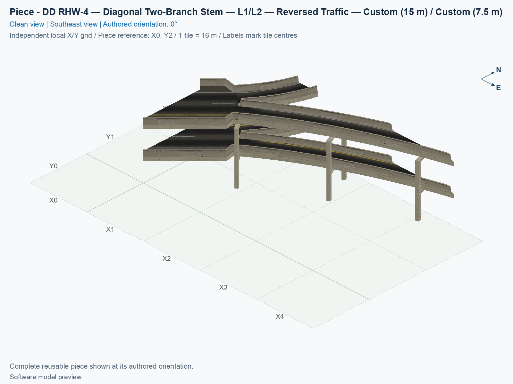
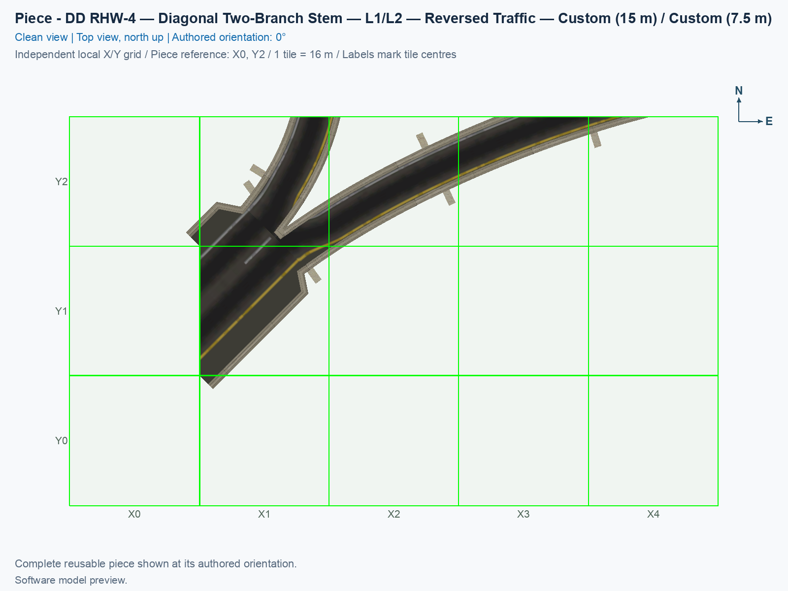
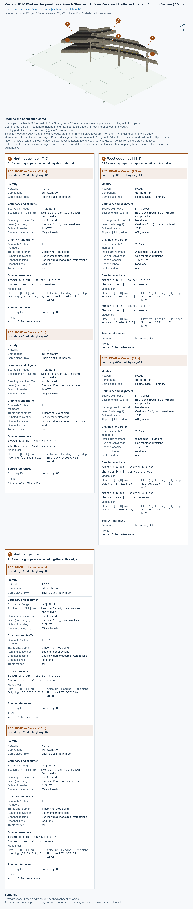

# DD RHW-4 — Diagonal Two-Branch Stem — L1/L2 — Reversed Traffic

Purpose: Supply the diagonal two-branch stem component of the reversed-traffic compact DD RHW Y junction, with yellow on the driver's left.

<!-- PIECE README LAYOUT: 2 -->

[1. Views](#1-views) · [2. Piece and placement](#2-piece-and-placement) · [3. Connection matrix](#3-connection-matrix) · [Testing ↗ (separate document)](TESTING.md)

## 1. Views

The [angled view](previews/preview.png), [north-up view](previews/preview-top.png), and [thumbnail](previews/preview-thumb.png) show this component alone at 0°. A city tile measures 16 × 16 m. The pictures are software renders of saved models; game appearance and moving traffic have separate observations in [TESTING](TESTING.md).

<!-- BEGIN PIECE VIEWS -->

<!-- END PIECE VIEWS -->

## 2. Piece and placement

**DD RHW-4** is a double-decker RealHighway with two lanes per travel deck. Level 1, or L1, is 7.5 m above ground; Level 2, or L2, is 15 m. The two decks carry opposite directions. A **PATH** resource stores directed traffic routes, and a **DAT** file is an archive containing game resources. This component carries cars and supplies no ground-highway transition or pedestrian route. Custom cast shadows are disabled.

The southwest upper deck carries traffic out of the junction at 15 m. The southwest lower deck carries traffic into it at 7.5 m. This owner contains the south band of the four level journeys. In the [complete assembly](../../01_assemblies/ddrhw-compact-diagonal-y-junction-reversed/README.md), A is southwest, B is northwest, and C is east. Every directed journey is the reverse of the corresponding original Y journey. The physical arm positions remain the same. Yellow is on the driver's left on every deck; this is a separate type, so the original remains selectable.

### 2.1 Owned cells and native approach

This type owns **8 city tiles inside a 5 × 3-tile rectangle**. Only the cells listed below are occupied. Local source addresses are (column,row): columns increase eastward, and rows increase southward. The complete permanent definition is [piece.jsonc](piece.jsonc).

| Local source row | Owned columns |
| --- | --- |
| 0 | 0, 1, 2, 3, and 4 |
| 1 | 1 and 2 |
| 2 | 1 |

The model-only cells are (0,0), (4,0), (2,1), and (1,2). A model-only cell contains visible geometry but an intentionally empty traffic PATH. It still owns its city tile and must remain clear of other construction.

Its local reference (0,0) is an owned model-only cell. A **native socket** is an ordinary NAM DD highway tile beside the custom component. This component's socket is unowned at local **(0,1)**, or **(X0, Y1)** in the complete assembly. Reserve the outward **southwest** approach, including the staggered neighbouring cells for a diagonal arm. A component owns all road, barrier, support, and route fragments inside each of its occupied cells, even when several journeys cross that cell.

### 2.2 Place the component

1. Use a deliberately installed, verified experimental build with the audited NAM 50 right-hand-traffic inputs. Follow the [build and installation guide](../../../../docs/BUILD_AND_INSTALL.md). Close SimCity 4 before changing plugin files, restart it afterward, and place this new revision afresh.
2. Prepare a flat area using the [complete placement plan](../../01_assemblies/ddrhw-compact-diagonal-y-junction-reversed/README.md#3-placements). This component is **P01**, with its reference at **(X0, Y2)** and a **0°** rotation. The complete assembly occupies 21 tiles within a 6 × 7-tile rectangle; leave additional native continuation space outside it.
3. Open **Transportation → Highways → SCP → Assemblies**, and select **SCP | ASSEMBLY | DD RHW-4 — Compact Y-Junction — Diagonal Stem — Reversed Traffic**. Press **Tab** or **Shift+Tab** until the tooltip shows **DD RHW-4 — Diagonal Two-Branch Stem — L1/L2 — Reversed Traffic**. Each click places only one component.
4. Press **Home** or **End** until the model and all occupied cells match the north-up construction view. Keep the reference at the stated address, including when it is unowned. The actual cursor anchor still requires a game observation, so compare the complete occupied shape before clicking once.
5. Inspect the ordinary native tile at **(X0, Y1)**. Cancel placement with **Esc**, choose **RealHighway (RHW-2)**, and drag outward toward the **southwest** for at least three native tiles. Do not drag across the custom-owned cells. Record automatic socket appearance, outward dragging, and attachment to a prebuilt native approach as separate game checks.
6. Place the other two components at their exact references. Test all six journeys only after all components and three native approaches are complete.

For a prebuilt native control, select **Transportation → Highways → RealHighway (RHW) Starter Pieces**, and press **Tab** until the tooltip reads **Double-Decker RHW-4 Starter Piece (Upper Deck: Level 2, Lower Deck: Level 1)**. Place it, and extend it with **RealHighway (RHW-2)**. Match the reversed component's deck directions and measured diagonal phase before joining. The separately named rail-based DDRHW starter uses a different network.

### 2.3 Reuse and limits

The exact reusable identifier is `ddrhw-y-reversed-diagonal-stem-split`. Four proper rotations turn the whole type through 0°, 90°, 180°, and 270°. Its eight cursor states repeat those four orientations; they do not reflect the layout. Reuse requires matching every exposed lane, direction, height, cross-section, and ownership boundary. An internal component cut is not an arbitrary native highway socket.

A **grade** is vertical height change divided by horizontal distance. For example, a 20% descent loses 2 m in 10 m horizontally. The complete reversed assembly has four level journeys and two separate descents from 15 m to 7.5 m. Their peak absolute grades are approximately 25.761% for B→C and 26.572% for C→B, below the experimental 30% ceiling. These compact game choices still require visible-vehicle checks.

<!-- BEGIN PIECE OVERVIEW -->

Native diagonal two-lane split and reverse merge, with the south paired flat approaches; all directed journeys and their driver-left markings are reversed. Place its owned cells at the matching assembly reference; every native deck retains its measured real car lanes.

Exact reusable identifier: `ddrhw-y-reversed-diagonal-stem-split`.

Footprint: **5 × 3 tiles**. Exact menu name: **DD RHW-4 — Diagonal Two-Branch Stem — L1/L2 — Reversed Traffic**.

<!-- END PIECE OVERVIEW -->

## 3. Connection matrix

The generated matrix describes this component's saved route fragments. Whole-junction journeys require all three placements. **Saved PATH** checks the stored routes, **Route Query** checks the route shown by the game, and **Visible travel** checks an actual vehicle. These have separate evidence in [TESTING](TESTING.md).

<!-- BEGIN PIECE CONNECTION MATRIX -->

### Directed entrance/exit matrix

Read **from an entrance row to an exit column**. **Saved PATH** checks the saved traffic route; **Route Query** checks the route shown by the game; **Visible travel** checks a vehicle completing that journey. For HSR, visible travel means a moving train.

**Game appearance:** [?](TESTING.md#case-in_game_render-8be21832cb3ef4006ac4) — the complete piece’s appearance in the game, checked separately from its journeys.

**Legend:** ✅ confirmed; ❌ failed; ? not established. **Forbidden** means the movement is unavailable; its in-game check confirms that it stays unavailable. Click a result for its exact test case. Scope, evidence, and limitations remain in [the test checklist](TESTING.md#test-checklist).

| Entrance ↓ / Exit → | **Road · West exit** `c-a-out` Variant: dd-rhw-l2 | **Road · West exit** `b-a-out` Variant: dd-rhw-l2 | **Road · North exit** `a-b-out` Variant: dd-rhw-l1 | **Road · North exit** `a-c-out` Variant: dd-rhw-l1 |
| --- | --- | --- | --- | --- |
| **Road · West entrance** `a-c-in` Variant: dd-rhw-l1 | **Forbidden** **Saved PATH:** [?](TESTING.md#case-software_connectivity-91ab691238c7e7473061) In-game check: [?](TESTING.md#case-in_game_forbidden_transfer-25ab2e332dc49634fc6b) | **Forbidden** **Saved PATH:** [?](TESTING.md#case-software_connectivity-91ab691238c7e7473061) In-game check: [?](TESTING.md#case-in_game_forbidden_transfer-52c7a540dff7d1ebee33) | **Forbidden** **Saved PATH:** [?](TESTING.md#case-software_connectivity-91ab691238c7e7473061) In-game check: [?](TESTING.md#case-in_game_forbidden_transfer-1682b11abebe90092473) | **Saved PATH:** [?](TESTING.md#case-software_connectivity-91ab691238c7e7473061) **Route Query:** [?](TESTING.md#case-in_game_route_query-881fd24a1dbd73fc1245) **Visible travel:** [?](TESTING.md#case-in_game_visible_travel-881fd24a1dbd73fc1245) |
| **Road · West entrance** `a-b-in` Variant: dd-rhw-l1 | **Forbidden** **Saved PATH:** [?](TESTING.md#case-software_connectivity-91ab691238c7e7473061) In-game check: [?](TESTING.md#case-in_game_forbidden_transfer-1cbf0d11a4d5d7767ca4) | **Forbidden** **Saved PATH:** [?](TESTING.md#case-software_connectivity-91ab691238c7e7473061) In-game check: [?](TESTING.md#case-in_game_forbidden_transfer-7cd25e317d1ed7caf0d9) | **Saved PATH:** [?](TESTING.md#case-software_connectivity-91ab691238c7e7473061) **Route Query:** [?](TESTING.md#case-in_game_route_query-a4ba5a250e8a25ba74bb) **Visible travel:** [?](TESTING.md#case-in_game_visible_travel-a4ba5a250e8a25ba74bb) | **Forbidden** **Saved PATH:** [?](TESTING.md#case-software_connectivity-91ab691238c7e7473061) In-game check: [?](TESTING.md#case-in_game_forbidden_transfer-f13226d0dfe8be9d491f) |
| **Road · North entrance** `b-a-in` Variant: dd-rhw-l2 | **Forbidden** **Saved PATH:** [?](TESTING.md#case-software_connectivity-91ab691238c7e7473061) In-game check: [?](TESTING.md#case-in_game_forbidden_transfer-99e324b21d569191643a) | **Saved PATH:** [?](TESTING.md#case-software_connectivity-91ab691238c7e7473061) **Route Query:** [?](TESTING.md#case-in_game_route_query-4714aa5f7029874baaa8) **Visible travel:** [?](TESTING.md#case-in_game_visible_travel-4714aa5f7029874baaa8) | **Forbidden** **Saved PATH:** [?](TESTING.md#case-software_connectivity-91ab691238c7e7473061) In-game check: [?](TESTING.md#case-in_game_forbidden_transfer-b2f0320d6403d072883d) | **Forbidden** **Saved PATH:** [?](TESTING.md#case-software_connectivity-91ab691238c7e7473061) In-game check: [?](TESTING.md#case-in_game_forbidden_transfer-be9cce0327fbc025c593) |
| **Road · North entrance** `c-a-in` Variant: dd-rhw-l2 | **Saved PATH:** [?](TESTING.md#case-software_connectivity-91ab691238c7e7473061) **Route Query:** [?](TESTING.md#case-in_game_route_query-25032d10f1a934342fc5) **Visible travel:** [?](TESTING.md#case-in_game_visible_travel-25032d10f1a934342fc5) | **Forbidden** **Saved PATH:** [?](TESTING.md#case-software_connectivity-91ab691238c7e7473061) In-game check: [?](TESTING.md#case-in_game_forbidden_transfer-e899b5d51edb0e3611da) | **Forbidden** **Saved PATH:** [?](TESTING.md#case-software_connectivity-91ab691238c7e7473061) In-game check: [?](TESTING.md#case-in_game_forbidden_transfer-7c85e05d9a9fe81573dd) | **Forbidden** **Saved PATH:** [?](TESTING.md#case-software_connectivity-91ab691238c7e7473061) In-game check: [?](TESTING.md#case-in_game_forbidden_transfer-32277a530487e46af4cc) |

Source: [connections.json](connections.json).

<!-- END PIECE CONNECTION MATRIX -->

<!-- BEGIN CONNECTOR OVERVIEW -->

### Connection overview

Generated from this piece's source-bound connector metadata and the current compiled model; marker letters refer to the boundary cards below.

[Rendering sources and verification scope](evidence/connection-overview.json).

Headings: 0° = North, 90° = East, 180° = South, and 270° = West; clockwise in plan view, pointing out of the piece.

Coordinates [E,N,H] = [east,north,height] in metres. Source cells [column,row] increase east and south.

Display grid: X = source column − (0); Y = 2 − source row.

Slope is measured outward at the joining edge; the interior may differ. Offsets are + left and − right facing out of the tile edge.

Member offsets use the section origin. Counts distinguish physical channels / edge cuts / directed members; modes do not multiply channels.

Incoming flow enters this piece; outgoing flow leaves it. Letters identify boundary cards; source IDs remain the stable identities.

Not declared means no section origin or offset was authored. Its marker uses an actual member endpoint; the measured intersections remain authoritative.

#### Boundary A: `boundary-01`

All 2 service groups are required together at this edge.

##### Service group 1 / 2: ROAD — Custom (7.5 m)

| Field | Value |
| --- | --- |
| End / component | `boundary-01-dd-highway-01` / `dd-highway` |
| Network / game class / role | road / Engine class (1); primary |
| Source cell / edge | `[1,0]` / North |
| Section origin [E,N] (m) | Not declared; see member endpoints |
| Centring / section offset | Not declared |
| Level (path height) | Custom (7.5 m); no nominal level |
| Outward heading | 14.9073° |
| Slope at joining edge | 0% outward |
| Channels / edge cuts / directed members | 1 / 1 / 1 |
| Traffic arrangement / running | 0 incoming; 1 outgoing; See member directions |
| Channel spacing | See individual measured intersections |
| Channel kinds | road-lane |
| Traffic modes | car |
| Profile | No profile reference |

| Member / measured source | Channel / cut / modes | Flow | Endpoint [E,N,H] (m) | Offset (m) | Outward heading | Edge slope (%) |
| --- | --- | --- | --- | ---: | ---: | ---: |
| `member-a-b-out` / `a-b-out` | `a-b` / `cut-a-b-out` / car | Outgoing | `[22.3328,8,7.5]` | Not declared | 14.9073° | 0 |

##### Service group 2 / 2: ROAD — Custom (15 m)

| Field | Value |
| --- | --- |
| End / component | `boundary-01-dd-highway-02` / `dd-highway` |
| Network / game class / role | road / Engine class (1); primary |
| Source cell / edge | `[1,0]` / North |
| Section origin [E,N] (m) | Not declared; see member endpoints |
| Centring / section offset | Not declared |
| Level (path height) | Custom (15 m); no nominal level |
| Outward heading | 14.9073° |
| Slope at joining edge | 0% outward |
| Channels / edge cuts / directed members | 1 / 1 / 1 |
| Traffic arrangement / running | 1 incoming; 0 outgoing; See member directions |
| Channel spacing | See individual measured intersections |
| Channel kinds | road-lane |
| Traffic modes | car |
| Profile | No profile reference |

| Member / measured source | Channel / cut / modes | Flow | Endpoint [E,N,H] (m) | Offset (m) | Outward heading | Edge slope (%) |
| --- | --- | --- | --- | ---: | ---: | ---: |
| `member-b-a-in` / `b-a-in` | `b-a` / `cut-b-a-in` / car | Incoming | `[22.3328,8,15]` | Not declared | 14.9073° | 0 |

#### Boundary B: `boundary-02`

All 2 service groups are required together at this edge.

##### Service group 1 / 2: ROAD — Custom (7.5 m)

| Field | Value |
| --- | --- |
| End / component | `boundary-02-dd-highway-01` / `dd-highway` |
| Network / game class / role | road / Engine class (1); primary |
| Source cell / edge | `[1,1]` / West |
| Section origin [E,N] (m) | Not declared; see member endpoints |
| Centring / section offset | Not declared |
| Level (path height) | Custom (7.5 m); no nominal level |
| Outward heading | 225° |
| Slope at joining edge | 0% outward |
| Channels / edge cuts / directed members | 2 / 2 / 2 |
| Traffic arrangement / running | 2 incoming; 0 outgoing; See member directions |
| Channel spacing | 4.52548 m |
| Channel kinds | road-lane |
| Traffic modes | car |
| Profile | No profile reference |

| Member / measured source | Channel / cut / modes | Flow | Endpoint [E,N,H] (m) | Offset (m) | Outward heading | Edge slope (%) |
| --- | --- | --- | --- | ---: | ---: | ---: |
| `member-a-b-in` / `a-b-in` | `a-b` / `cut-a-b-in` / car | Incoming | `[8,-12.8,7.5]` | Not declared | 225° | 0 |
| `member-a-c-in` / `a-c-in` | `a-c` / `cut-a-c-in` / car | Incoming | `[8,-19.2,7.5]` | Not declared | 225° | 0 |

##### Service group 2 / 2: ROAD — Custom (15 m)

| Field | Value |
| --- | --- |
| End / component | `boundary-02-dd-highway-02` / `dd-highway` |
| Network / game class / role | road / Engine class (1); primary |
| Source cell / edge | `[1,1]` / West |
| Section origin [E,N] (m) | Not declared; see member endpoints |
| Centring / section offset | Not declared |
| Level (path height) | Custom (15 m); no nominal level |
| Outward heading | 225° |
| Slope at joining edge | 0% outward |
| Channels / edge cuts / directed members | 2 / 2 / 2 |
| Traffic arrangement / running | 0 incoming; 2 outgoing; See member directions |
| Channel spacing | 4.52548 m |
| Channel kinds | road-lane |
| Traffic modes | car |
| Profile | No profile reference |

| Member / measured source | Channel / cut / modes | Flow | Endpoint [E,N,H] (m) | Offset (m) | Outward heading | Edge slope (%) |
| --- | --- | --- | --- | ---: | ---: | ---: |
| `member-b-a-out` / `b-a-out` | `b-a` / `cut-b-a-out` / car | Outgoing | `[8,-12.8,15]` | Not declared | 225° | 0 |
| `member-c-a-out` / `c-a-out` | `c-a` / `cut-c-a-out` / car | Outgoing | `[8,-19.2,15]` | Not declared | 225° | 0 |

#### Boundary C: `boundary-03`

All 2 service groups are required together at this edge.

##### Service group 1 / 2: ROAD — Custom (7.5 m)

| Field | Value |
| --- | --- |
| End / component | `boundary-03-dd-highway-01` / `dd-highway` |
| Network / game class / role | road / Engine class (1); primary |
| Source cell / edge | `[3,0]` / North |
| Section origin [E,N] (m) | Not declared; see member endpoints |
| Centring / section offset | Not declared |
| Level (path height) | Custom (7.5 m); no nominal level |
| Outward heading | 71.3571° |
| Slope at joining edge | 0% outward |
| Channels / edge cuts / directed members | 1 / 1 / 1 |
| Traffic arrangement / running | 0 incoming; 1 outgoing; See member directions |
| Channel spacing | See individual measured intersections |
| Channel kinds | road-lane |
| Traffic modes | car |
| Profile | No profile reference |

| Member / measured source | Channel / cut / modes | Flow | Endpoint [E,N,H] (m) | Offset (m) | Outward heading | Edge slope (%) |
| --- | --- | --- | --- | ---: | ---: | ---: |
| `member-a-c-out` / `a-c-out` | `a-c` / `cut-a-c-out` / car | Outgoing | `[53.3218,8,7.5]` | Not declared | 71.3571° | 0 |

##### Service group 2 / 2: ROAD — Custom (15 m)

| Field | Value |
| --- | --- |
| End / component | `boundary-03-dd-highway-02` / `dd-highway` |
| Network / game class / role | road / Engine class (1); primary |
| Source cell / edge | `[3,0]` / North |
| Section origin [E,N] (m) | Not declared; see member endpoints |
| Centring / section offset | Not declared |
| Level (path height) | Custom (15 m); no nominal level |
| Outward heading | 71.3571° |
| Slope at joining edge | 0% outward |
| Channels / edge cuts / directed members | 1 / 1 / 1 |
| Traffic arrangement / running | 1 incoming; 0 outgoing; See member directions |
| Channel spacing | See individual measured intersections |
| Channel kinds | road-lane |
| Traffic modes | car |
| Profile | No profile reference |

| Member / measured source | Channel / cut / modes | Flow | Endpoint [E,N,H] (m) | Offset (m) | Outward heading | Edge slope (%) |
| --- | --- | --- | --- | ---: | ---: | ---: |
| `member-c-a-in` / `c-a-in` | `c-a` / `cut-c-a-in` / car | Incoming | `[53.3218,8,15]` | Not declared | 71.3571° | 0 |

The overview uses source metadata, current compiled resource identities, and the saved model. Current placement, connection, and traffic results belong to the generated connection matrix and linked testing records.

<!-- END CONNECTOR OVERVIEW -->
