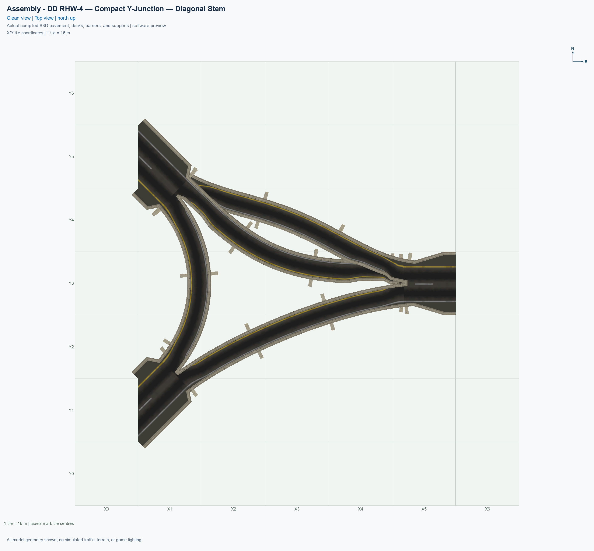
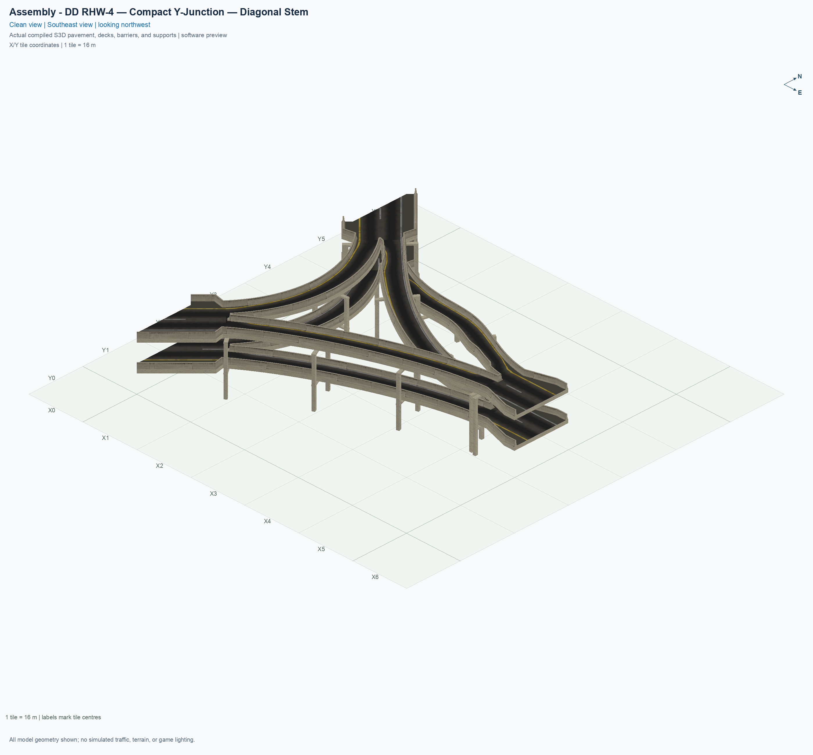
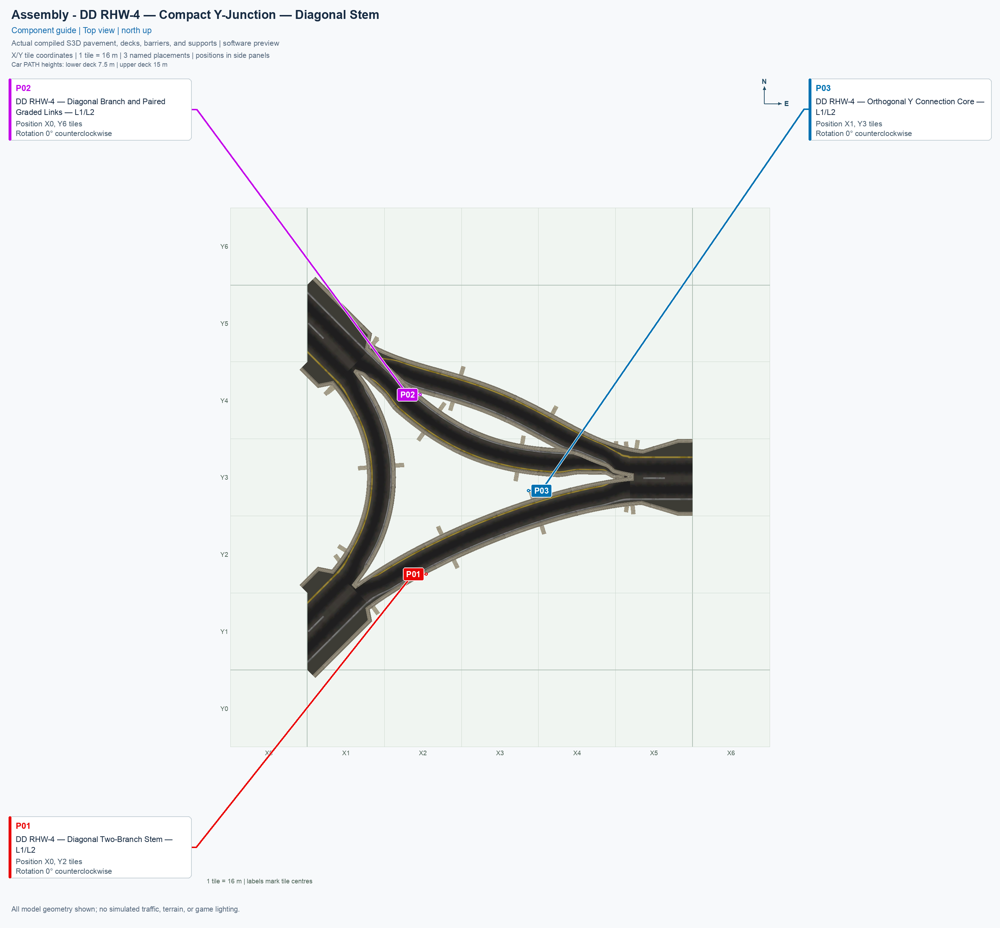
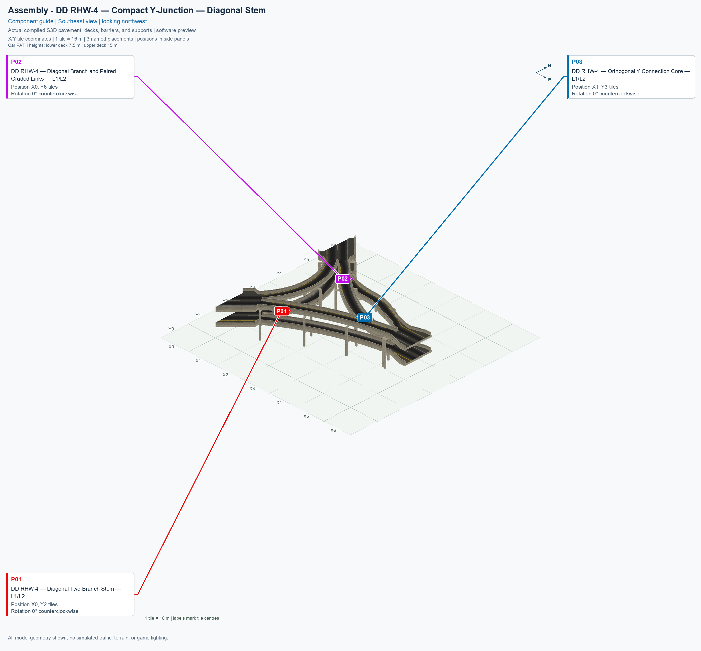
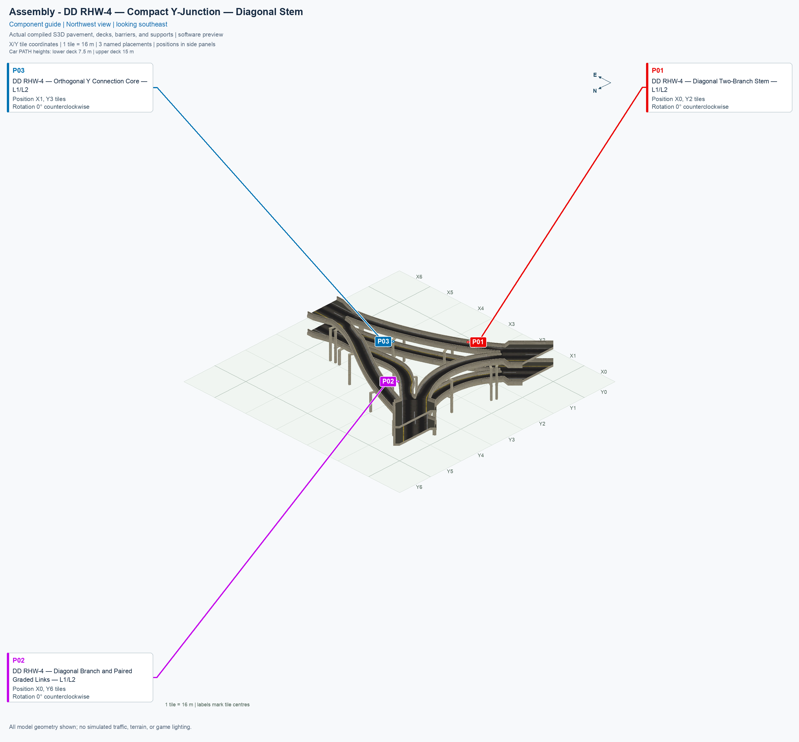
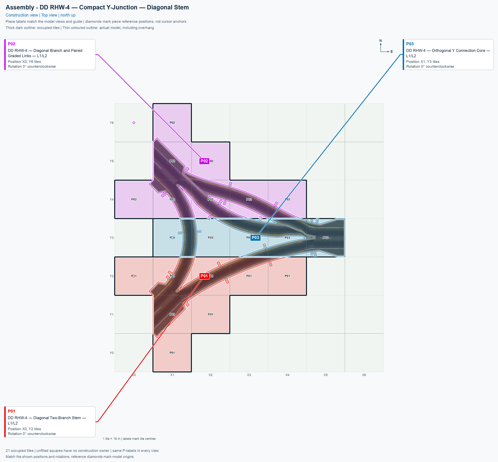
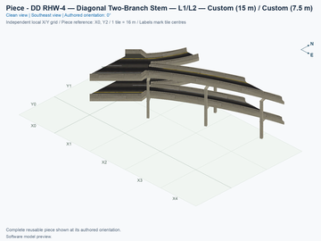
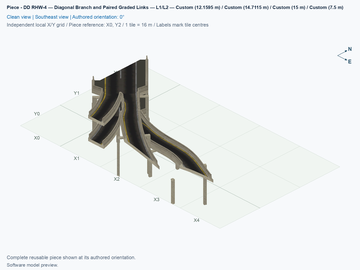
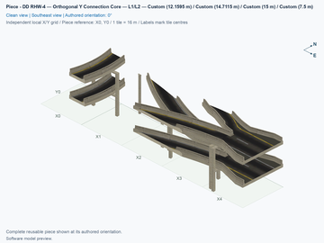

# DD RHW-4 — Compact Y-Junction — Diagonal Stem

<!-- ASSEMBLY README LAYOUT: 1 -->

[1. Views](#1-views) · [2. Pieces](#2-pieces) · [3. Placements](#3-placements) · [4. Connection matrix](#4-connection-matrix) · [Testing ↗ (separate document)](TESTING.md)

This assembly connects three double-decker RealHighway arms: **A** enters from the southwest, **B** extends northwest, and **C** extends east. Each native DD RHW-4 end has two lanes in one direction at 15 m and two lanes in the opposite direction at 7.5 m. Each incoming lane serves one of the other arms, giving six one-lane journeys and no U-turns.

The junction uses **three reusable component types, three placements, and 21 occupied city tiles within a 6 × 7-tile rectangle**, or 96 × 112 m. A city tile is 16 × 16 m. The rectangle includes unowned holes; it is not a solid 42-tile component. Keep the native approaches and their continuation space clear as described below.

The four A↔B and A↔C journeys remain level. Both B↔C journeys use separate ramps from the 7.5 m lower deck to the 15 m upper deck. A **grade** is height gained divided by horizontal distance: a 20% grade rises 2 m over 10 m horizontally. The source peak grades are approximately 26.572% for B→C and 25.761% for C→B, below this library's experimental 30% ceiling. These are compact game ramps, and their driving behavior remains subject to the [game checks](TESTING.md#4-game-checks).

The graded links normally have a 6 m-wide deck, including their barriers. Short transitions narrow the inner shoulder to a 5.25 m deck, leaving 3.59375 m of unobstructed asphalt so the neighbouring decks clear one another. Each route still carries one lane.

## 1. Views

The six pictures below show the actual compiled pavement, decks, barriers, and supports at the registered component positions. They are software renders, rather than game screenshots. Every picture uses one fixed city grid: X increases eastward, Y increases northward, and (X0, Y0) is the southwest tile centre of the construction rectangle. A north-up view places A at the lower left, B at the upper left, and C at the right.

The construction view places ownership colours over the actual top-view model at 30% opacity. Each colour identifies one component's occupied tiles. Opaque outlines distinguish the tile boundaries from the actual model projections, and reference diamonds show the placement references. A reference can be an unowned tile inside a component's surrounding rectangle; match the complete occupied shape, rather than assuming the reference must contain road.

## 2. Pieces

A **type** is a reusable component design. A **placement** is one copy placed in the city. This assembly uses each of its three types once. Each click places only the selected component. Click an angled thumbnail or **Top view** to inspect that component separately in its unrotated orientation.

| Standalone angled picture | Exact component name and permanent piece ID | Placement | Quantity | Occupied tiles |
| --- | --- | --- | ---: | ---: |
|  [Top view](../../00_pieces/ddrhw-y-diagonal-stem-split/previews/preview-top.png) | **[DD RHW-4 — Diagonal Two-Branch Stem — L1/L2](../../00_pieces/ddrhw-y-diagonal-stem-split/README.md)** `ddrhw-y-diagonal-stem-split` | P01 | 1 | 8 |
|  [Top view](../../00_pieces/ddrhw-y-diagonal-branch/previews/preview-top.png) | **[DD RHW-4 — Diagonal Branch and Paired Graded Links — L1/L2](../../00_pieces/ddrhw-y-diagonal-branch/README.md)** `ddrhw-y-diagonal-branch` | P02 | 1 | 8 |
|  [Top view](../../00_pieces/ddrhw-y-orthogonal-core/previews/preview-top.png) | **[DD RHW-4 — Orthogonal Y Connection Core — L1/L2](../../00_pieces/ddrhw-y-orthogonal-core/README.md)** `ddrhw-y-orthogonal-core` | P03 | 1 | 5 |

P01 contains the southwest native connection and the south band of the flat split and merge. P02 contains the northwest native connection and the north band of both graded links. P03 contains the east native connection and the coordinated centre band. Each component owns every surface and saved route fragment within its occupied tiles, including fragments belonging to several journeys. This prevents one placement from replacing another's lanes on the same city tile.

Standalone pictures include cut road ends, partial beams, and piers whose remaining geometry belongs to an adjacent component. The three registered placements complete those shared structures.

These are functional multi-tile modules, rather than independent full-length ramps. Reuse requires matching every exposed lane boundary, height, direction, and physical cross-section. The generated connector overviews in the individual manuals describe their intrinsic boundaries; they do not establish compatibility with arbitrary existing pieces. Native extensions are supported only at the three reviewed exterior sockets.

## 3. Placements

The table and construction view describe the unrotated layout. A **reference tile** is the component's local column 0, row 0 position. Rows in the source run southward, while the displayed Y coordinate runs northward. The reference for P02 is unowned by the custom component; its first custom-owned tile lies immediately east of it. That reference can contain the ordinary native B approach after extension or in a prebuilt control. P01 and P03 have occupied reference tiles. These are measured geometric references; the actual mouse-cursor anchor still requires a game observation. Match the entire occupied shape before clicking.

1. Prepare a flat, clear area at least 6 tiles wide and 7 tiles tall, plus room southwest, northwest, and east for ordinary native DD RHW approaches. Use the southwest tile centre as (X0, Y0).
2. Build and deliberately install a verified experimental selection through the [build and installation guide](../../../../docs/BUILD_AND_INSTALL.md). Building the source does not install it. Close SimCity 4 before replacing a plugin, restart it afterward, and use fresh placements for this new controller, model, and PATH revision.
3. Open **Transportation → Highways → SCP → Assemblies**, and select **SCP | ASSEMBLY | DD RHW-4 — Compact Y-Junction — Diagonal Stem**. This is one menu button containing three components.
4. Press **Tab** to move forward through the components or **Shift+Tab** to move backward. Read the component's full name in its tooltip. Press **Home** or **End** to rotate it until its orientation matches the north-up construction view. Use 0° for all three rows below.
5. Select the **Diagonal Two-Branch Stem**, put its reference at (X0, Y2), check its eight occupied cells against P01, and click once.
6. Select the **Diagonal Branch and Paired Graded Links**, put its unowned reference at (X0, Y6), check its eight occupied cells against P02, and click once. Do not shift it east merely because the reference cell is unowned.
7. Select the **Orthogonal Y Connection Core**, put its reference at (X1, Y3), check its five occupied cells against P03, and click once.
8. Inspect the three native approach sockets listed below. Each new component requests an optional ordinary NAM DD RHW tile outside its owned cells. Confirm that the expected native tile appears and that no temporary Road or construction-marker tile remains. Missing automatic placement is an unverified game outcome, not a reason to place another custom component over the socket.
9. Cancel component placement with **Esc**. Open **Transportation → Highways**, select **RealHighway (RHW-2)**, and drag outward from each native socket in its listed direction for at least three native tiles. Keep the diagonal two-cell staircase clear, and do not drag through the 21 custom-owned tiles. For a separate prebuilt-approach control, select **Transportation → Highways → RealHighway (RHW) Starter Pieces**, press **Tab** until the tooltip reads **Double-Decker RHW-4 Starter Piece (Upper Deck: Level 2, Lower Deck: Level 1)**, place it in the matching orientation, and extend its approach with **RealHighway (RHW-2)**. The similarly named rail-based DDRHW starter is a different network. Record outward dragging, inward connection, and placement beside prebuilt native approaches separately.

| Placement | Reference tile | Rotation | Bounding rectangle | Owned tiles |
| --- | --- | ---: | --- | ---: |
| P01 — Diagonal Two-Branch Stem | (X0, Y2) | 0° | 5 × 3 tiles | 8 |
| P02 — Diagonal Branch and Paired Graded Links | (X0, Y6), unowned reference | 0° | 5 × 3 tiles | 8 |
| P03 — Orthogonal Y Connection Core | (X1, Y3) | 0° | 5 × 1 tiles | 5 |

| Arm | Optional native socket | Continue outward | Incoming / outgoing deck |
| --- | --- | --- | --- |
| A — southwest stem | (X0, Y1) | Southwest, keeping the diagonal two-cell native pattern clear | Upper incoming / lower outgoing |
| B — northwest branch | (X0, Y5) | Northwest, keeping the diagonal two-cell native pattern clear | Lower incoming / upper outgoing |
| C — east branch | (X6, Y3) | East along Y3 | Lower incoming / upper outgoing |

The diagonal approaches need their staggered neighbouring native cells as they continue away from the junction; the one optional socket is not the whole approach. The native masks are protected from custom ownership. Both diagonal sockets are unowned holes inside the overall construction rectangle. C at (X6, Y3) is one tile east of that rectangle, immediately beyond P03's last owned tile. Leave room beyond the rectangle for connecting roads. Use the [native connection test](TESTING.md#4-game-checks) to establish actual construction behavior.

Only the first measured diagonal alignment is supplied. The four proper rotations are software-checked; reflected geometry and another native grid phase are not delivered variants. All six journeys and the prohibition on U-turns are defined below.

<!-- BEGIN ASSEMBLY CONNECTION MATRIX -->

## 4. Connection matrix

Read **from an entrance row to an exit column**. **Saved PATH** checks the saved traffic route; **Route Query** checks the route shown by the game; **Visible travel** checks a vehicle completing that journey. For HSR, visible travel means a moving train.

**Game appearance:** [✅](TESTING.md#case-in_game_render-465a700caf670d0de617) — the complete assembly’s appearance in the game, checked separately from its journeys.

**Legend:** ✅ confirmed; ❌ failed; ? not established. **Forbidden** means the movement is unavailable; its in-game check confirms that it stays unavailable. Click a result for its exact test case. Scope, evidence, and limitations remain in [TESTING](TESTING.md#test-checklist).

| Entrance ↓ / Exit → | **Road · external-1** `external-1` Variant: dd-rhw-l1 | **Road · external-3** `external-3` Variant: dd-rhw-l1 | **Road · external-6** `external-6` Variant: dd-rhw-l2 | **Road · external-8** `external-8` Variant: dd-rhw-l2 | **Road · external-10** `external-10` Variant: dd-rhw-l2 | **Road · external-12** `external-12` Variant: dd-rhw-l2 |
| --- | --- | --- | --- | --- | --- | --- |
| **Road · external-2** `external-2` Variant: dd-rhw-l2 | **Forbidden** **Saved PATH:** [?](TESTING.md#case-software_connectivity-2da37c4d9ad7ac7307fe) In-game check: [?](TESTING.md#case-in_game_forbidden_transfer-b1d731177041e6b6a2a2) | **Forbidden** **Saved PATH:** [?](TESTING.md#case-software_connectivity-2da37c4d9ad7ac7307fe) In-game check: [?](TESTING.md#case-in_game_forbidden_transfer-c5b03c092c50638d2d5f) | **Forbidden** **Saved PATH:** [?](TESTING.md#case-software_connectivity-2da37c4d9ad7ac7307fe) In-game check: [?](TESTING.md#case-in_game_forbidden_transfer-54f06858f62feb7ed51f) | **Forbidden** **Saved PATH:** [?](TESTING.md#case-software_connectivity-2da37c4d9ad7ac7307fe) In-game check: [?](TESTING.md#case-in_game_forbidden_transfer-a28ed6e6ed70d51f6391) | **Saved PATH:** [?](TESTING.md#case-software_connectivity-2da37c4d9ad7ac7307fe) **Route Query:** [✅](TESTING.md#case-in_game_route_query-b25d963a622411d235d9) **Visible travel:** [✅](TESTING.md#case-in_game_visible_travel-b25d963a622411d235d9) | **Forbidden** **Saved PATH:** [?](TESTING.md#case-software_connectivity-2da37c4d9ad7ac7307fe) In-game check: [?](TESTING.md#case-in_game_forbidden_transfer-e16a323fc244e5f82504) |
| **Road · external-4** `external-4` Variant: dd-rhw-l2 | **Forbidden** **Saved PATH:** [?](TESTING.md#case-software_connectivity-2da37c4d9ad7ac7307fe) In-game check: [?](TESTING.md#case-in_game_forbidden_transfer-6af83903a68ce8016fd2) | **Forbidden** **Saved PATH:** [?](TESTING.md#case-software_connectivity-2da37c4d9ad7ac7307fe) In-game check: [?](TESTING.md#case-in_game_forbidden_transfer-a3489bb7f0024115630e) | **Saved PATH:** [?](TESTING.md#case-software_connectivity-2da37c4d9ad7ac7307fe) **Route Query:** [✅](TESTING.md#case-in_game_route_query-0c893f7b6eb5ef69293a) **Visible travel:** [✅](TESTING.md#case-in_game_visible_travel-0c893f7b6eb5ef69293a) | **Forbidden** **Saved PATH:** [?](TESTING.md#case-software_connectivity-2da37c4d9ad7ac7307fe) In-game check: [?](TESTING.md#case-in_game_forbidden_transfer-76a99da4f12f8780c1d0) | **Forbidden** **Saved PATH:** [?](TESTING.md#case-software_connectivity-2da37c4d9ad7ac7307fe) In-game check: [?](TESTING.md#case-in_game_forbidden_transfer-c42f7ebfc416b0b485d6) | **Forbidden** **Saved PATH:** [?](TESTING.md#case-software_connectivity-2da37c4d9ad7ac7307fe) In-game check: [?](TESTING.md#case-in_game_forbidden_transfer-f5571ef39326d49443fe) |
| **Road · external-5** `external-5` Variant: dd-rhw-l1 | **Forbidden** **Saved PATH:** [?](TESTING.md#case-software_connectivity-2da37c4d9ad7ac7307fe) In-game check: [?](TESTING.md#case-in_game_forbidden_transfer-a77ab27f193b9306851f) | **Saved PATH:** [?](TESTING.md#case-software_connectivity-2da37c4d9ad7ac7307fe) **Route Query:** [✅](TESTING.md#case-in_game_route_query-45093b97a30e304435a4) **Visible travel:** [✅](TESTING.md#case-in_game_visible_travel-45093b97a30e304435a4) | **Forbidden** **Saved PATH:** [?](TESTING.md#case-software_connectivity-2da37c4d9ad7ac7307fe) In-game check: [?](TESTING.md#case-in_game_forbidden_transfer-f23915b0a74bf3a96501) | **Forbidden** **Saved PATH:** [?](TESTING.md#case-software_connectivity-2da37c4d9ad7ac7307fe) In-game check: [?](TESTING.md#case-in_game_forbidden_transfer-94fab5af3bd61bd9d753) | **Forbidden** **Saved PATH:** [?](TESTING.md#case-software_connectivity-2da37c4d9ad7ac7307fe) In-game check: [?](TESTING.md#case-in_game_forbidden_transfer-f973763b324c6bfa4d8a) | **Forbidden** **Saved PATH:** [?](TESTING.md#case-software_connectivity-2da37c4d9ad7ac7307fe) In-game check: [?](TESTING.md#case-in_game_forbidden_transfer-0b8a7675ba74e1f2ff93) |
| **Road · external-7** `external-7` Variant: dd-rhw-l1 | **Forbidden** **Saved PATH:** [?](TESTING.md#case-software_connectivity-2da37c4d9ad7ac7307fe) In-game check: [?](TESTING.md#case-in_game_forbidden_transfer-a0bf81e5cd4716bbee05) | **Forbidden** **Saved PATH:** [?](TESTING.md#case-software_connectivity-2da37c4d9ad7ac7307fe) In-game check: [?](TESTING.md#case-in_game_forbidden_transfer-ee3e2ce78f340e0a6a5e) | **Forbidden** **Saved PATH:** [?](TESTING.md#case-software_connectivity-2da37c4d9ad7ac7307fe) In-game check: [?](TESTING.md#case-in_game_forbidden_transfer-fc81d48fb897a4419fe8) | **Forbidden** **Saved PATH:** [?](TESTING.md#case-software_connectivity-2da37c4d9ad7ac7307fe) In-game check: [?](TESTING.md#case-in_game_forbidden_transfer-31725baaf3e50fce72b7) | **Forbidden** **Saved PATH:** [?](TESTING.md#case-software_connectivity-2da37c4d9ad7ac7307fe) In-game check: [?](TESTING.md#case-in_game_forbidden_transfer-bc14f5590e9972943cf2) | **Saved PATH:** [?](TESTING.md#case-software_connectivity-2da37c4d9ad7ac7307fe) **Route Query:** [✅](TESTING.md#case-in_game_route_query-c87e6848ddfffc9a497f) **Visible travel:** [✅](TESTING.md#case-in_game_visible_travel-c87e6848ddfffc9a497f) |
| **Road · external-9** `external-9` Variant: dd-rhw-l1 | **Saved PATH:** [?](TESTING.md#case-software_connectivity-2da37c4d9ad7ac7307fe) **Route Query:** [✅](TESTING.md#case-in_game_route_query-56a9183bc6dd760de5ed) **Visible travel:** [✅](TESTING.md#case-in_game_visible_travel-56a9183bc6dd760de5ed) | **Forbidden** **Saved PATH:** [?](TESTING.md#case-software_connectivity-2da37c4d9ad7ac7307fe) In-game check: [?](TESTING.md#case-in_game_forbidden_transfer-822d599b5ac726c3a054) | **Forbidden** **Saved PATH:** [?](TESTING.md#case-software_connectivity-2da37c4d9ad7ac7307fe) In-game check: [?](TESTING.md#case-in_game_forbidden_transfer-84ee9177920704615e46) | **Forbidden** **Saved PATH:** [?](TESTING.md#case-software_connectivity-2da37c4d9ad7ac7307fe) In-game check: [?](TESTING.md#case-in_game_forbidden_transfer-4e0bb33e22d53a3e9eaa) | **Forbidden** **Saved PATH:** [?](TESTING.md#case-software_connectivity-2da37c4d9ad7ac7307fe) In-game check: [?](TESTING.md#case-in_game_forbidden_transfer-cb82de06d20f783873cd) | **Forbidden** **Saved PATH:** [?](TESTING.md#case-software_connectivity-2da37c4d9ad7ac7307fe) In-game check: [?](TESTING.md#case-in_game_forbidden_transfer-498f33631ff14a70224a) |
| **Road · external-11** `external-11` Variant: dd-rhw-l1 | **Forbidden** **Saved PATH:** [?](TESTING.md#case-software_connectivity-2da37c4d9ad7ac7307fe) In-game check: [?](TESTING.md#case-in_game_forbidden_transfer-ac52c2f6fb17a4da916e) | **Forbidden** **Saved PATH:** [?](TESTING.md#case-software_connectivity-2da37c4d9ad7ac7307fe) In-game check: [?](TESTING.md#case-in_game_forbidden_transfer-0b69825467445cfb42c2) | **Forbidden** **Saved PATH:** [?](TESTING.md#case-software_connectivity-2da37c4d9ad7ac7307fe) In-game check: [?](TESTING.md#case-in_game_forbidden_transfer-4b0cbfa27a443564bcd5) | **Saved PATH:** [?](TESTING.md#case-software_connectivity-2da37c4d9ad7ac7307fe) **Route Query:** [✅](TESTING.md#case-in_game_route_query-43cd4b114ba16db01787) **Visible travel:** [✅](TESTING.md#case-in_game_visible_travel-43cd4b114ba16db01787) | **Forbidden** **Saved PATH:** [?](TESTING.md#case-software_connectivity-2da37c4d9ad7ac7307fe) In-game check: [?](TESTING.md#case-in_game_forbidden_transfer-aacccceb4827941747cf) | **Forbidden** **Saved PATH:** [?](TESTING.md#case-software_connectivity-2da37c4d9ad7ac7307fe) In-game check: [?](TESTING.md#case-in_game_forbidden_transfer-40017744d2a72dcbcf1a) |

Source: [connections.json](connections.json).

<!-- END ASSEMBLY CONNECTION MATRIX -->
