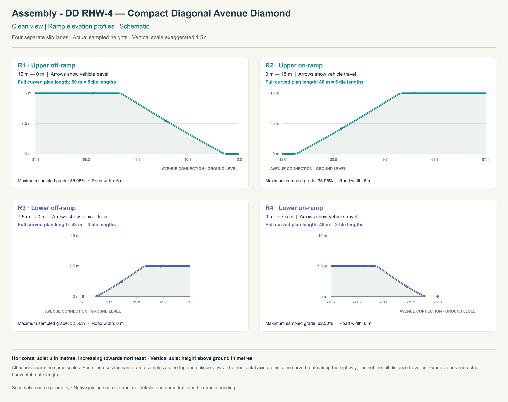
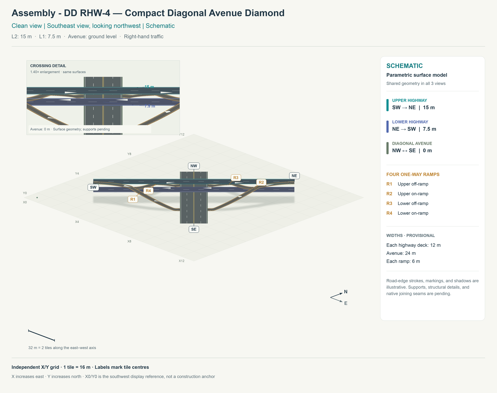
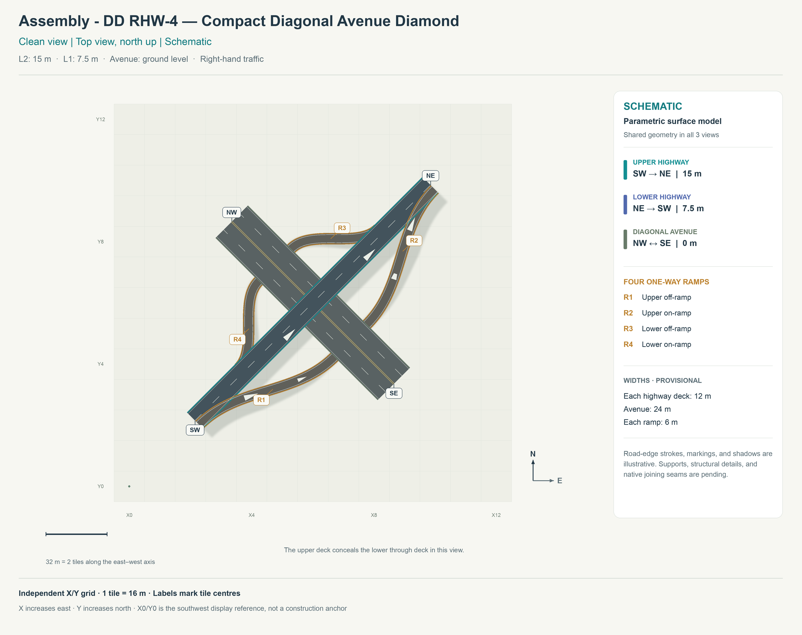
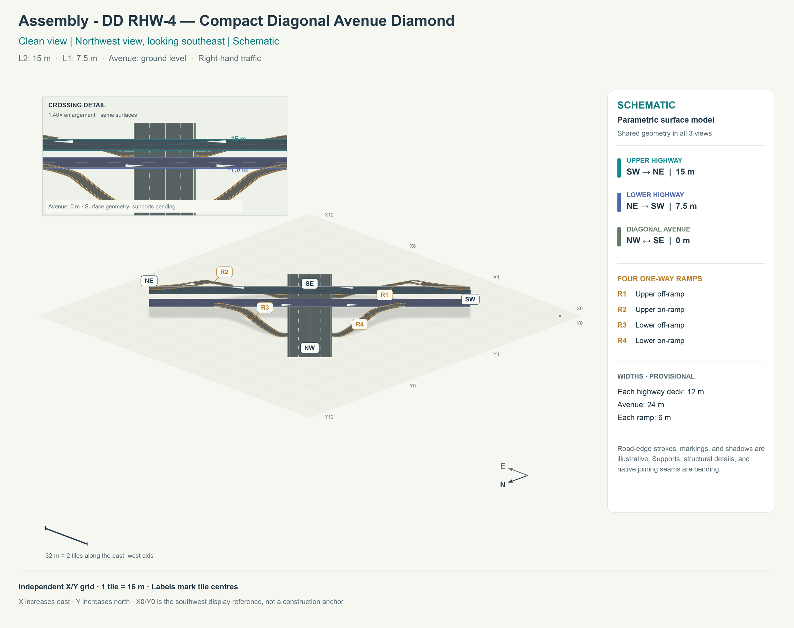

# DD RHW-4 — Compact Diagonal Avenue Diamond

[1. Views](#1-views) · [2. Pieces](#2-pieces) · [3. Placements](#3-placements) · [4. Connection matrix](#4-connection-matrix) · [Testing ↗ (separate document)](TESTING.md)

This is a **geometry prototype**, meaning a reproducible road layout made from sampled three-dimensional curves. It is not yet a placeable SimCity 4 construction. It uses NAM's **DD RHW-4**, the double-decker RealHighway with one two-lane direction on each stacked deck. The highway runs southwest–northeast above a perpendicular, ground-level diagonal avenue. Four separate slip lanes connect the avenue to the two highway decks: two at 15 m and two at 7.5 m.

The urban design brief is a very tight, Tokyo-inspired corridor. The lower ramps have a full curved horizontal length of **48 m, or three 16 m tile lengths**. The upper ramps remain longer at **80 m, or five tile lengths**, because their deck is twice as high. The avenue intersections sit only 28 m to either side of the highway centreline. An upper-deck ramp first moves outside the lower highway's envelope, then descends towards the avenue. Its opposite on-ramp climbs from the avenue and reaches the full upper height before joining the highway. Each highway direction can enter and leave towards both avenue directions. The Tokyo reference describes the compact urban form; this candidate retains the audited NAM installation's right-hand traffic.

This deliberately steep experiment follows the user's request for substantially shorter ramps. The descending sections reach approximately 35.96% grade on the upper level and 32.50% on the lower level. A **grade** is rise divided by horizontal distance, expressed as a percentage. Those values describe the sampled geometry, rather than an established NAM or in-game operating limit.

## 1. Views

These are **schematics**, rather than renders of saved game models. All views use the same sampled geometry. Road widths, markings, and shaded ribbons are provisional; structural decks, supports, native seams, and traffic-control hardware remain unimplemented. The profile view makes the separate height changes explicit; its vertical exaggeration is labelled in the image.

The upper deck hides the lower deck in the top view. Use the enlarged crossing inset in either angled view to see their separation. Heights are measured from flat ground, while the X/Y labels identify 16 m city-grid tile centres. Those labels provide a review reference; they are not game placement anchors.

## 2. Pieces

An **assembly** is a layout built from reusable, individually selectable components. The final implementation is intended to use one menu button with Tab and Shift+Tab cycling through its components; each click would place one component. No such button or component exists for this prototype yet.

| Candidate module | Reusable function | Current state |
| --- | --- | --- |
| M01 | Stacked diagonal highway over diagonal avenue core | Native donor paths and models audited; selectable construction missing. |
| M02 | Upper-deck approach split and merge | Provisional road curves and clearance checks only. |
| M03 | Lower-deck approach split and merge | Provisional road curves and clearance checks only. |
| M04 | Curved height-changing slip lanes | Sampled separately for upper off, upper on, lower off, and lower on. |
| M05 | Ground avenue intersection with paired one-way ramp legs | Eight turning curves and avenue through routes sampled; game traffic control missing. |

These are functional candidates, rather than five allocated piece types or five proven placements. Where different roads occupy the same city tile, their geometry and traffic must belong to one coordinated construction. Exact cuts, type reuse, occupied tiles, resource IDs, supports, and proper rotations require implementation evidence. A mirrored road curve does not prove that two one-way game pieces can share a proper rotation.

## 3. Placements

The maintained plan is [design.jsonc](design.jsonc). The generated [geometry export](evidence/geometry.json) stores actual sampled coordinates in metres. No game placement table is available because construction footprints and anchors have not been proved.

The local axis `u` follows the highway towards northeast; `v` points across it towards northwest. The crossing centre is `u=0, v=0`. World east is `(u-v)/√2`, and world north is `(u+v)/√2`. Height `z` measures metres above ground. Positive `v` is the lower highway's right side; negative `v` is the upper highway's right side.

| Road or slip lane | Direction | Height change | Connection at the avenue |
| --- | --- | --- | --- |
| Upper highway | SW → NE | Constant 15 m | Passes above the avenue. |
| Lower highway | NE → SW | Constant 7.5 m | Passes above the avenue. |
| R1: upper off-ramp | From the SW highway approach | 15 m → 0 m | Southeast surface intersection; turn towards NW or SE. |
| R2: upper on-ramp | Towards the NE highway exit | 0 m → 15 m | Enter from either avenue direction at the southeast surface intersection. |
| R3: lower off-ramp | From the NE highway approach | 7.5 m → 0 m | Northwest surface intersection; turn towards NW or SE. |
| R4: lower on-ramp | Towards the SW highway exit | 0 m → 7.5 m | Enter from either avenue direction at the northwest surface intersection. |

Each surface intersection has four legs: two avenue legs, an incoming off-ramp, and an outgoing on-ramp. Conflicting movements require future signals or priority rules. No immediate highway U-turn or direct transfer between stacked decks is authored. An indirect return via the avenue and the opposite on-ramp remains possible, as it does in a conventional diamond.

## 4. Connection matrix

**Sampled connectivity** means that the prototype's directed curves join at matching endpoints. It is separate from encoded game traffic paths, native neighbour compatibility, Route Query, and visible travel. **Route Query** is the game tool that displays assigned traffic routes; **visible travel** means watching vehicles complete the stated journey.

| From | To | Sampled route graph | Saved game PATHs | Route Query | Visible travel |
| --- | --- | --- | --- | --- | --- |
| SW | NE | Checked | Not built | Not run | Not run |
| NE | SW | Checked | Not built | Not run | Not run |
| NW | SE | Checked | Not built | Not run | Not run |
| SE | NW | Checked | Not built | Not run | Not run |
| SW | NW | Checked | Not built | Not run | Not run |
| SW | SE | Checked | Not built | Not run | Not run |
| NE | NW | Checked | Not built | Not run | Not run |
| NE | SE | Checked | Not built | Not run | Not run |
| NW | NE | Checked | Not built | Not run | Not run |
| SE | NE | Checked | Not built | Not run | Not run |
| NW | SW | Checked | Not built | Not run | Not run |
| SE | SW | Checked | Not built | Not run | Not run |

The [prototype check report](evidence/geometry-check.json) supplies the numerical scope and exact source fingerprints. It does not replace the future generated connection matrix from independently verified game resources. See [TESTING.md](TESTING.md) for reproduction commands, limits, native evidence, and remaining implementation work.
