# DD RHW-4 — Compact Diagonal Avenue Diamond

[1. Views](#1-views) · [2. Pieces](#2-pieces) · [3. Placements](#3-placements) · [4. Connection matrix](#4-connection-matrix) · [Testing ↗ (separate document)](TESTING.md)

A compact diagonal NAM DD RHW-4 crosses a diagonal ground avenue. The lower deck is 7.5 m high, and the opposing upper deck is 15 m high. The assembly uses 13 reusable component types, 15 placements, and 53 occupied tiles inside a 10 × 10-tile rectangle (160 × 160 m).

Each ramp carries traffic in one direction and connects only to its adjacent avenue carriageway. A **carriageway** is the part of the avenue carrying traffic in one direction. The avenue itself remains two-way, and all four highway or avenue through journeys remain available. Ramp traffic makes the four right turns below; it cannot cross the opposing avenue carriageway to make a left turn.

| Ramp | Traffic arrives from | Traffic leaves towards |
| --- | --- | --- |
| Lower off-ramp | Northeast highway approach, on the lower deck | Northwest avenue arm |
| Lower on-ramp | Northwest avenue approach | Southwest highway arm, on the lower deck |
| Upper off-ramp | Southwest highway approach, on the upper deck | Southeast avenue arm |
| Upper on-ramp | Southeast avenue approach | Northeast highway arm, on the upper deck |

## 1. Views

These pictures render the actual saved module models at their registered positions. P01–P15 identify individual placements, and every picture uses the same X/Y city coordinates, with north up in the top views. Their presentation follows the HSR trumpet: clean top, clean southeast, named top, named southeast, named northwest, and tile ownership.

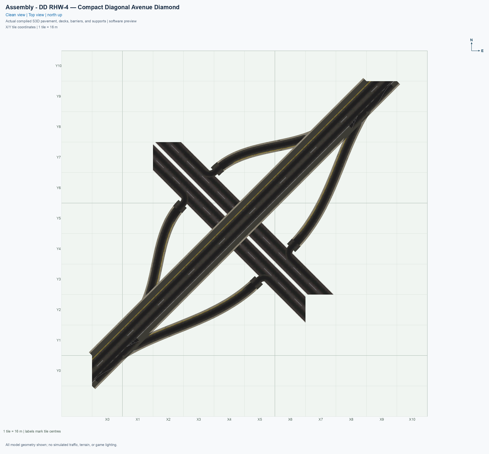

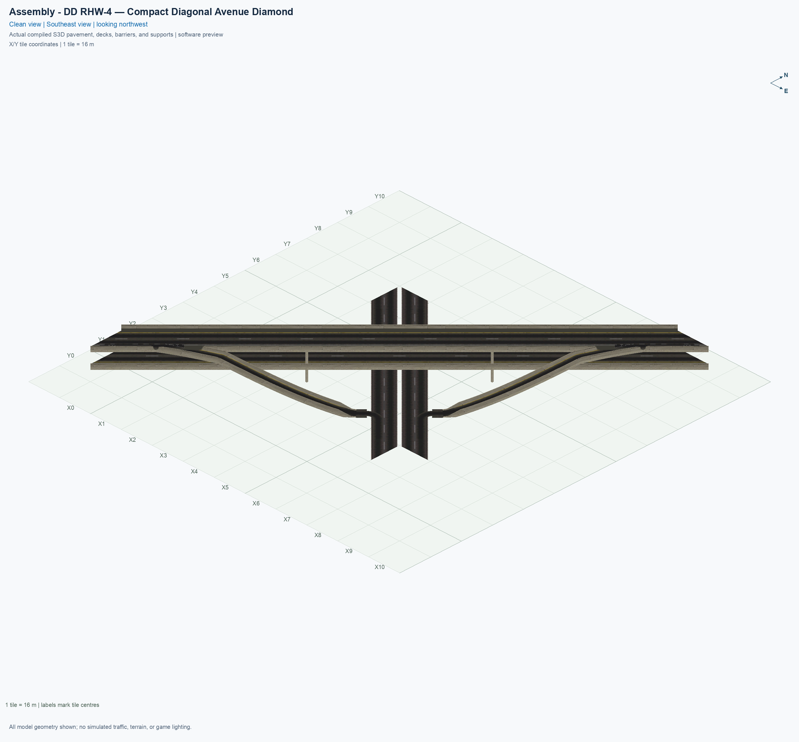

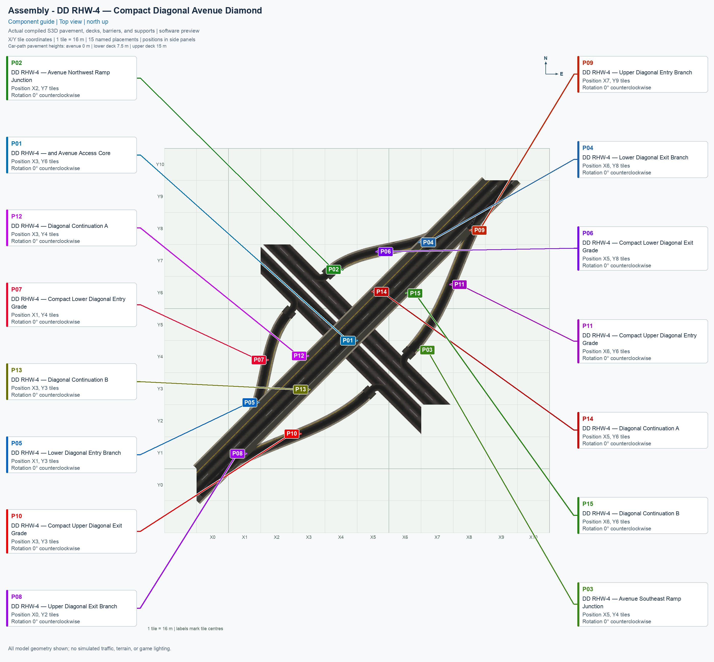

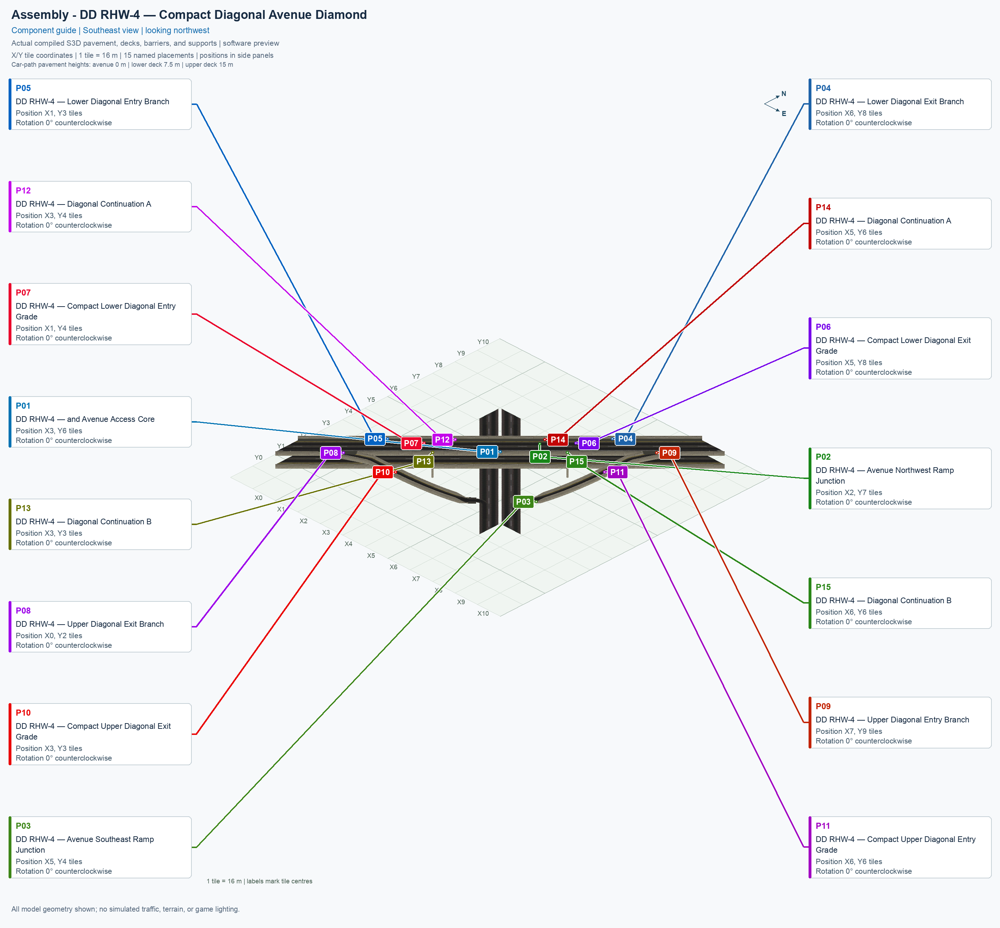

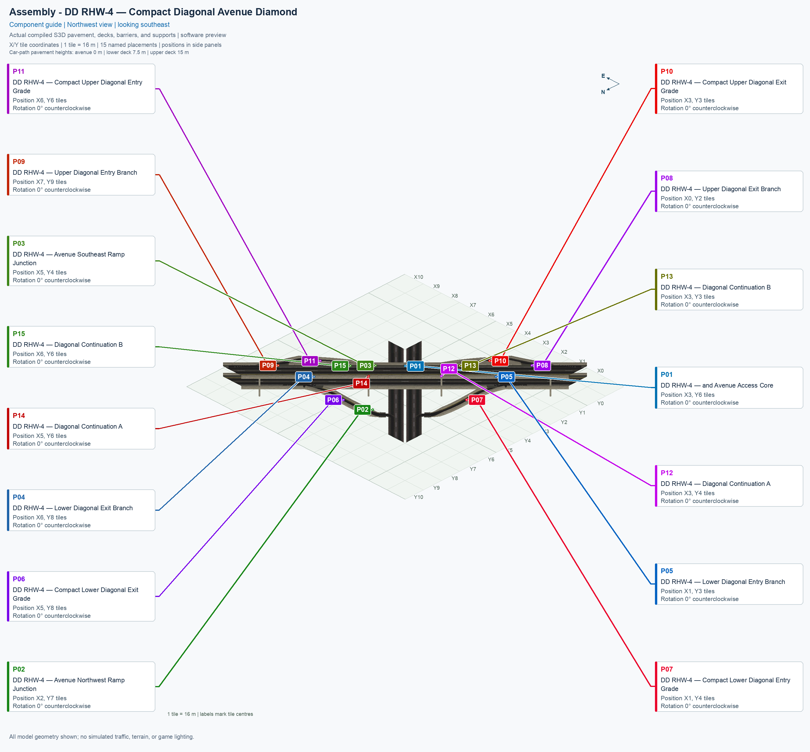

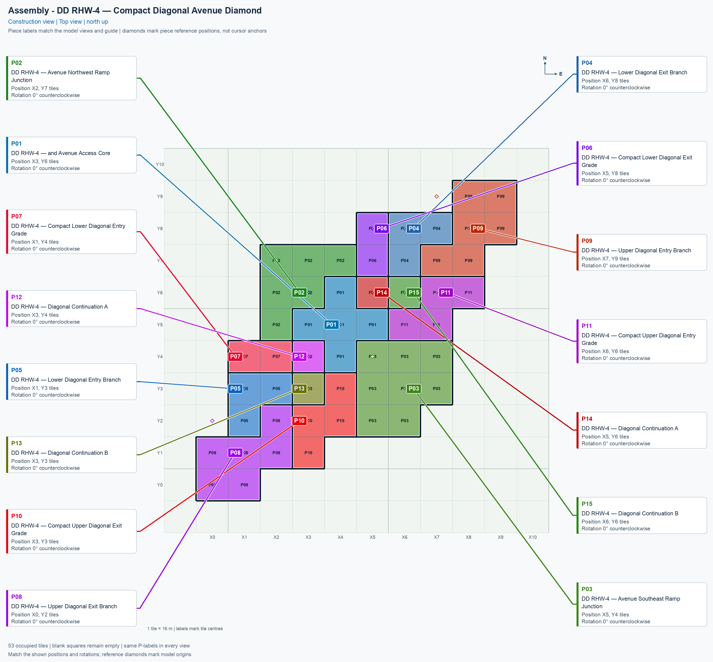

Each highway ramp connection retains its extended position one diagonal city-grid step farther from the avenue: 16 m along each city axis, or about 22.63 m along the diagonal highway. Including the new shoulder-lane approaches, the complete authored driving curve is about 70.33 m lower and 102.21 m upper. The active height transitions remain about 35.08 m lower and 52.66 m upper, with 4 m ground landings. Source peak grades remain about 22.68% lower and 29.61% upper. A **grade** is height change divided by horizontal travel distance; 20% means 2 m of height change over 10 m horizontally. Saved-resource measurements and game observations are recorded separately in [TESTING.md](TESTING.md).

Each highway join now uses an **auxiliary lane**: a lane beside the two through lanes that serves the ramp. An exit route changes gradually from the outer through lane into this shoulder lane, runs parallel to the highway, then follows the off-ramp. An entrance route follows the reverse sequence. The lower joins use a 12 m taper and a 4 m parallel section; the upper joins use a 16 m taper and an 8 m parallel section. These taper and parallel lengths are distances along the straight highway axis. White dashed separators, continuous outer edges, and compact painted split areas identify these lanes. The saved driving paths follow these lane changes. The 53-tile construction footprint, outer ramps, right-turn-only Avenue access, and two through lanes on each deck are retained.

Barrier openings follow each ramp’s actual deck and side. A lower-ramp opening leaves the upper barrier intact, and the opposite side of an upper-deck branch stays closed. Ramp pavement, barriers, and concrete use the measured native NAM materials described in the [ramp-material audit](evidence/native-ramp-materials-audit.json). All authored ramp pavement, including the highway joins and ground turns, uses pavement from NAM’s single-lane ramp network, MIS. Its texture direction continues through each ramp mouth. The retained native DD RHW-4 mainline faces keep their original pavement material. Retained native model overhangs remain visible beyond the construction tiles.

### 1.1 Avenue connections and sidewalks

The components already include the ground Avenue section, its car routes, and its pedestrian routes. The intended experiment is to connect an ordinary diagonal ground Avenue to the assembly’s northwest and southeast Avenue ends:

1. Place the assembly on a clear, flat area, using the numbered component placements in chapter 3.
2. Open **Transportation → Roads**, and select the ordinary **Avenue** tool.
3. Drag a diagonal Avenue up to the assembly’s northwest Avenue end, stopping at the component boundary. Repeat at the southeast Avenue end.

The saved lane boundaries match measured native Avenue channels, but these in-game joins remain unverified. Dragging an Avenue through the occupied assembly, and placing the components over a complete prebuilt Avenue, are separate untested operations. A prebuilt Avenue is not a documented prerequisite for this experimental placement sequence.

Pedestrian routes and visible sidewalks are separate: a **pedestrian route** is a saved path that permits walking, while a **sidewalk** is the visible paved artwork. The current components retain fixed native Avenue models and texture references; automatic matching to an adjoining Avenue’s sidewalk style is not an implemented feature. Connecting an Avenue with sidewalks therefore does not establish that matching walkways will appear inside the assembly. Installed texture replacements can change the referenced images globally, but that is separate from adaptation to a particular neighbour. Actual sidewalk appearance and pedestrian travel still need in-game observations.

## 2. Pieces

Use the exact menu names below. A **type** is a reusable component design; a **placement** is one instance of that design in the city. Continuation A and continuation B are each placed twice. Click a thumbnail to open the full standalone angled picture, or click **Top view** to see the component from above. Each standalone picture shows the component at 0°.

The upper branch modules own their outer native continuation cells because the extended ramps’ road faces also occupy those cells. The previous separate outer continuation placements are absorbed into those branches. Shared native roadway and authored ramp faces on one construction tile have one component owner.

| Standalone angled picture | Component name and permanent piece ID | Placements | Quantity | Occupied tiles per click |
| --- | --- | --- | ---: | ---: |
| [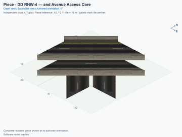](../../00_pieces/ddrhw-diagonal-access-core/previews/preview.png) [Top view](../../00_pieces/ddrhw-diagonal-access-core/previews/preview-top.png) | **[DD RHW-4 — and Avenue Access Core](../../00_pieces/ddrhw-diagonal-access-core/README.md)** `ddrhw-diagonal-access-core` | P01 | 1 | 5 |
| [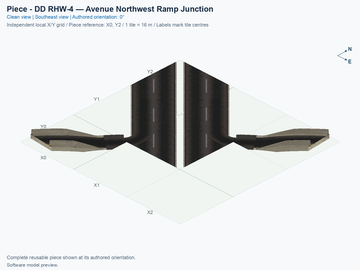](../../00_pieces/ddrhw-diagonal-northwest-junction/previews/preview.png) [Top view](../../00_pieces/ddrhw-diagonal-northwest-junction/previews/preview-top.png) | **[DD RHW-4 — Avenue Northwest Ramp Junction](../../00_pieces/ddrhw-diagonal-northwest-junction/README.md)** `ddrhw-diagonal-northwest-junction` | P02 | 1 | 6 |
| [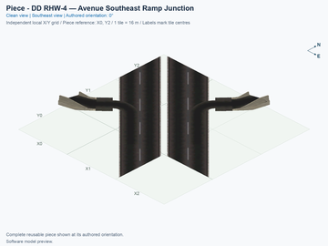](../../00_pieces/ddrhw-diagonal-southeast-junction/previews/preview.png) [Top view](../../00_pieces/ddrhw-diagonal-southeast-junction/previews/preview-top.png) | **[DD RHW-4 — Avenue Southeast Ramp Junction](../../00_pieces/ddrhw-diagonal-southeast-junction/README.md)** `ddrhw-diagonal-southeast-junction` | P03 | 1 | 8 |
| [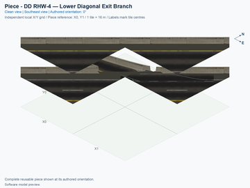](../../00_pieces/ddrhw-diagonal-lower-exit-branch/previews/preview.png) [Top view](../../00_pieces/ddrhw-diagonal-lower-exit-branch/previews/preview-top.png) | **[DD RHW-4 — Lower Diagonal Exit Branch](../../00_pieces/ddrhw-diagonal-lower-exit-branch/README.md)** `ddrhw-diagonal-lower-exit-branch` | P04 | 1 | 3 |
| [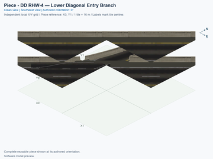](../../00_pieces/ddrhw-diagonal-lower-entry-branch/previews/preview.png) [Top view](../../00_pieces/ddrhw-diagonal-lower-entry-branch/previews/preview-top.png) | **[DD RHW-4 — Lower Diagonal Entry Branch](../../00_pieces/ddrhw-diagonal-lower-entry-branch/README.md)** `ddrhw-diagonal-lower-entry-branch` | P05 | 1 | 3 |
| [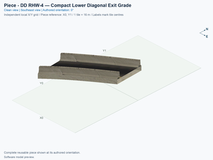](../../00_pieces/ddrhw-diagonal-lower-exit-grade/previews/preview.png) [Top view](../../00_pieces/ddrhw-diagonal-lower-exit-grade/previews/preview-top.png) | **[DD RHW-4 — Compact Lower Diagonal Exit Grade](../../00_pieces/ddrhw-diagonal-lower-exit-grade/README.md)** `ddrhw-diagonal-lower-exit-grade` | P06 | 1 | 2 |
| [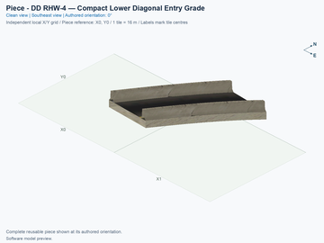](../../00_pieces/ddrhw-diagonal-lower-entry-grade/previews/preview.png) [Top view](../../00_pieces/ddrhw-diagonal-lower-entry-grade/previews/preview-top.png) | **[DD RHW-4 — Compact Lower Diagonal Entry Grade](../../00_pieces/ddrhw-diagonal-lower-entry-grade/README.md)** `ddrhw-diagonal-lower-entry-grade` | P07 | 1 | 2 |
| [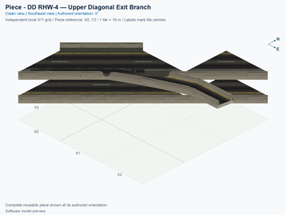](../../00_pieces/ddrhw-diagonal-upper-exit-branch/previews/preview.png) [Top view](../../00_pieces/ddrhw-diagonal-upper-exit-branch/previews/preview-top.png) | **[DD RHW-4 — Upper Diagonal Exit Branch](../../00_pieces/ddrhw-diagonal-upper-exit-branch/README.md)** `ddrhw-diagonal-upper-exit-branch` | P08 | 1 | 6 |
| [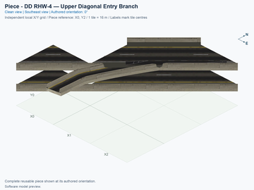](../../00_pieces/ddrhw-diagonal-upper-entry-branch/previews/preview.png) [Top view](../../00_pieces/ddrhw-diagonal-upper-entry-branch/previews/preview-top.png) | **[DD RHW-4 — Upper Diagonal Entry Branch](../../00_pieces/ddrhw-diagonal-upper-entry-branch/README.md)** `ddrhw-diagonal-upper-entry-branch` | P09 | 1 | 6 |
| [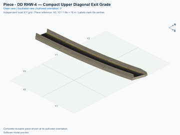](../../00_pieces/ddrhw-diagonal-upper-exit-grade/previews/preview.png) [Top view](../../00_pieces/ddrhw-diagonal-upper-exit-grade/previews/preview-top.png) | **[DD RHW-4 — Compact Upper Diagonal Exit Grade](../../00_pieces/ddrhw-diagonal-upper-exit-grade/README.md)** `ddrhw-diagonal-upper-exit-grade` | P10 | 1 | 4 |
| [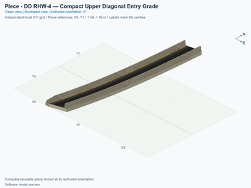](../../00_pieces/ddrhw-diagonal-upper-entry-grade/previews/preview.png) [Top view](../../00_pieces/ddrhw-diagonal-upper-entry-grade/previews/preview-top.png) | **[DD RHW-4 — Compact Upper Diagonal Entry Grade](../../00_pieces/ddrhw-diagonal-upper-entry-grade/README.md)** `ddrhw-diagonal-upper-entry-grade` | P11 | 1 | 4 |
| [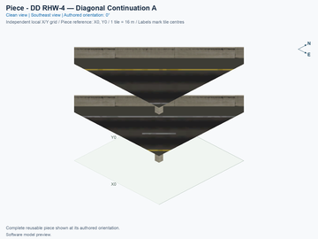](../../00_pieces/ddrhw-diagonal-diagonal-half-a/previews/preview.png) [Top view](../../00_pieces/ddrhw-diagonal-diagonal-half-a/previews/preview-top.png) | **[DD RHW-4 — Diagonal Continuation A](../../00_pieces/ddrhw-diagonal-diagonal-half-a/README.md)** `ddrhw-diagonal-diagonal-half-a` | P12, P14 | 2 | 1 |
| [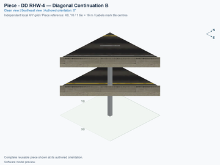](../../00_pieces/ddrhw-diagonal-diagonal-half-b/previews/preview.png) [Top view](../../00_pieces/ddrhw-diagonal-diagonal-half-b/previews/preview-top.png) | **[DD RHW-4 — Diagonal Continuation B](../../00_pieces/ddrhw-diagonal-diagonal-half-b/README.md)** `ddrhw-diagonal-diagonal-half-b` | P13, P15 | 2 | 1 |

## 3. Placements

1. Prepare a flat 10 × 10-tile area. X increases eastward, Y increases northward, and the southwest tile centre is (X0, Y0). A tile is 16 × 16 m.
2. Install only an explicitly selected, verified experimental build through the [shared installation procedure](../../../../docs/BUILD_AND_INSTALL.md). The source and build commands do not install it automatically.
3. Open **Transportation → Roads**, then select **SCP | ASSEMBLY | DD RHW-4 — Compact Diagonal Avenue Diamond**.
4. Press **Tab** to advance through the component types or **Shift+Tab** to go back. Press **Home** or **End** to rotate the current component. Use rotation 0° for every placement below.
5. Place P01 first, then follow the numbered rows. The listed position is the component’s local (column 0, row 0) reference, which can be an empty tile for a sparse component. Match all occupied cells to the ownership picture. Each click places only the current component.
6. Use the measured outer native lane boundaries for DD RHW-4 and Avenue approaches. Do not substitute a standard Maxis highway or claim compatibility from a single matching lane. Complete native boundary and game-placement checks remain separate.

| Placement | Component | Reference tile | Rotation |
| --- | --- | --- | ---: |
| P01 | DD RHW-4 — and Avenue Access Core | (X3, Y6) | 0° |
| P02 | DD RHW-4 — Avenue Northwest Ramp Junction | (X2, Y7) | 0° |
| P03 | DD RHW-4 — Avenue Southeast Ramp Junction | (X5, Y4) | 0° |
| P04 | DD RHW-4 — Lower Diagonal Exit Branch | (X6, Y8) | 0° |
| P05 | DD RHW-4 — Lower Diagonal Entry Branch | (X1, Y3) | 0° |
| P06 | DD RHW-4 — Compact Lower Diagonal Exit Grade | (X5, Y8) | 0° |
| P07 | DD RHW-4 — Compact Lower Diagonal Entry Grade | (X1, Y4) | 0° |
| P08 | DD RHW-4 — Upper Diagonal Exit Branch | (X0, Y2) | 0° |
| P09 | DD RHW-4 — Upper Diagonal Entry Branch | (X7, Y9) | 0° |
| P10 | DD RHW-4 — Compact Upper Diagonal Exit Grade | (X3, Y3) | 0° |
| P11 | DD RHW-4 — Compact Upper Diagonal Entry Grade | (X6, Y6) | 0° |
| P12 | DD RHW-4 — Diagonal Continuation A | (X3, Y4) | 0° |
| P13 | DD RHW-4 — Diagonal Continuation B | (X3, Y3) | 0° |
| P14 | DD RHW-4 — Diagonal Continuation A | (X5, Y6) | 0° |
| P15 | DD RHW-4 — Diagonal Continuation B | (X6, Y6) | 0° |

<!-- BEGIN ASSEMBLY CONNECTION MATRIX -->

## 4. Connection matrix

Read **from an entrance row to an exit column**. **Saved PATH** checks the saved traffic route; **Route Query** checks the route shown by the game; **Visible travel** checks a vehicle completing that journey. For HSR, visible travel means a moving train.

**Game appearance:** [?](TESTING.md#case-in_game_render-d3cfcd278fba6b54f7d5) — the complete assembly’s appearance in the game, checked separately from its journeys.

**Legend:** ✅ confirmed; ❌ failed; ? not established. **Forbidden** means the movement is unavailable; its in-game check confirms that it stays unavailable. Click a result for its exact test case. Scope, evidence, and limitations remain in [TESTING](TESTING.md#test-checklist).

| Entrance ↓ / Exit → | **Road · external-1** `external-1` Variant: dd-rhw-l1 | **Road · external-3** `external-3` Variant: dd-rhw-l1 | **Road · external-7** `external-7` Variant: avenue-ground | **Road · external-8** `external-8` Variant: avenue-ground | **Road · external-9** `external-9` Variant: avenue-ground | **Road · external-10** `external-10` Variant: avenue-ground | **Road · external-14** `external-14` Variant: dd-rhw-l2 | **Road · external-16** `external-16` Variant: dd-rhw-l2 | **pedestrian · external-18** `external-18` Variant: avenue-sidewalk | **pedestrian · external-19** `external-19` Variant: avenue-sidewalk |
| --- | --- | --- | --- | --- | --- | --- | --- | --- | --- | --- |
| **Road · external-2** `external-2` Variant: dd-rhw-l2 | **Forbidden** **Saved PATH:** [?](TESTING.md#case-software_connectivity-0184d6b917d00cb763b7) In-game check: [?](TESTING.md#case-in_game_forbidden_transfer-4df5253325d3a5a962f5) | **Forbidden** **Saved PATH:** [?](TESTING.md#case-software_connectivity-0184d6b917d00cb763b7) In-game check: [?](TESTING.md#case-in_game_forbidden_transfer-ddb4a78290312195656f) | **Forbidden** **Saved PATH:** [?](TESTING.md#case-software_connectivity-0184d6b917d00cb763b7) In-game check: [?](TESTING.md#case-in_game_forbidden_transfer-b0d9ea504f5838993d64) | **Forbidden** **Saved PATH:** [?](TESTING.md#case-software_connectivity-0184d6b917d00cb763b7) In-game check: [?](TESTING.md#case-in_game_forbidden_transfer-5014330c9d5a4a52cb11) | **Saved PATH:** [?](TESTING.md#case-software_connectivity-0184d6b917d00cb763b7) **Route Query:** [?](TESTING.md#case-in_game_route_query-13159f474c48173fe328) **Visible travel:** [?](TESTING.md#case-in_game_visible_travel-13159f474c48173fe328) | **Forbidden** **Saved PATH:** [?](TESTING.md#case-software_connectivity-0184d6b917d00cb763b7) In-game check: [?](TESTING.md#case-in_game_forbidden_transfer-92beb85de3919a9f9e38) | **Forbidden** **Saved PATH:** [?](TESTING.md#case-software_connectivity-0184d6b917d00cb763b7) In-game check: [?](TESTING.md#case-in_game_forbidden_transfer-140ee7e98e4d06df1dc0) | **Saved PATH:** [?](TESTING.md#case-software_connectivity-0184d6b917d00cb763b7) **Route Query:** [?](TESTING.md#case-in_game_route_query-089b8090f0d1c2d11686) **Visible travel:** [?](TESTING.md#case-in_game_visible_travel-089b8090f0d1c2d11686) | **Forbidden** **Saved PATH:** [?](TESTING.md#case-software_connectivity-0184d6b917d00cb763b7) In-game check: [?](TESTING.md#case-in_game_forbidden_transfer-6f964e85ffe9fc05e267) | **Forbidden** **Saved PATH:** [?](TESTING.md#case-software_connectivity-0184d6b917d00cb763b7) In-game check: [?](TESTING.md#case-in_game_forbidden_transfer-178b32f6566a0961d27e) |
| **Road · external-4** `external-4` Variant: dd-rhw-l2 | **Forbidden** **Saved PATH:** [?](TESTING.md#case-software_connectivity-0184d6b917d00cb763b7) In-game check: [?](TESTING.md#case-in_game_forbidden_transfer-e3f26b8bfed582a472bc) | **Forbidden** **Saved PATH:** [?](TESTING.md#case-software_connectivity-0184d6b917d00cb763b7) In-game check: [?](TESTING.md#case-in_game_forbidden_transfer-f27e177f3bed406e3c3c) | **Forbidden** **Saved PATH:** [?](TESTING.md#case-software_connectivity-0184d6b917d00cb763b7) In-game check: [?](TESTING.md#case-in_game_forbidden_transfer-f2a81135215123b6227a) | **Forbidden** **Saved PATH:** [?](TESTING.md#case-software_connectivity-0184d6b917d00cb763b7) In-game check: [?](TESTING.md#case-in_game_forbidden_transfer-895ce6abaea73f8a17e0) | **Forbidden** **Saved PATH:** [?](TESTING.md#case-software_connectivity-0184d6b917d00cb763b7) In-game check: [?](TESTING.md#case-in_game_forbidden_transfer-600a06c657e4ef3e84d8) | **Forbidden** **Saved PATH:** [?](TESTING.md#case-software_connectivity-0184d6b917d00cb763b7) In-game check: [?](TESTING.md#case-in_game_forbidden_transfer-2b811d8d836f123cbdcc) | **Saved PATH:** [?](TESTING.md#case-software_connectivity-0184d6b917d00cb763b7) **Route Query:** [?](TESTING.md#case-in_game_route_query-95326c16946a4571e900) **Visible travel:** [?](TESTING.md#case-in_game_visible_travel-95326c16946a4571e900) | **Forbidden** **Saved PATH:** [?](TESTING.md#case-software_connectivity-0184d6b917d00cb763b7) In-game check: [?](TESTING.md#case-in_game_forbidden_transfer-65313dd337171d04c96d) | **Forbidden** **Saved PATH:** [?](TESTING.md#case-software_connectivity-0184d6b917d00cb763b7) In-game check: [?](TESTING.md#case-in_game_forbidden_transfer-b5ee10b6728a6ddebc6e) | **Forbidden** **Saved PATH:** [?](TESTING.md#case-software_connectivity-0184d6b917d00cb763b7) In-game check: [?](TESTING.md#case-in_game_forbidden_transfer-514360e303d5be6acb85) |
| **Road · external-5** `external-5` Variant: avenue-ground | **Forbidden** **Saved PATH:** [?](TESTING.md#case-software_connectivity-0184d6b917d00cb763b7) In-game check: [?](TESTING.md#case-in_game_forbidden_transfer-614d4acdee2b148f4a12) | **Saved PATH:** [?](TESTING.md#case-software_connectivity-0184d6b917d00cb763b7) **Route Query:** [?](TESTING.md#case-in_game_route_query-e35bd55025909f0c6ae9) **Visible travel:** [?](TESTING.md#case-in_game_visible_travel-e35bd55025909f0c6ae9) | **Forbidden** **Saved PATH:** [?](TESTING.md#case-software_connectivity-0184d6b917d00cb763b7) In-game check: [?](TESTING.md#case-in_game_forbidden_transfer-09136b99468fea2ee46b) | **Forbidden** **Saved PATH:** [?](TESTING.md#case-software_connectivity-0184d6b917d00cb763b7) In-game check: [?](TESTING.md#case-in_game_forbidden_transfer-3a2fc47b60f9cc340289) | **Saved PATH:** [?](TESTING.md#case-software_connectivity-0184d6b917d00cb763b7) **Route Query:** [?](TESTING.md#case-in_game_route_query-0301aed91499dadd0fc9) **Visible travel:** [?](TESTING.md#case-in_game_visible_travel-0301aed91499dadd0fc9) | **Forbidden** **Saved PATH:** [?](TESTING.md#case-software_connectivity-0184d6b917d00cb763b7) In-game check: [?](TESTING.md#case-in_game_forbidden_transfer-5f983faebd94d30d9f06) | **Forbidden** **Saved PATH:** [?](TESTING.md#case-software_connectivity-0184d6b917d00cb763b7) In-game check: [?](TESTING.md#case-in_game_forbidden_transfer-5738e475c8093b427958) | **Forbidden** **Saved PATH:** [?](TESTING.md#case-software_connectivity-0184d6b917d00cb763b7) In-game check: [?](TESTING.md#case-in_game_forbidden_transfer-009ecfaa62f094dfae33) | **Forbidden** **Saved PATH:** [?](TESTING.md#case-software_connectivity-0184d6b917d00cb763b7) In-game check: [?](TESTING.md#case-in_game_forbidden_transfer-0b4e6f8ac70a36cf84d8) | **Forbidden** **Saved PATH:** [?](TESTING.md#case-software_connectivity-0184d6b917d00cb763b7) In-game check: [?](TESTING.md#case-in_game_forbidden_transfer-75a6aae1800a807aff56) |
| **Road · external-6** `external-6` Variant: avenue-ground | **Forbidden** **Saved PATH:** [?](TESTING.md#case-software_connectivity-0184d6b917d00cb763b7) In-game check: [?](TESTING.md#case-in_game_forbidden_transfer-f2702d2408f51ed64baa) | **Forbidden** **Saved PATH:** [?](TESTING.md#case-software_connectivity-0184d6b917d00cb763b7) In-game check: [?](TESTING.md#case-in_game_forbidden_transfer-c5e5229b98fc4fd7d276) | **Forbidden** **Saved PATH:** [?](TESTING.md#case-software_connectivity-0184d6b917d00cb763b7) In-game check: [?](TESTING.md#case-in_game_forbidden_transfer-851dcd531963126d90ae) | **Forbidden** **Saved PATH:** [?](TESTING.md#case-software_connectivity-0184d6b917d00cb763b7) In-game check: [?](TESTING.md#case-in_game_forbidden_transfer-cb4376b570116c5c99cb) | **Forbidden** **Saved PATH:** [?](TESTING.md#case-software_connectivity-0184d6b917d00cb763b7) In-game check: [?](TESTING.md#case-in_game_forbidden_transfer-15a3c1721c004d0fc4b3) | **Saved PATH:** [?](TESTING.md#case-software_connectivity-0184d6b917d00cb763b7) **Route Query:** [?](TESTING.md#case-in_game_route_query-c6e378012e647981855f) **Visible travel:** [?](TESTING.md#case-in_game_visible_travel-c6e378012e647981855f) | **Forbidden** **Saved PATH:** [?](TESTING.md#case-software_connectivity-0184d6b917d00cb763b7) In-game check: [?](TESTING.md#case-in_game_forbidden_transfer-fd3e8683ebc19b6b9a6d) | **Forbidden** **Saved PATH:** [?](TESTING.md#case-software_connectivity-0184d6b917d00cb763b7) In-game check: [?](TESTING.md#case-in_game_forbidden_transfer-ff38f9cccda68adf36c7) | **Forbidden** **Saved PATH:** [?](TESTING.md#case-software_connectivity-0184d6b917d00cb763b7) In-game check: [?](TESTING.md#case-in_game_forbidden_transfer-8124ebb60a084f8eee97) | **Forbidden** **Saved PATH:** [?](TESTING.md#case-software_connectivity-0184d6b917d00cb763b7) In-game check: [?](TESTING.md#case-in_game_forbidden_transfer-6e69021717448af2b78d) |
| **Road · external-11** `external-11` Variant: avenue-ground | **Forbidden** **Saved PATH:** [?](TESTING.md#case-software_connectivity-0184d6b917d00cb763b7) In-game check: [?](TESTING.md#case-in_game_forbidden_transfer-860ff11898ce9da9dd60) | **Forbidden** **Saved PATH:** [?](TESTING.md#case-software_connectivity-0184d6b917d00cb763b7) In-game check: [?](TESTING.md#case-in_game_forbidden_transfer-3e6be5243156fd77aece) | **Saved PATH:** [?](TESTING.md#case-software_connectivity-0184d6b917d00cb763b7) **Route Query:** [?](TESTING.md#case-in_game_route_query-d2f154517af1f34df383) **Visible travel:** [?](TESTING.md#case-in_game_visible_travel-d2f154517af1f34df383) | **Forbidden** **Saved PATH:** [?](TESTING.md#case-software_connectivity-0184d6b917d00cb763b7) In-game check: [?](TESTING.md#case-in_game_forbidden_transfer-81e40d16a6fb7ddea32b) | **Forbidden** **Saved PATH:** [?](TESTING.md#case-software_connectivity-0184d6b917d00cb763b7) In-game check: [?](TESTING.md#case-in_game_forbidden_transfer-69da7c404c761b3223fc) | **Forbidden** **Saved PATH:** [?](TESTING.md#case-software_connectivity-0184d6b917d00cb763b7) In-game check: [?](TESTING.md#case-in_game_forbidden_transfer-59cdf78f61c5c85070d2) | **Forbidden** **Saved PATH:** [?](TESTING.md#case-software_connectivity-0184d6b917d00cb763b7) In-game check: [?](TESTING.md#case-in_game_forbidden_transfer-f1f4321e731d9b8ef6df) | **Forbidden** **Saved PATH:** [?](TESTING.md#case-software_connectivity-0184d6b917d00cb763b7) In-game check: [?](TESTING.md#case-in_game_forbidden_transfer-1f648c8cad4fb8757c89) | **Forbidden** **Saved PATH:** [?](TESTING.md#case-software_connectivity-0184d6b917d00cb763b7) In-game check: [?](TESTING.md#case-in_game_forbidden_transfer-f13c6c8629b99dcab52c) | **Forbidden** **Saved PATH:** [?](TESTING.md#case-software_connectivity-0184d6b917d00cb763b7) In-game check: [?](TESTING.md#case-in_game_forbidden_transfer-7894c684490be6756b0c) |
| **Road · external-12** `external-12` Variant: avenue-ground | **Forbidden** **Saved PATH:** [?](TESTING.md#case-software_connectivity-0184d6b917d00cb763b7) In-game check: [?](TESTING.md#case-in_game_forbidden_transfer-a617399437f290d64bfa) | **Forbidden** **Saved PATH:** [?](TESTING.md#case-software_connectivity-0184d6b917d00cb763b7) In-game check: [?](TESTING.md#case-in_game_forbidden_transfer-a2b4bf4919859daccec0) | **Forbidden** **Saved PATH:** [?](TESTING.md#case-software_connectivity-0184d6b917d00cb763b7) In-game check: [?](TESTING.md#case-in_game_forbidden_transfer-3a6ca43c4e5f07e46529) | **Saved PATH:** [?](TESTING.md#case-software_connectivity-0184d6b917d00cb763b7) **Route Query:** [?](TESTING.md#case-in_game_route_query-28af9e63db79bbfe30a1) **Visible travel:** [?](TESTING.md#case-in_game_visible_travel-28af9e63db79bbfe30a1) | **Forbidden** **Saved PATH:** [?](TESTING.md#case-software_connectivity-0184d6b917d00cb763b7) In-game check: [?](TESTING.md#case-in_game_forbidden_transfer-5f7cc94031de147fe741) | **Forbidden** **Saved PATH:** [?](TESTING.md#case-software_connectivity-0184d6b917d00cb763b7) In-game check: [?](TESTING.md#case-in_game_forbidden_transfer-f4e4b616f8ea9af9c0ba) | **Forbidden** **Saved PATH:** [?](TESTING.md#case-software_connectivity-0184d6b917d00cb763b7) In-game check: [?](TESTING.md#case-in_game_forbidden_transfer-ff2dc60f1e6b5e5a016b) | **Saved PATH:** [?](TESTING.md#case-software_connectivity-0184d6b917d00cb763b7) **Route Query:** [?](TESTING.md#case-in_game_route_query-436733b1aaf8ff9ec9f6) **Visible travel:** [?](TESTING.md#case-in_game_visible_travel-436733b1aaf8ff9ec9f6) | **Forbidden** **Saved PATH:** [?](TESTING.md#case-software_connectivity-0184d6b917d00cb763b7) In-game check: [?](TESTING.md#case-in_game_forbidden_transfer-0a51ee7510ac014c4b1e) | **Forbidden** **Saved PATH:** [?](TESTING.md#case-software_connectivity-0184d6b917d00cb763b7) In-game check: [?](TESTING.md#case-in_game_forbidden_transfer-7a60b3c99a06b0931b9d) |
| **Road · external-13** `external-13` Variant: dd-rhw-l1 | **Forbidden** **Saved PATH:** [?](TESTING.md#case-software_connectivity-0184d6b917d00cb763b7) In-game check: [?](TESTING.md#case-in_game_forbidden_transfer-210d47233ae064107780) | **Saved PATH:** [?](TESTING.md#case-software_connectivity-0184d6b917d00cb763b7) **Route Query:** [?](TESTING.md#case-in_game_route_query-fcb5284a8b56ce0a931e) **Visible travel:** [?](TESTING.md#case-in_game_visible_travel-fcb5284a8b56ce0a931e) | **Forbidden** **Saved PATH:** [?](TESTING.md#case-software_connectivity-0184d6b917d00cb763b7) In-game check: [?](TESTING.md#case-in_game_forbidden_transfer-8f0c6eda05a095b919df) | **Saved PATH:** [?](TESTING.md#case-software_connectivity-0184d6b917d00cb763b7) **Route Query:** [?](TESTING.md#case-in_game_route_query-d8b5edba6be3bd9f2716) **Visible travel:** [?](TESTING.md#case-in_game_visible_travel-d8b5edba6be3bd9f2716) | **Forbidden** **Saved PATH:** [?](TESTING.md#case-software_connectivity-0184d6b917d00cb763b7) In-game check: [?](TESTING.md#case-in_game_forbidden_transfer-2291b13f6fa48e39e6ac) | **Forbidden** **Saved PATH:** [?](TESTING.md#case-software_connectivity-0184d6b917d00cb763b7) In-game check: [?](TESTING.md#case-in_game_forbidden_transfer-705c289bfd8950702a81) | **Forbidden** **Saved PATH:** [?](TESTING.md#case-software_connectivity-0184d6b917d00cb763b7) In-game check: [?](TESTING.md#case-in_game_forbidden_transfer-314c1990d32c0e69c644) | **Forbidden** **Saved PATH:** [?](TESTING.md#case-software_connectivity-0184d6b917d00cb763b7) In-game check: [?](TESTING.md#case-in_game_forbidden_transfer-1877150269648e0194dc) | **Forbidden** **Saved PATH:** [?](TESTING.md#case-software_connectivity-0184d6b917d00cb763b7) In-game check: [?](TESTING.md#case-in_game_forbidden_transfer-9a0796e79791a0914e25) | **Forbidden** **Saved PATH:** [?](TESTING.md#case-software_connectivity-0184d6b917d00cb763b7) In-game check: [?](TESTING.md#case-in_game_forbidden_transfer-a6e94d9fff2f07d76565) |
| **Road · external-15** `external-15` Variant: dd-rhw-l1 | **Saved PATH:** [?](TESTING.md#case-software_connectivity-0184d6b917d00cb763b7) **Route Query:** [?](TESTING.md#case-in_game_route_query-878a5811b90486840d7f) **Visible travel:** [?](TESTING.md#case-in_game_visible_travel-878a5811b90486840d7f) | **Forbidden** **Saved PATH:** [?](TESTING.md#case-software_connectivity-0184d6b917d00cb763b7) In-game check: [?](TESTING.md#case-in_game_forbidden_transfer-2fe324b9ddfea7efd735) | **Forbidden** **Saved PATH:** [?](TESTING.md#case-software_connectivity-0184d6b917d00cb763b7) In-game check: [?](TESTING.md#case-in_game_forbidden_transfer-cb152456b8963fd35e67) | **Forbidden** **Saved PATH:** [?](TESTING.md#case-software_connectivity-0184d6b917d00cb763b7) In-game check: [?](TESTING.md#case-in_game_forbidden_transfer-35149ccce45158ec2d18) | **Forbidden** **Saved PATH:** [?](TESTING.md#case-software_connectivity-0184d6b917d00cb763b7) In-game check: [?](TESTING.md#case-in_game_forbidden_transfer-39cc6c6371f04ead37c2) | **Forbidden** **Saved PATH:** [?](TESTING.md#case-software_connectivity-0184d6b917d00cb763b7) In-game check: [?](TESTING.md#case-in_game_forbidden_transfer-8710d4a3a76557f4279f) | **Forbidden** **Saved PATH:** [?](TESTING.md#case-software_connectivity-0184d6b917d00cb763b7) In-game check: [?](TESTING.md#case-in_game_forbidden_transfer-02e67baeee7acfa73fa6) | **Forbidden** **Saved PATH:** [?](TESTING.md#case-software_connectivity-0184d6b917d00cb763b7) In-game check: [?](TESTING.md#case-in_game_forbidden_transfer-d1aa2d95bfe64701a475) | **Forbidden** **Saved PATH:** [?](TESTING.md#case-software_connectivity-0184d6b917d00cb763b7) In-game check: [?](TESTING.md#case-in_game_forbidden_transfer-cde12397e2f6c14e1643) | **Forbidden** **Saved PATH:** [?](TESTING.md#case-software_connectivity-0184d6b917d00cb763b7) In-game check: [?](TESTING.md#case-in_game_forbidden_transfer-85409cc7a7f54617a8d8) |
| **pedestrian · external-17** `external-17` Variant: avenue-sidewalk | **Forbidden** **Saved PATH:** [?](TESTING.md#case-software_connectivity-0184d6b917d00cb763b7) In-game check: [?](TESTING.md#case-in_game_forbidden_transfer-0780a79eb4db8710079f) | **Forbidden** **Saved PATH:** [?](TESTING.md#case-software_connectivity-0184d6b917d00cb763b7) In-game check: [?](TESTING.md#case-in_game_forbidden_transfer-325c8c48bd66821a5ad3) | **Forbidden** **Saved PATH:** [?](TESTING.md#case-software_connectivity-0184d6b917d00cb763b7) In-game check: [?](TESTING.md#case-in_game_forbidden_transfer-eac78f169152de0a0f6c) | **Forbidden** **Saved PATH:** [?](TESTING.md#case-software_connectivity-0184d6b917d00cb763b7) In-game check: [?](TESTING.md#case-in_game_forbidden_transfer-b894b214d3de2fe5e32b) | **Forbidden** **Saved PATH:** [?](TESTING.md#case-software_connectivity-0184d6b917d00cb763b7) In-game check: [?](TESTING.md#case-in_game_forbidden_transfer-dfdcf0631a3cd2c0a813) | **Forbidden** **Saved PATH:** [?](TESTING.md#case-software_connectivity-0184d6b917d00cb763b7) In-game check: [?](TESTING.md#case-in_game_forbidden_transfer-bcde64e24a630bf05dbd) | **Forbidden** **Saved PATH:** [?](TESTING.md#case-software_connectivity-0184d6b917d00cb763b7) In-game check: [?](TESTING.md#case-in_game_forbidden_transfer-90385d2019babb4a11a3) | **Forbidden** **Saved PATH:** [?](TESTING.md#case-software_connectivity-0184d6b917d00cb763b7) In-game check: [?](TESTING.md#case-in_game_forbidden_transfer-81111a85a2195e0ed19b) | **Forbidden** **Saved PATH:** [?](TESTING.md#case-software_connectivity-0184d6b917d00cb763b7) In-game check: [?](TESTING.md#case-in_game_forbidden_transfer-7b7c79d53c6fdcb2868c) | **Saved PATH:** [?](TESTING.md#case-software_connectivity-0184d6b917d00cb763b7) **Route Query:** [?](TESTING.md#case-in_game_route_query-f17d10cd5202df482809) **Visible travel:** [?](TESTING.md#case-in_game_visible_travel-f17d10cd5202df482809) |
| **pedestrian · external-20** `external-20` Variant: avenue-sidewalk | **Forbidden** **Saved PATH:** [?](TESTING.md#case-software_connectivity-0184d6b917d00cb763b7) In-game check: [?](TESTING.md#case-in_game_forbidden_transfer-1212b93cc0f383f87f10) | **Forbidden** **Saved PATH:** [?](TESTING.md#case-software_connectivity-0184d6b917d00cb763b7) In-game check: [?](TESTING.md#case-in_game_forbidden_transfer-b8dd9b963e1fdd62c375) | **Forbidden** **Saved PATH:** [?](TESTING.md#case-software_connectivity-0184d6b917d00cb763b7) In-game check: [?](TESTING.md#case-in_game_forbidden_transfer-bf40b57c560afb13368a) | **Forbidden** **Saved PATH:** [?](TESTING.md#case-software_connectivity-0184d6b917d00cb763b7) In-game check: [?](TESTING.md#case-in_game_forbidden_transfer-8fbbf10899e99de0972a) | **Forbidden** **Saved PATH:** [?](TESTING.md#case-software_connectivity-0184d6b917d00cb763b7) In-game check: [?](TESTING.md#case-in_game_forbidden_transfer-c52c358bdea5d3ac4f2c) | **Forbidden** **Saved PATH:** [?](TESTING.md#case-software_connectivity-0184d6b917d00cb763b7) In-game check: [?](TESTING.md#case-in_game_forbidden_transfer-6e5230f19d494bf01502) | **Forbidden** **Saved PATH:** [?](TESTING.md#case-software_connectivity-0184d6b917d00cb763b7) In-game check: [?](TESTING.md#case-in_game_forbidden_transfer-993efc9f8d4e533d6f32) | **Forbidden** **Saved PATH:** [?](TESTING.md#case-software_connectivity-0184d6b917d00cb763b7) In-game check: [?](TESTING.md#case-in_game_forbidden_transfer-e2fabb3f0b8a6a4e16f1) | **Saved PATH:** [?](TESTING.md#case-software_connectivity-0184d6b917d00cb763b7) **Route Query:** [?](TESTING.md#case-in_game_route_query-f3aa920e0190d1b9428b) **Visible travel:** [?](TESTING.md#case-in_game_visible_travel-f3aa920e0190d1b9428b) | **Forbidden** **Saved PATH:** [?](TESTING.md#case-software_connectivity-0184d6b917d00cb763b7) In-game check: [?](TESTING.md#case-in_game_forbidden_transfer-68bb0ed5b880e3158c72) |

Source: [connections.json](connections.json).

<!-- END ASSEMBLY CONNECTION MATRIX -->
