# DD RHW-4 — Modular Diagonal Avenue Diamond

[1. Views](#1-views) · [2. Pieces](#2-pieces) · [3. Placements](#3-placements) · [4. Connection matrix](#4-connection-matrix) · [Testing ↗ (separate document)](TESTING.md)

This modular blueprint crosses a diagonal ground Avenue with NAM's double-decker RHW-4 highway. The lower highway deck is 7.5 m above the pavement datum, and the upper deck is 15 m above it. The decks carry opposing traffic. Place the highway and its four slip-lane openings together in one click, then attach the four ramps and two Avenue terminals separately. A **slip lane** is the lane beside the through lanes that leads into or out of a ramp. The highway stamp contains the slip lanes and their beginnings; it does not contain the independently attached ramp pieces.

The default layout uses seven component types, seven placements, and 62 occupied tiles within a 10 × 10-tile rectangle (160 × 160 m). Its assembly button cycles forward with **Tab** and backward with **Shift+Tab**; each click places only the selected component. Six retained compact components are available separately as an alternative to the new ramp-and-terminal families.

Each ramp connects only to the adjacent Avenue **carriageway**, meaning the part of the Avenue carrying traffic in one direction. Ramp traffic cannot cross the opposing carriageway. The Avenue remains two-way, both highway decks retain their two through lanes, and the four ramp movements remain:

| Ramp | Traffic arrives from | Traffic leaves towards |
| --- | --- | --- |
| Lower off-ramp | Northeast highway approach, on the lower deck | Northwest Avenue arm |
| Lower on-ramp | Northwest Avenue approach | Southwest highway arm, on the lower deck |
| Upper off-ramp | Southwest highway approach, on the upper deck | Southeast Avenue arm |
| Upper on-ramp | Southeast Avenue approach | Northeast highway arm, on the upper deck |

## 1. Views

These views show the saved component models in the default seven-placement layout. They follow the HSR trumpet's exact presentation order: clean top, clean southeast, named top, named southeast, named northwest, and construction overview. P01–P07 identify the same placements in every named picture. X increases eastward, Y increases northward, and one tile is 16 × 16 m.

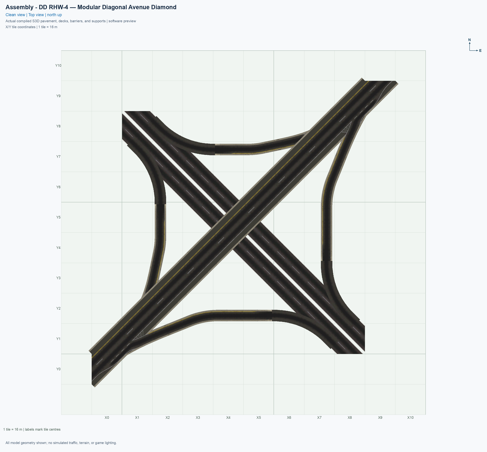

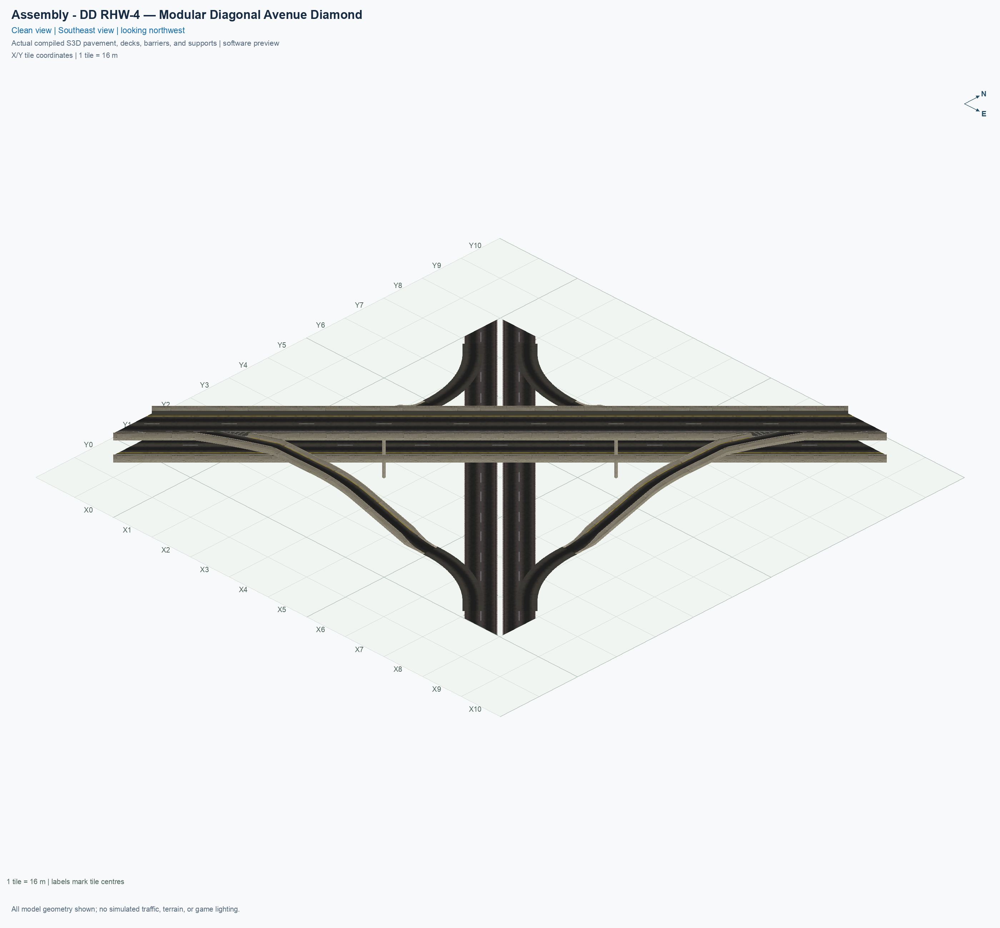

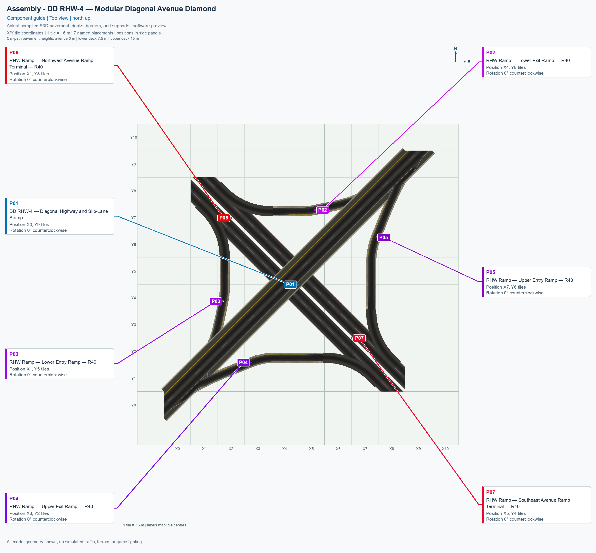

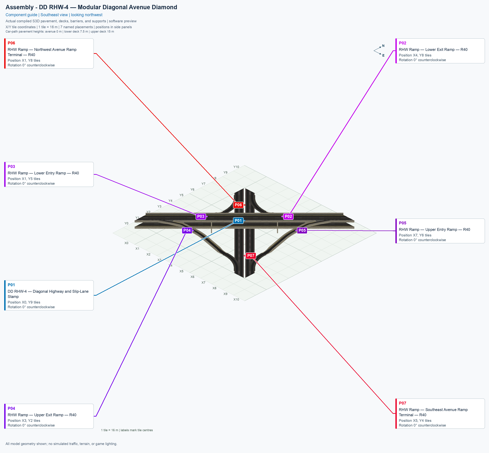

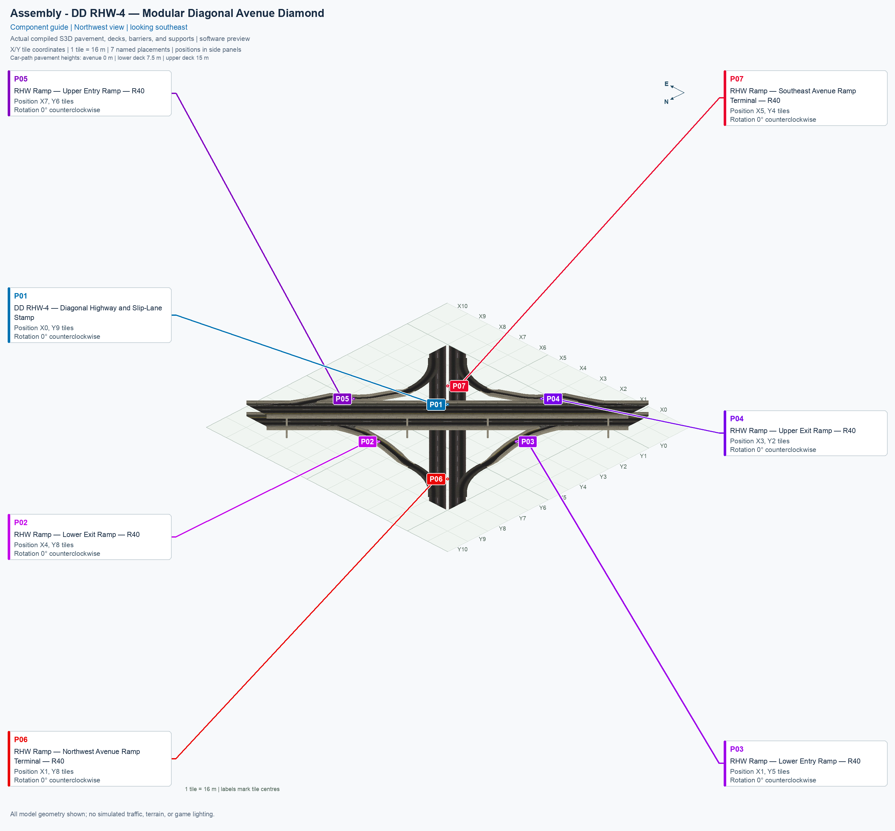

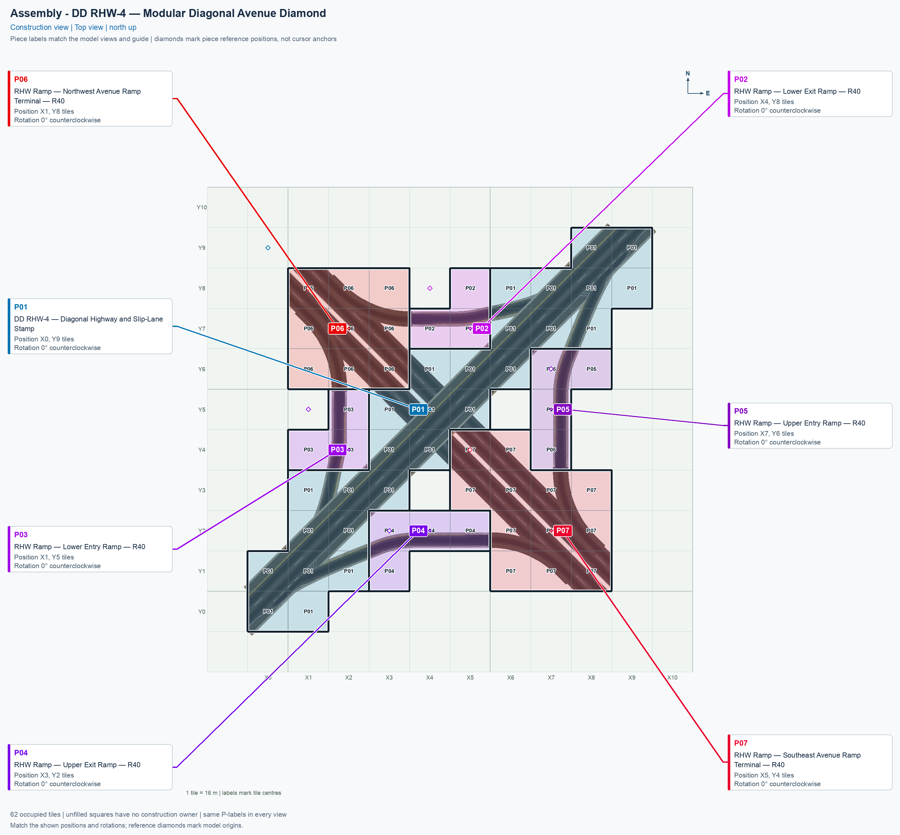

The construction overview places the actual top-view model beneath ownership colours at 30% opacity. Boundaries, placement labels, reference diamonds, and the complete component-name legend remain opaque. Unfilled cells are outside the selected component's ownership; visible native model overhang does not grant another independently placed component the same construction tile.

Two interior cells, (X4, Y3) and (X6, Y5), deliberately have no construction owner in this R40 layout. Small parts of the retained native highway pavement and barrier models remain visible over them. The saved-resource check identifies those faces through the exact retained stamp-model fingerprints; every new R40 ramp and terminal stays within its own owned cells. This specific native overhang does not make the two cells a supported place to stack another traffic piece.

The pictures show a fixed native Avenue ground appearance. In the game, the stamp and terminals use adaptive Avenue artwork: the surrounding development can change visible pedestrian pavement. Pedestrian routes, visible sidewalks, Avenue redraw, and actual travel remain separate checks in [TESTING.md](TESTING.md#4-game-checks).

**R40** identifies the new circular sections' 40 m horizontal centreline radius. The ramps preserve at least 2 m of their original high-end geometry, so the upper ramp's retained collar still contains a tighter measured radius of approximately 29.50 m. The lower descent is approximately 32.18 m long from the stamp boundary to its ground port; the upper descent is approximately 48.66 m. A **port** is the complete measured connection through a tile edge. Both new ground ports are flat and point along a city-grid axis; the separate terminals complete the remaining 45° ground turns into the Avenue.

The retained highway ports are sloped and oblique. Their measured height, direction, grade, and traffic services appear on each component's generated connection cards. The [saved assembly checks](TESTING.md#3-software-checks) separately compare the complete pavement and barrier profiles at the stamp joins. A **grade** is height change divided by horizontal route distance; 20% means a 2 m height change over 10 m horizontally. The new lower ramps reach approximately 25.43%, and the upper ramps retain approximately 29.61%. These are compact game dimensions within the experiment's 30% bound.

## 2. Pieces

Use the exact component names below. Each thumbnail opens the component's full angled preview; **Top view** opens its north-up picture. Standalone component pictures show their authored 0° orientation. The placement table in chapter 3 supplies the assembly position and rotation.

### 2.1 Default seven-component layout

| Standalone angled picture | Component name and permanent piece ID | Placement | Quantity | Occupied tiles per click |
| --- | --- | --- | ---: | ---: |
| [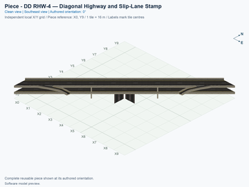](../../00_pieces/ddrhw-modular-highway-stamp/previews/preview.png) [Top view](../../00_pieces/ddrhw-modular-highway-stamp/previews/preview-top.png) | **[DD RHW-4 — Diagonal Highway and Slip-Lane Stamp](../../00_pieces/ddrhw-modular-highway-stamp/README.md)** `ddrhw-modular-highway-stamp` | P01 | 1 | 27 |
| [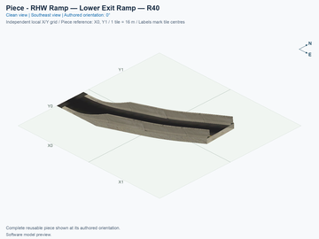](../../00_pieces/ddrhw-modular-lower-exit-r40/previews/preview.png) [Top view](../../00_pieces/ddrhw-modular-lower-exit-r40/previews/preview-top.png) | **[RHW Ramp — Lower Exit Ramp — R40](../../00_pieces/ddrhw-modular-lower-exit-r40/README.md)** `ddrhw-modular-lower-exit-r40` | P02 | 1 | 3 |
| [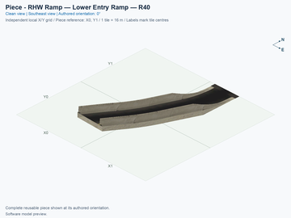](../../00_pieces/ddrhw-modular-lower-entry-r40/previews/preview.png) [Top view](../../00_pieces/ddrhw-modular-lower-entry-r40/previews/preview-top.png) | **[RHW Ramp — Lower Entry Ramp — R40](../../00_pieces/ddrhw-modular-lower-entry-r40/README.md)** `ddrhw-modular-lower-entry-r40` | P03 | 1 | 3 |
| [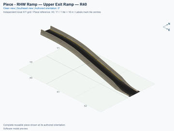](../../00_pieces/ddrhw-modular-upper-exit-r40/previews/preview.png) [Top view](../../00_pieces/ddrhw-modular-upper-exit-r40/previews/preview-top.png) | **[RHW Ramp — Upper Exit Ramp — R40](../../00_pieces/ddrhw-modular-upper-exit-r40/README.md)** `ddrhw-modular-upper-exit-r40` | P04 | 1 | 4 |
| [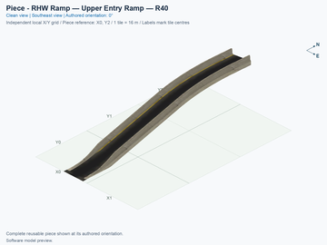](../../00_pieces/ddrhw-modular-upper-entry-r40/previews/preview.png) [Top view](../../00_pieces/ddrhw-modular-upper-entry-r40/previews/preview-top.png) | **[RHW Ramp — Upper Entry Ramp — R40](../../00_pieces/ddrhw-modular-upper-entry-r40/README.md)** `ddrhw-modular-upper-entry-r40` | P05 | 1 | 4 |
| [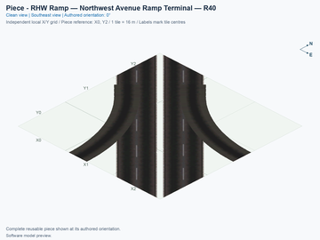](../../00_pieces/ddrhw-modular-northwest-terminal-r40/previews/preview.png) [Top view](../../00_pieces/ddrhw-modular-northwest-terminal-r40/previews/preview-top.png) | **[RHW Ramp — Northwest Avenue Ramp Terminal — R40](../../00_pieces/ddrhw-modular-northwest-terminal-r40/README.md)** `ddrhw-modular-northwest-terminal-r40` | P06 | 1 | 9 |
| [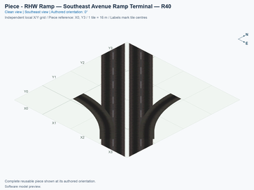](../../00_pieces/ddrhw-modular-southeast-terminal-r40/previews/preview.png) [Top view](../../00_pieces/ddrhw-modular-southeast-terminal-r40/previews/preview-top.png) | **[RHW Ramp — Southeast Avenue Ramp Terminal — R40](../../00_pieces/ddrhw-modular-southeast-terminal-r40/README.md)** `ddrhw-modular-southeast-terminal-r40` | P07 | 1 | 12 |

### 2.2 Retained compact alternatives

These six types keep their individual menu buttons in the modular-kit selection. They are outside the default assembly's seven-component Tab cycle. Keep P01, and replace the matching ramp pair and its terminal together: the two lower compact grades use the compact northwest junction, and the two upper compact grades use the compact southeast junction. The R40 terminal and compact terminal have different joining positions and profiles; do not interchange a terminal alone.

| Standalone angled picture | Component name and permanent piece ID | Replaces in the default layout | Quantity | Occupied tiles per click |
| --- | --- | --- | ---: | ---: |
| [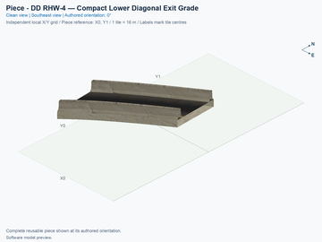](../../00_pieces/ddrhw-diagonal-lower-exit-grade/previews/preview.png) [Top view](../../00_pieces/ddrhw-diagonal-lower-exit-grade/previews/preview-top.png) | **[DD RHW-4 — Compact Lower Diagonal Exit Grade](../../00_pieces/ddrhw-diagonal-lower-exit-grade/README.md)** `ddrhw-diagonal-lower-exit-grade` | P02, with its matching family | 1 | 2 |
| [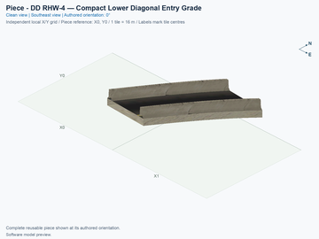](../../00_pieces/ddrhw-diagonal-lower-entry-grade/previews/preview.png) [Top view](../../00_pieces/ddrhw-diagonal-lower-entry-grade/previews/preview-top.png) | **[DD RHW-4 — Compact Lower Diagonal Entry Grade](../../00_pieces/ddrhw-diagonal-lower-entry-grade/README.md)** `ddrhw-diagonal-lower-entry-grade` | P03, with its matching family | 1 | 2 |
| [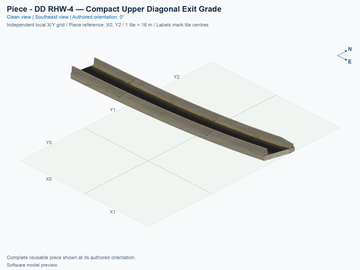](../../00_pieces/ddrhw-diagonal-upper-exit-grade/previews/preview.png) [Top view](../../00_pieces/ddrhw-diagonal-upper-exit-grade/previews/preview-top.png) | **[DD RHW-4 — Compact Upper Diagonal Exit Grade](../../00_pieces/ddrhw-diagonal-upper-exit-grade/README.md)** `ddrhw-diagonal-upper-exit-grade` | P04, with its matching family | 1 | 4 |
| [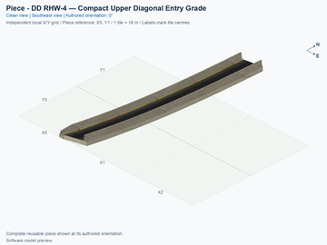](../../00_pieces/ddrhw-diagonal-upper-entry-grade/previews/preview.png) [Top view](../../00_pieces/ddrhw-diagonal-upper-entry-grade/previews/preview-top.png) | **[DD RHW-4 — Compact Upper Diagonal Entry Grade](../../00_pieces/ddrhw-diagonal-upper-entry-grade/README.md)** `ddrhw-diagonal-upper-entry-grade` | P05, with its matching family | 1 | 4 |
| [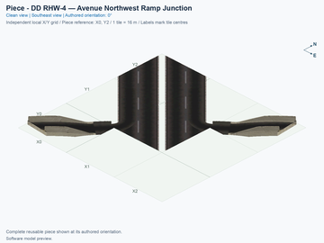](../../00_pieces/ddrhw-diagonal-northwest-junction/previews/preview.png) [Top view](../../00_pieces/ddrhw-diagonal-northwest-junction/previews/preview-top.png) | **[DD RHW-4 — Avenue Northwest Ramp Junction](../../00_pieces/ddrhw-diagonal-northwest-junction/README.md)** `ddrhw-diagonal-northwest-junction` | P06, with both compact lower grades | 1 | 6 |
| [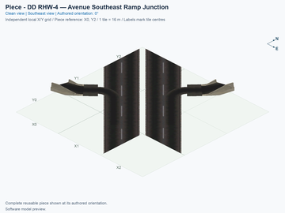](../../00_pieces/ddrhw-diagonal-southeast-junction/previews/preview.png) [Top view](../../00_pieces/ddrhw-diagonal-southeast-junction/previews/preview-top.png) | **[DD RHW-4 — Avenue Southeast Ramp Junction](../../00_pieces/ddrhw-diagonal-southeast-junction/README.md)** `ddrhw-diagonal-southeast-junction` | P07, with both compact upper grades | 1 | 8 |

## 3. Placements

1. Prepare a clear, flat 10 × 10-tile area. Read the pictures with X increasing eastward and Y increasing northward; the southwest tile centre is (X0, Y0). Keep that same reference for every component.
2. Install an explicitly selected, verified experimental build through the [shared installation procedure](../../../../docs/BUILD_AND_INSTALL.md). Building and rendering do not install game files.
3. Open **Transportation → Highways**, and select **SCP | ASSEMBLY | DD RHW-4 — Modular Diagonal Avenue Diamond**.
4. Select P01 first. Press **Tab** to move forward through the seven default types, or **Shift+Tab** to move backward. Press **Home** or **End** to rotate the selected component. Use 0° for every row below.
5. Align P01 with the construction overview, and click once to place the highway stamp. Then select and place P02–P07 separately, using the table. Each listed position is the component's local (column 0, row 0) construction reference. A sparse component can have an empty reference cell: align all occupied cells in the preview, rather than treating an empty reference as a confirmed mouse-click position.
6. Connect matching native diagonal DD RHW-4 approaches at the northeast and southwest highway ends. For the Avenue, open **Transportation → Roads → Avenue**, and drag an ordinary diagonal ground Avenue up to the northwest and southeast outer terminal boundaries. Native approach joining, dragging through occupied cells, and placement over a prebuilt Avenue are distinct game checks.

| Placement | Exact component name | Reference tile | Rotation |
| --- | --- | --- | ---: |
| P01 | DD RHW-4 — Diagonal Highway and Slip-Lane Stamp | (X0, Y9) | 0° |
| P02 | RHW Ramp — Lower Exit Ramp — R40 | (X4, Y8) | 0° |
| P03 | RHW Ramp — Lower Entry Ramp — R40 | (X1, Y5) | 0° |
| P04 | RHW Ramp — Upper Exit Ramp — R40 | (X3, Y2) | 0° |
| P05 | RHW Ramp — Upper Entry Ramp — R40 | (X7, Y6) | 0° |
| P06 | RHW Ramp — Northwest Avenue Ramp Terminal — R40 | (X1, Y8) | 0° |
| P07 | RHW Ramp — Southeast Avenue Ramp Terminal — R40 | (X5, Y4) | 0° |

These positions come from [assembly.jsonc](assembly.jsonc). The highway stamp's exact sloped cuts are fixed; the separate ramp pieces match them without moving the highway. Matching only height is insufficient: use each piece's measured connection cards to check position, direction, slope, and required traffic services, and use the saved assembly checks for the pavement and barrier profiles.

To use the compact alternative, select the individual component buttons named in chapter 2.2, retain P01, and place the following matching groups instead of their R40 counterparts. Every row still uses rotation 0° and the same global X/Y reference. Remove the group being replaced before placing the alternative; two components cannot own the same construction tile.

| Compact alternative component | Reference tile | Matching group |
| --- | --- | --- |
| DD RHW-4 — Compact Lower Diagonal Exit Grade | (X5, Y8) | Lower grades and northwest junction |
| DD RHW-4 — Compact Lower Diagonal Entry Grade | (X1, Y4) | Lower grades and northwest junction |
| DD RHW-4 — Avenue Northwest Ramp Junction | (X2, Y7) | Lower grades and northwest junction |
| DD RHW-4 — Compact Upper Diagonal Exit Grade | (X3, Y3) | Upper grades and southeast junction |
| DD RHW-4 — Compact Upper Diagonal Entry Grade | (X6, Y6) | Upper grades and southeast junction |
| DD RHW-4 — Avenue Southeast Ramp Junction | (X5, Y4) | Upper grades and southeast junction |

The six main pictures depict the default R40 layout. The retained [compact assembly](../ddrhw-l1-and-l2-diagonal-avenue-diamond/README.md) shows the compact ramp geometry. Adaptive pavement, traffic, and placement observations for one layout do not establish results for the other; see [TESTING.md](TESTING.md).

<!-- BEGIN ASSEMBLY CONNECTION MATRIX -->

## 4. Connection matrix

Read **from an entrance row to an exit column**. **Saved PATH** checks the saved traffic route; **Route Query** checks the route shown by the game; **Visible travel** checks a vehicle completing that journey. For HSR, visible travel means a moving train.

**Game appearance:** [?](TESTING.md#case-in_game_render-0c0c36dadab6af0fb0a7) — the complete assembly’s appearance in the game, checked separately from its journeys.

**Legend:** ✅ confirmed; ❌ failed; ? not established. **Forbidden** means the movement is unavailable; its in-game check confirms that it stays unavailable. Click a result for its exact test case. Scope, evidence, and limitations remain in [TESTING](TESTING.md#test-checklist).

| Entrance ↓ / Exit → | **Road · external-1** `external-1` Variant: dd-rhw-l1 | **Road · external-3** `external-3` Variant: dd-rhw-l1 | **Road · external-7** `external-7` Variant: avenue-ground | **Road · external-8** `external-8` Variant: avenue-ground | **Road · external-9** `external-9` Variant: avenue-ground | **Road · external-10** `external-10` Variant: avenue-ground | **Road · external-14** `external-14` Variant: dd-rhw-l2 | **Road · external-16** `external-16` Variant: dd-rhw-l2 | **pedestrian · external-18** `external-18` Variant: avenue-sidewalk | **pedestrian · external-19** `external-19` Variant: avenue-sidewalk |
| --- | --- | --- | --- | --- | --- | --- | --- | --- | --- | --- |
| **Road · external-2** `external-2` Variant: dd-rhw-l2 | **Forbidden** **Saved PATH:** [?](TESTING.md#case-software_connectivity-4f7cd219751f98fe28d6) In-game check: [?](TESTING.md#case-in_game_forbidden_transfer-1e9998b050d26530b1ae) | **Forbidden** **Saved PATH:** [?](TESTING.md#case-software_connectivity-4f7cd219751f98fe28d6) In-game check: [?](TESTING.md#case-in_game_forbidden_transfer-8f84b0fbc0d11e150b0e) | **Forbidden** **Saved PATH:** [?](TESTING.md#case-software_connectivity-4f7cd219751f98fe28d6) In-game check: [?](TESTING.md#case-in_game_forbidden_transfer-4959d5d12e8020a762d1) | **Forbidden** **Saved PATH:** [?](TESTING.md#case-software_connectivity-4f7cd219751f98fe28d6) In-game check: [?](TESTING.md#case-in_game_forbidden_transfer-0c6ad5317c6dce3f4ac1) | **Saved PATH:** [?](TESTING.md#case-software_connectivity-4f7cd219751f98fe28d6) **Route Query:** [?](TESTING.md#case-in_game_route_query-f40919dd6af22e158e52) **Visible travel:** [?](TESTING.md#case-in_game_visible_travel-f40919dd6af22e158e52) | **Forbidden** **Saved PATH:** [?](TESTING.md#case-software_connectivity-4f7cd219751f98fe28d6) In-game check: [?](TESTING.md#case-in_game_forbidden_transfer-c222c0a5b3ffdb1876c7) | **Forbidden** **Saved PATH:** [?](TESTING.md#case-software_connectivity-4f7cd219751f98fe28d6) In-game check: [?](TESTING.md#case-in_game_forbidden_transfer-0fbf968c03853cef5058) | **Saved PATH:** [?](TESTING.md#case-software_connectivity-4f7cd219751f98fe28d6) **Route Query:** [?](TESTING.md#case-in_game_route_query-3dec403284fe91d87129) **Visible travel:** [?](TESTING.md#case-in_game_visible_travel-3dec403284fe91d87129) | **Forbidden** **Saved PATH:** [?](TESTING.md#case-software_connectivity-4f7cd219751f98fe28d6) In-game check: [?](TESTING.md#case-in_game_forbidden_transfer-e6c8aba5afabb9b8ce92) | **Forbidden** **Saved PATH:** [?](TESTING.md#case-software_connectivity-4f7cd219751f98fe28d6) In-game check: [?](TESTING.md#case-in_game_forbidden_transfer-47d0e62e8b3596b5885e) |
| **Road · external-4** `external-4` Variant: dd-rhw-l2 | **Forbidden** **Saved PATH:** [?](TESTING.md#case-software_connectivity-4f7cd219751f98fe28d6) In-game check: [?](TESTING.md#case-in_game_forbidden_transfer-3294baecff92b5d80d2f) | **Forbidden** **Saved PATH:** [?](TESTING.md#case-software_connectivity-4f7cd219751f98fe28d6) In-game check: [?](TESTING.md#case-in_game_forbidden_transfer-1af3eda52dc45cbd5036) | **Forbidden** **Saved PATH:** [?](TESTING.md#case-software_connectivity-4f7cd219751f98fe28d6) In-game check: [?](TESTING.md#case-in_game_forbidden_transfer-cd4a9dad3ed1b8dc5e0a) | **Forbidden** **Saved PATH:** [?](TESTING.md#case-software_connectivity-4f7cd219751f98fe28d6) In-game check: [?](TESTING.md#case-in_game_forbidden_transfer-06b3ca9f5a1a34c67380) | **Forbidden** **Saved PATH:** [?](TESTING.md#case-software_connectivity-4f7cd219751f98fe28d6) In-game check: [?](TESTING.md#case-in_game_forbidden_transfer-7bcb11ce981eaea43788) | **Forbidden** **Saved PATH:** [?](TESTING.md#case-software_connectivity-4f7cd219751f98fe28d6) In-game check: [?](TESTING.md#case-in_game_forbidden_transfer-7f89eede7aa8831e01ab) | **Saved PATH:** [?](TESTING.md#case-software_connectivity-4f7cd219751f98fe28d6) **Route Query:** [?](TESTING.md#case-in_game_route_query-6548ff85569527986ac0) **Visible travel:** [?](TESTING.md#case-in_game_visible_travel-6548ff85569527986ac0) | **Forbidden** **Saved PATH:** [?](TESTING.md#case-software_connectivity-4f7cd219751f98fe28d6) In-game check: [?](TESTING.md#case-in_game_forbidden_transfer-5dbc7bbc1ded5459e2c3) | **Forbidden** **Saved PATH:** [?](TESTING.md#case-software_connectivity-4f7cd219751f98fe28d6) In-game check: [?](TESTING.md#case-in_game_forbidden_transfer-6744115467c873c0eb6a) | **Forbidden** **Saved PATH:** [?](TESTING.md#case-software_connectivity-4f7cd219751f98fe28d6) In-game check: [?](TESTING.md#case-in_game_forbidden_transfer-bed4f3b314f7dfcf0339) |
| **Road · external-5** `external-5` Variant: avenue-ground | **Forbidden** **Saved PATH:** [?](TESTING.md#case-software_connectivity-4f7cd219751f98fe28d6) In-game check: [?](TESTING.md#case-in_game_forbidden_transfer-75df08fc73af47f59e87) | **Saved PATH:** [?](TESTING.md#case-software_connectivity-4f7cd219751f98fe28d6) **Route Query:** [?](TESTING.md#case-in_game_route_query-b619b468ab7724499c99) **Visible travel:** [?](TESTING.md#case-in_game_visible_travel-b619b468ab7724499c99) | **Forbidden** **Saved PATH:** [?](TESTING.md#case-software_connectivity-4f7cd219751f98fe28d6) In-game check: [?](TESTING.md#case-in_game_forbidden_transfer-fa10901ea5060453e145) | **Forbidden** **Saved PATH:** [?](TESTING.md#case-software_connectivity-4f7cd219751f98fe28d6) In-game check: [?](TESTING.md#case-in_game_forbidden_transfer-a8ca046409563ea62674) | **Saved PATH:** [?](TESTING.md#case-software_connectivity-4f7cd219751f98fe28d6) **Route Query:** [?](TESTING.md#case-in_game_route_query-bcc4377a74b9cfcedb97) **Visible travel:** [?](TESTING.md#case-in_game_visible_travel-bcc4377a74b9cfcedb97) | **Forbidden** **Saved PATH:** [?](TESTING.md#case-software_connectivity-4f7cd219751f98fe28d6) In-game check: [?](TESTING.md#case-in_game_forbidden_transfer-c13e9c01658de236c78a) | **Forbidden** **Saved PATH:** [?](TESTING.md#case-software_connectivity-4f7cd219751f98fe28d6) In-game check: [?](TESTING.md#case-in_game_forbidden_transfer-c202463a907fa12e80d6) | **Forbidden** **Saved PATH:** [?](TESTING.md#case-software_connectivity-4f7cd219751f98fe28d6) In-game check: [?](TESTING.md#case-in_game_forbidden_transfer-73b0518de116beaa3a14) | **Forbidden** **Saved PATH:** [?](TESTING.md#case-software_connectivity-4f7cd219751f98fe28d6) In-game check: [?](TESTING.md#case-in_game_forbidden_transfer-47611a374b23870e90a8) | **Forbidden** **Saved PATH:** [?](TESTING.md#case-software_connectivity-4f7cd219751f98fe28d6) In-game check: [?](TESTING.md#case-in_game_forbidden_transfer-76e9ba174ec850c62aa3) |
| **Road · external-6** `external-6` Variant: avenue-ground | **Forbidden** **Saved PATH:** [?](TESTING.md#case-software_connectivity-4f7cd219751f98fe28d6) In-game check: [?](TESTING.md#case-in_game_forbidden_transfer-f4f3684794c789e725ad) | **Forbidden** **Saved PATH:** [?](TESTING.md#case-software_connectivity-4f7cd219751f98fe28d6) In-game check: [?](TESTING.md#case-in_game_forbidden_transfer-e77e963c96f0038556db) | **Forbidden** **Saved PATH:** [?](TESTING.md#case-software_connectivity-4f7cd219751f98fe28d6) In-game check: [?](TESTING.md#case-in_game_forbidden_transfer-8ccce177f9b5ad723f71) | **Forbidden** **Saved PATH:** [?](TESTING.md#case-software_connectivity-4f7cd219751f98fe28d6) In-game check: [?](TESTING.md#case-in_game_forbidden_transfer-d54cc3da132a513444e5) | **Forbidden** **Saved PATH:** [?](TESTING.md#case-software_connectivity-4f7cd219751f98fe28d6) In-game check: [?](TESTING.md#case-in_game_forbidden_transfer-1ca05fbe9de086721974) | **Saved PATH:** [?](TESTING.md#case-software_connectivity-4f7cd219751f98fe28d6) **Route Query:** [?](TESTING.md#case-in_game_route_query-cd4d47a150b5d4076d21) **Visible travel:** [?](TESTING.md#case-in_game_visible_travel-cd4d47a150b5d4076d21) | **Forbidden** **Saved PATH:** [?](TESTING.md#case-software_connectivity-4f7cd219751f98fe28d6) In-game check: [?](TESTING.md#case-in_game_forbidden_transfer-25013e59050ed9175eb1) | **Forbidden** **Saved PATH:** [?](TESTING.md#case-software_connectivity-4f7cd219751f98fe28d6) In-game check: [?](TESTING.md#case-in_game_forbidden_transfer-343277e823b183a7fa75) | **Forbidden** **Saved PATH:** [?](TESTING.md#case-software_connectivity-4f7cd219751f98fe28d6) In-game check: [?](TESTING.md#case-in_game_forbidden_transfer-c15a1f00655c737bb10a) | **Forbidden** **Saved PATH:** [?](TESTING.md#case-software_connectivity-4f7cd219751f98fe28d6) In-game check: [?](TESTING.md#case-in_game_forbidden_transfer-f907224652854050b259) |
| **Road · external-11** `external-11` Variant: avenue-ground | **Forbidden** **Saved PATH:** [?](TESTING.md#case-software_connectivity-4f7cd219751f98fe28d6) In-game check: [?](TESTING.md#case-in_game_forbidden_transfer-d39743956c9f8c700f87) | **Forbidden** **Saved PATH:** [?](TESTING.md#case-software_connectivity-4f7cd219751f98fe28d6) In-game check: [?](TESTING.md#case-in_game_forbidden_transfer-60fecb2683e1e6b5598d) | **Saved PATH:** [?](TESTING.md#case-software_connectivity-4f7cd219751f98fe28d6) **Route Query:** [?](TESTING.md#case-in_game_route_query-15666051e4b7612e28d4) **Visible travel:** [?](TESTING.md#case-in_game_visible_travel-15666051e4b7612e28d4) | **Forbidden** **Saved PATH:** [?](TESTING.md#case-software_connectivity-4f7cd219751f98fe28d6) In-game check: [?](TESTING.md#case-in_game_forbidden_transfer-931d2d759f6cad65d300) | **Forbidden** **Saved PATH:** [?](TESTING.md#case-software_connectivity-4f7cd219751f98fe28d6) In-game check: [?](TESTING.md#case-in_game_forbidden_transfer-16f11d419ecd8b53158a) | **Forbidden** **Saved PATH:** [?](TESTING.md#case-software_connectivity-4f7cd219751f98fe28d6) In-game check: [?](TESTING.md#case-in_game_forbidden_transfer-869fcb69cee5396ba1ec) | **Forbidden** **Saved PATH:** [?](TESTING.md#case-software_connectivity-4f7cd219751f98fe28d6) In-game check: [?](TESTING.md#case-in_game_forbidden_transfer-de1cf8e52147c4b086f7) | **Forbidden** **Saved PATH:** [?](TESTING.md#case-software_connectivity-4f7cd219751f98fe28d6) In-game check: [?](TESTING.md#case-in_game_forbidden_transfer-42611599a1393603ee3e) | **Forbidden** **Saved PATH:** [?](TESTING.md#case-software_connectivity-4f7cd219751f98fe28d6) In-game check: [?](TESTING.md#case-in_game_forbidden_transfer-62b9e157e8769c455e2f) | **Forbidden** **Saved PATH:** [?](TESTING.md#case-software_connectivity-4f7cd219751f98fe28d6) In-game check: [?](TESTING.md#case-in_game_forbidden_transfer-5e3f33b0b1706094cd9a) |
| **Road · external-12** `external-12` Variant: avenue-ground | **Forbidden** **Saved PATH:** [?](TESTING.md#case-software_connectivity-4f7cd219751f98fe28d6) In-game check: [?](TESTING.md#case-in_game_forbidden_transfer-2465aff1d6a1a11a2f2a) | **Forbidden** **Saved PATH:** [?](TESTING.md#case-software_connectivity-4f7cd219751f98fe28d6) In-game check: [?](TESTING.md#case-in_game_forbidden_transfer-d0b4af99eb3569543044) | **Forbidden** **Saved PATH:** [?](TESTING.md#case-software_connectivity-4f7cd219751f98fe28d6) In-game check: [?](TESTING.md#case-in_game_forbidden_transfer-ffe3fdac827c007b3406) | **Saved PATH:** [?](TESTING.md#case-software_connectivity-4f7cd219751f98fe28d6) **Route Query:** [?](TESTING.md#case-in_game_route_query-4a4126f25851cc497054) **Visible travel:** [?](TESTING.md#case-in_game_visible_travel-4a4126f25851cc497054) | **Forbidden** **Saved PATH:** [?](TESTING.md#case-software_connectivity-4f7cd219751f98fe28d6) In-game check: [?](TESTING.md#case-in_game_forbidden_transfer-d6041a82abf4df169f18) | **Forbidden** **Saved PATH:** [?](TESTING.md#case-software_connectivity-4f7cd219751f98fe28d6) In-game check: [?](TESTING.md#case-in_game_forbidden_transfer-13c77830e1d98bc9bc4c) | **Forbidden** **Saved PATH:** [?](TESTING.md#case-software_connectivity-4f7cd219751f98fe28d6) In-game check: [?](TESTING.md#case-in_game_forbidden_transfer-50f24ef68efa0367c298) | **Saved PATH:** [?](TESTING.md#case-software_connectivity-4f7cd219751f98fe28d6) **Route Query:** [?](TESTING.md#case-in_game_route_query-46fbb6b9cdad81416738) **Visible travel:** [?](TESTING.md#case-in_game_visible_travel-46fbb6b9cdad81416738) | **Forbidden** **Saved PATH:** [?](TESTING.md#case-software_connectivity-4f7cd219751f98fe28d6) In-game check: [?](TESTING.md#case-in_game_forbidden_transfer-ef9035d64800b80aa539) | **Forbidden** **Saved PATH:** [?](TESTING.md#case-software_connectivity-4f7cd219751f98fe28d6) In-game check: [?](TESTING.md#case-in_game_forbidden_transfer-cb421b546be34a54e81f) |
| **Road · external-13** `external-13` Variant: dd-rhw-l1 | **Forbidden** **Saved PATH:** [?](TESTING.md#case-software_connectivity-4f7cd219751f98fe28d6) In-game check: [?](TESTING.md#case-in_game_forbidden_transfer-9e5db5cc6f82d86e9158) | **Saved PATH:** [?](TESTING.md#case-software_connectivity-4f7cd219751f98fe28d6) **Route Query:** [?](TESTING.md#case-in_game_route_query-f7b0ee5dc31ef4eb3b30) **Visible travel:** [?](TESTING.md#case-in_game_visible_travel-f7b0ee5dc31ef4eb3b30) | **Forbidden** **Saved PATH:** [?](TESTING.md#case-software_connectivity-4f7cd219751f98fe28d6) In-game check: [?](TESTING.md#case-in_game_forbidden_transfer-c9c6092105c88ec2b0ba) | **Saved PATH:** [?](TESTING.md#case-software_connectivity-4f7cd219751f98fe28d6) **Route Query:** [?](TESTING.md#case-in_game_route_query-173fa22edb651b27ccd8) **Visible travel:** [?](TESTING.md#case-in_game_visible_travel-173fa22edb651b27ccd8) | **Forbidden** **Saved PATH:** [?](TESTING.md#case-software_connectivity-4f7cd219751f98fe28d6) In-game check: [?](TESTING.md#case-in_game_forbidden_transfer-8b14dfb4fe69403e0f69) | **Forbidden** **Saved PATH:** [?](TESTING.md#case-software_connectivity-4f7cd219751f98fe28d6) In-game check: [?](TESTING.md#case-in_game_forbidden_transfer-4efdf2af43bcfcbbc1f7) | **Forbidden** **Saved PATH:** [?](TESTING.md#case-software_connectivity-4f7cd219751f98fe28d6) In-game check: [?](TESTING.md#case-in_game_forbidden_transfer-5ab918464fc68d957871) | **Forbidden** **Saved PATH:** [?](TESTING.md#case-software_connectivity-4f7cd219751f98fe28d6) In-game check: [?](TESTING.md#case-in_game_forbidden_transfer-ce703b550d0eb8dd35ac) | **Forbidden** **Saved PATH:** [?](TESTING.md#case-software_connectivity-4f7cd219751f98fe28d6) In-game check: [?](TESTING.md#case-in_game_forbidden_transfer-5b1fdc1b3f0f55e8a67a) | **Forbidden** **Saved PATH:** [?](TESTING.md#case-software_connectivity-4f7cd219751f98fe28d6) In-game check: [?](TESTING.md#case-in_game_forbidden_transfer-c888e2538af59af4b575) |
| **Road · external-15** `external-15` Variant: dd-rhw-l1 | **Saved PATH:** [?](TESTING.md#case-software_connectivity-4f7cd219751f98fe28d6) **Route Query:** [?](TESTING.md#case-in_game_route_query-133875e31f029041f9b3) **Visible travel:** [?](TESTING.md#case-in_game_visible_travel-133875e31f029041f9b3) | **Forbidden** **Saved PATH:** [?](TESTING.md#case-software_connectivity-4f7cd219751f98fe28d6) In-game check: [?](TESTING.md#case-in_game_forbidden_transfer-8508440c04df3edf7b5b) | **Forbidden** **Saved PATH:** [?](TESTING.md#case-software_connectivity-4f7cd219751f98fe28d6) In-game check: [?](TESTING.md#case-in_game_forbidden_transfer-5775f51f961aab6bc590) | **Forbidden** **Saved PATH:** [?](TESTING.md#case-software_connectivity-4f7cd219751f98fe28d6) In-game check: [?](TESTING.md#case-in_game_forbidden_transfer-4c9f70219511b633fe89) | **Forbidden** **Saved PATH:** [?](TESTING.md#case-software_connectivity-4f7cd219751f98fe28d6) In-game check: [?](TESTING.md#case-in_game_forbidden_transfer-e57ca92cba18004e032c) | **Forbidden** **Saved PATH:** [?](TESTING.md#case-software_connectivity-4f7cd219751f98fe28d6) In-game check: [?](TESTING.md#case-in_game_forbidden_transfer-2e6c7f0917a0c67b629e) | **Forbidden** **Saved PATH:** [?](TESTING.md#case-software_connectivity-4f7cd219751f98fe28d6) In-game check: [?](TESTING.md#case-in_game_forbidden_transfer-90de71f61789de439338) | **Forbidden** **Saved PATH:** [?](TESTING.md#case-software_connectivity-4f7cd219751f98fe28d6) In-game check: [?](TESTING.md#case-in_game_forbidden_transfer-6eeb914fb7a4b7885973) | **Forbidden** **Saved PATH:** [?](TESTING.md#case-software_connectivity-4f7cd219751f98fe28d6) In-game check: [?](TESTING.md#case-in_game_forbidden_transfer-2dbe392663e03b4244c8) | **Forbidden** **Saved PATH:** [?](TESTING.md#case-software_connectivity-4f7cd219751f98fe28d6) In-game check: [?](TESTING.md#case-in_game_forbidden_transfer-3b5b1f3daaae99d56ea7) |
| **pedestrian · external-17** `external-17` Variant: avenue-sidewalk | **Forbidden** **Saved PATH:** [?](TESTING.md#case-software_connectivity-4f7cd219751f98fe28d6) In-game check: [?](TESTING.md#case-in_game_forbidden_transfer-9203e110a5a8bb1c2c6d) | **Forbidden** **Saved PATH:** [?](TESTING.md#case-software_connectivity-4f7cd219751f98fe28d6) In-game check: [?](TESTING.md#case-in_game_forbidden_transfer-836739521f81beedace0) | **Forbidden** **Saved PATH:** [?](TESTING.md#case-software_connectivity-4f7cd219751f98fe28d6) In-game check: [?](TESTING.md#case-in_game_forbidden_transfer-efc466768b1174a1814e) | **Forbidden** **Saved PATH:** [?](TESTING.md#case-software_connectivity-4f7cd219751f98fe28d6) In-game check: [?](TESTING.md#case-in_game_forbidden_transfer-69fae782306fcfa057ce) | **Forbidden** **Saved PATH:** [?](TESTING.md#case-software_connectivity-4f7cd219751f98fe28d6) In-game check: [?](TESTING.md#case-in_game_forbidden_transfer-ae62b88afec1d7dd251c) | **Forbidden** **Saved PATH:** [?](TESTING.md#case-software_connectivity-4f7cd219751f98fe28d6) In-game check: [?](TESTING.md#case-in_game_forbidden_transfer-33c75f3b5d6fd15da3b7) | **Forbidden** **Saved PATH:** [?](TESTING.md#case-software_connectivity-4f7cd219751f98fe28d6) In-game check: [?](TESTING.md#case-in_game_forbidden_transfer-4de1c43dc3257b4adcf4) | **Forbidden** **Saved PATH:** [?](TESTING.md#case-software_connectivity-4f7cd219751f98fe28d6) In-game check: [?](TESTING.md#case-in_game_forbidden_transfer-6cc9c57f5cecfe7dd984) | **Forbidden** **Saved PATH:** [?](TESTING.md#case-software_connectivity-4f7cd219751f98fe28d6) In-game check: [?](TESTING.md#case-in_game_forbidden_transfer-e56e9ef71becf10d4afd) | **Saved PATH:** [?](TESTING.md#case-software_connectivity-4f7cd219751f98fe28d6) **Route Query:** [?](TESTING.md#case-in_game_route_query-f58ba8fc53514f0efc27) **Visible travel:** [?](TESTING.md#case-in_game_visible_travel-f58ba8fc53514f0efc27) |
| **pedestrian · external-20** `external-20` Variant: avenue-sidewalk | **Forbidden** **Saved PATH:** [?](TESTING.md#case-software_connectivity-4f7cd219751f98fe28d6) In-game check: [?](TESTING.md#case-in_game_forbidden_transfer-0a00c33fb988a33af597) | **Forbidden** **Saved PATH:** [?](TESTING.md#case-software_connectivity-4f7cd219751f98fe28d6) In-game check: [?](TESTING.md#case-in_game_forbidden_transfer-324a87db63709c767de3) | **Forbidden** **Saved PATH:** [?](TESTING.md#case-software_connectivity-4f7cd219751f98fe28d6) In-game check: [?](TESTING.md#case-in_game_forbidden_transfer-2a5a5c5168daa0e1007e) | **Forbidden** **Saved PATH:** [?](TESTING.md#case-software_connectivity-4f7cd219751f98fe28d6) In-game check: [?](TESTING.md#case-in_game_forbidden_transfer-05271c5b9188c2b31ea7) | **Forbidden** **Saved PATH:** [?](TESTING.md#case-software_connectivity-4f7cd219751f98fe28d6) In-game check: [?](TESTING.md#case-in_game_forbidden_transfer-fc0da0630a12950703ac) | **Forbidden** **Saved PATH:** [?](TESTING.md#case-software_connectivity-4f7cd219751f98fe28d6) In-game check: [?](TESTING.md#case-in_game_forbidden_transfer-91e9e9f849018b036f24) | **Forbidden** **Saved PATH:** [?](TESTING.md#case-software_connectivity-4f7cd219751f98fe28d6) In-game check: [?](TESTING.md#case-in_game_forbidden_transfer-0fc58a32cd6af3a85213) | **Forbidden** **Saved PATH:** [?](TESTING.md#case-software_connectivity-4f7cd219751f98fe28d6) In-game check: [?](TESTING.md#case-in_game_forbidden_transfer-7dba03633d94b19c3ac3) | **Saved PATH:** [?](TESTING.md#case-software_connectivity-4f7cd219751f98fe28d6) **Route Query:** [?](TESTING.md#case-in_game_route_query-52d5e6376733daad505b) **Visible travel:** [?](TESTING.md#case-in_game_visible_travel-52d5e6376733daad505b) | **Forbidden** **Saved PATH:** [?](TESTING.md#case-software_connectivity-4f7cd219751f98fe28d6) In-game check: [?](TESTING.md#case-in_game_forbidden_transfer-a44afa549adbaf7c155e) |

Source: [connections.json](connections.json).

<!-- END ASSEMBLY CONNECTION MATRIX -->
