# DD RHW-4 — Parallel Diagonal Avenue Diamond — Alignment B

[1. Views](#1-views) · [2. Pieces](#2-pieces) · [3. Placements](#3-placements) · [4. Connection matrix](#4-connection-matrix) · [Testing ↗ (separate document)](TESTING.md)

This modular blueprint is **Alignment B** of the close parallel diagonal diamond. Use it when a diagonal Avenue occupies the adjacent grid alignment beneath the same directed double-decker highway and [Alignment A](../ddrhw-l1-and-l2-diagonal-avenue-parallel-diamond/README.md) cannot meet both networks at once. A grid alignment describes how the two diagonal networks fall on the city's square tile grid. Rotating the whole junction does not change A into B.

The highway remains straight: the lower deck is 7.5 m high and carries traffic southwest, and the upper deck is 15 m high and carries traffic northeast in this north-up reference orientation. Four separate ramps run close and parallel to it and meet the Avenue at 90°, with right turns into or out of the adjacent carriageway only. Relative to A's physical layout, B translates the crossing position and ramp geometry by **8 m east and 8 m north**, while the native DD highway keeps its existing grid phase and directions. The pieces remain fixed placements on whole city tiles; this does not introduce free half-tile dragging.

B uses **15 distinct reusable types, 15 placements, and 34 custom-owned city tiles inside a 9 × 9-tile rectangle**, or **144 × 144 m**. These are B's own allocations and traffic cuts. An Alignment A component must not replace a B component merely because their surfaces look similar. Ordinary Avenue tiles and outside highway approaches are additional to the 34 custom-owned cells.

Open **Transportation → Highways → SCP → Assemblies**, then select **SCP | ASSEMBLY | DD RHW-4 — Parallel Diagonal Avenue Diamond — Alignment B**. **Tab** selects the next B component, **Shift+Tab** selects the previous one, **Home** and **End** rotate it, and **each click places one component**. The Alignment A button starts its own separate cycle. This nested menu requires the Submenus DLL, SC4ResourceLoadingHooks DLL version 2.0.1 or later, and `submenu-essentials.dat`; follow the [shared menu procedure](../../../../docs/BUILD_AND_INSTALL.md#8-prepare-the-assembly-menu).

**Adaptive pavement is implemented on eight custom Avenue cells:** P01 owns three, P02 owns three, and P03 owns two. The game chooses their native pavement appearance from the surrounding development. An Avenue connection alone does not force developed sidewalks. The southeast terminal also meets an ordinary native Avenue centre tile at **X6, Y4**; this is outside its two custom-owned halves and must remain available for the native Avenue connection. The pedestrian routes, pavement appearance, and moving cars require separate checks.

**All fifteen B components use the explicit no-shadow policy.** They retain visible models and traffic paths, while custom shadow carriers and fixed network shadows are disabled. B has new identifiers, so place fresh B components for its first game test. Software results, package creation, installation, and human game observations retain separate scope in [TESTING.md](TESTING.md).

**In-game acceptance recorded on 2026-11-01:** after the complete installation, the user confirmed that all parallel-diamond checks pass. The [authoritative results](TESTING.md#5-results-and-known-issues) bind this aggregate confirmation to the installed candidate and B's 118 current 0° assembly game cases. Preview-image reviews, software cases, standalone component checks, and additional orientations retain their separate evidence.

## 1. Views

These six canonical pictures follow the HSR trumpet's order: clean top, clean southeast, named top, named southeast, named northwest, and construction overview. P01–P15 keep the same names, colours, badges, leaders, and full-name side legends in every named view. X increases east/right, Y increases north/up, and one city tile measures 16 × 16 m. These are software views of the saved model; they do not establish the game's appearance or traffic behavior.

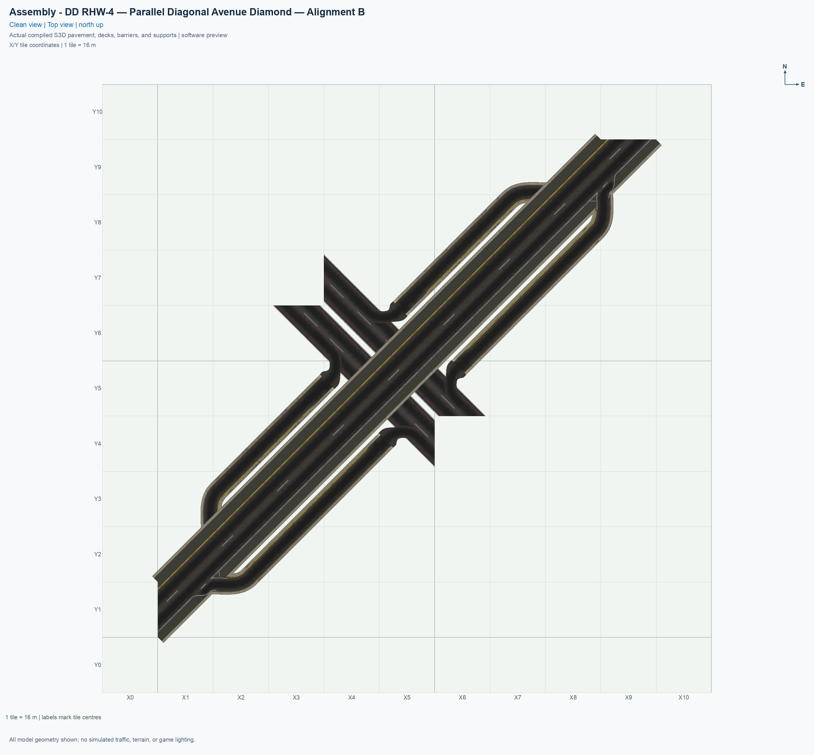

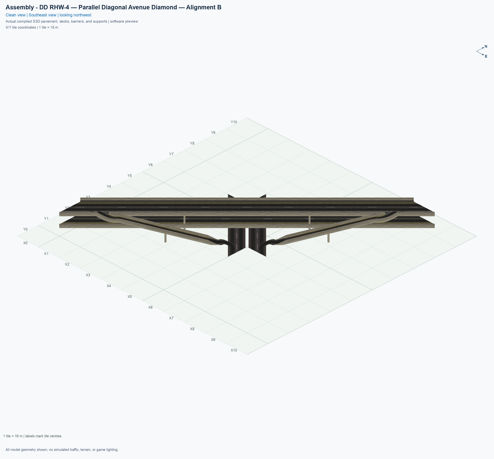

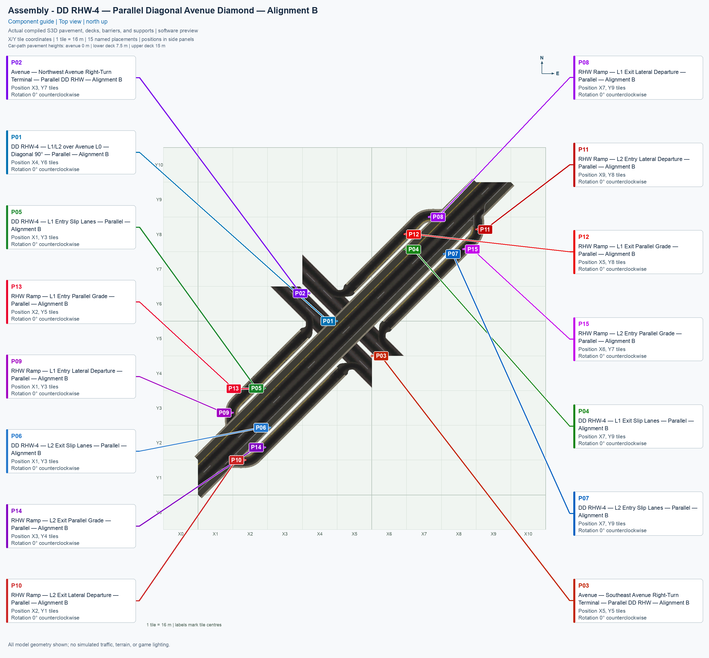

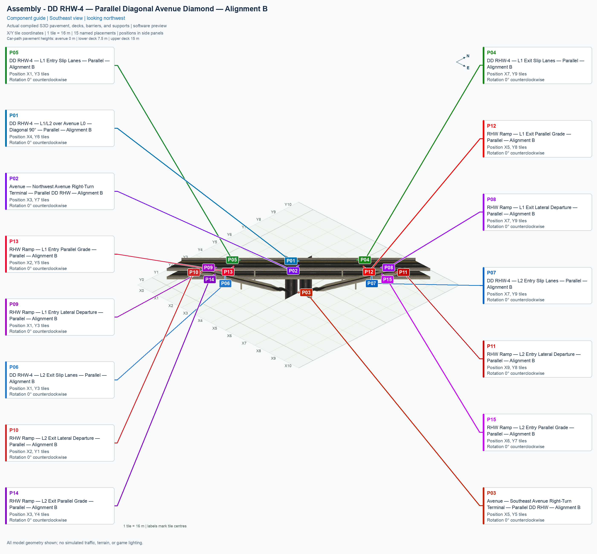

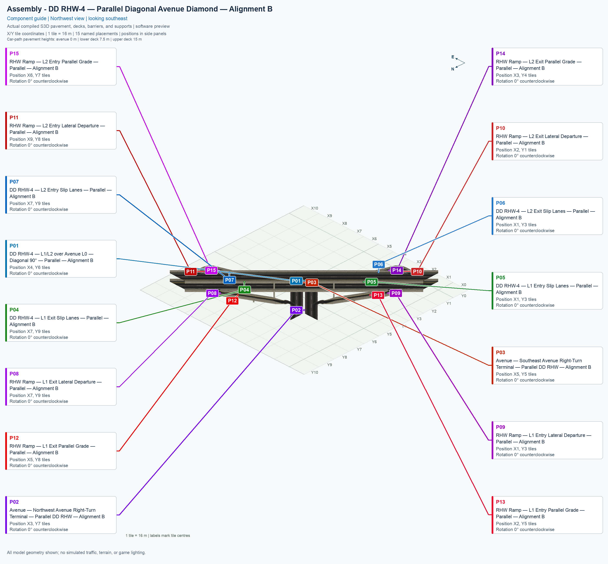

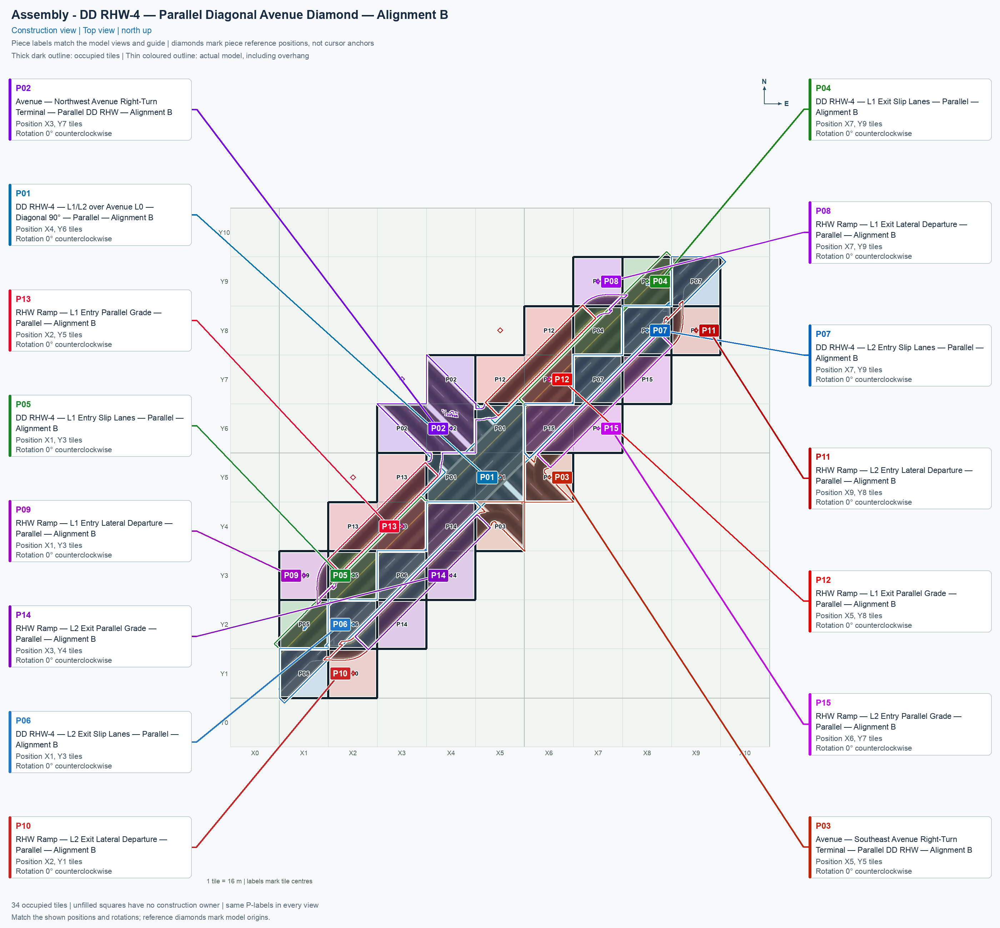

The supplementary comparison below uses one unchanged source-coordinate frame for both alignments. It deliberately does not apply the two guides' different drawing-origin offsets. The fixed DD axis stays in the same place; the crossing position moves 8 m east and 8 m north, or 11.313708 m along that highway axis. The four ramp colours and whole-city-cell outlines explain why B needs different traffic cuts. This is an independent expected-route schematic, not a saved-model preview or a game result.

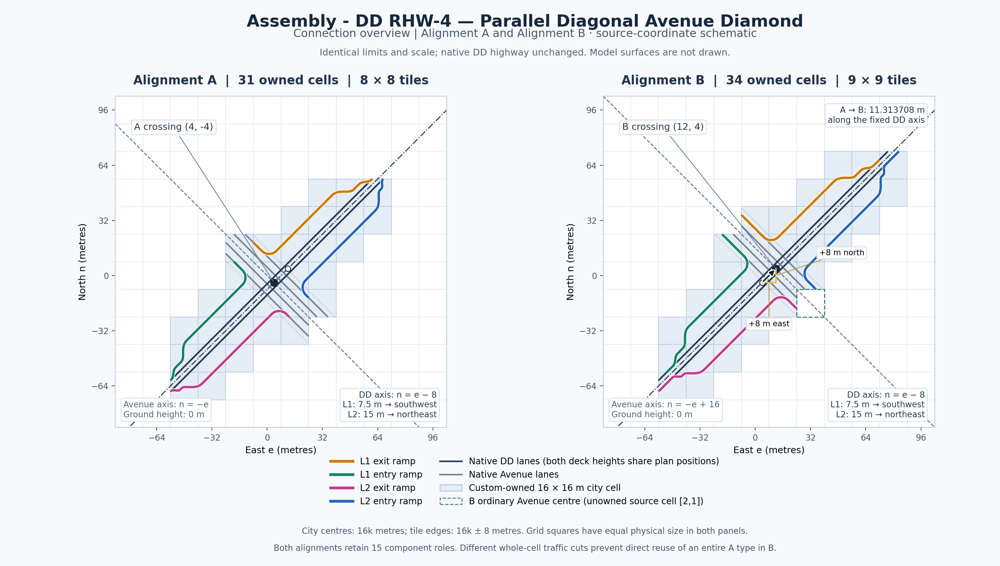

Its [provenance](evidence/alignment-comparison.jsonc) records the source frame, independent route fingerprints, 31-versus-34 ownership, 15 roles in each alignment, the whole-owner traffic comparison, and the output hashes. Reproduce it with the [public drawing tool](../../tools/draw_parallel_alignment_comparison.py); use the six canonical pictures above for the actual saved model.

The construction view shows the actual top-view model beneath translucent ownership colours. Opaque tile borders identify the city squares replaced by a component. Separate outlines trace that component's model projection, including overhang above another plot. Overlapping pictures do not grant overlapping construction ownership or additional traffic routes.

## 2. Pieces

Each row is used once. The order below is the button's forward component cycle. Click a thumbnail for the full angled view, click **Top view** for the north-up view, or click the name for that reusable type's placement instructions.

| Standalone angled picture | Exact menu name and permanent piece ID | Placement | Quantity | Occupied tiles |
| --- | --- | --- | ---: | ---: |
| [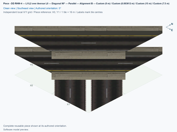](../../00_pieces/ddrhw-parallel-b-crossing/previews/preview.png) [Top view](../../00_pieces/ddrhw-parallel-b-crossing/previews/preview-top.png) | **[DD RHW-4 — L1/L2 over Avenue L0 — Diagonal 90° — Parallel — Alignment B](../../00_pieces/ddrhw-parallel-b-crossing/README.md)** `ddrhw-parallel-b-crossing` | P01 | 1 | 3 |
| [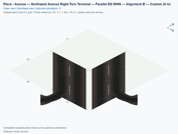](../../00_pieces/ddrhw-parallel-b-northwest-terminal/previews/preview.png) [Top view](../../00_pieces/ddrhw-parallel-b-northwest-terminal/previews/preview-top.png) | **[Avenue — Northwest Avenue Right-Turn Terminal — Parallel DD RHW — Alignment B](../../00_pieces/ddrhw-parallel-b-northwest-terminal/README.md)** `ddrhw-parallel-b-northwest-terminal` | P02 | 1 | 3 |
| [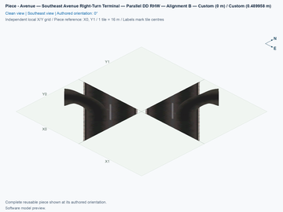](../../00_pieces/ddrhw-parallel-b-southeast-terminal/previews/preview.png) [Top view](../../00_pieces/ddrhw-parallel-b-southeast-terminal/previews/preview-top.png) | **[Avenue — Southeast Avenue Right-Turn Terminal — Parallel DD RHW — Alignment B](../../00_pieces/ddrhw-parallel-b-southeast-terminal/README.md)** `ddrhw-parallel-b-southeast-terminal` | P03 | 1 | 2 |
| [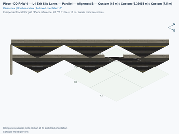](../../00_pieces/ddrhw-parallel-b-lower-exit-slip/previews/preview.png) [Top view](../../00_pieces/ddrhw-parallel-b-lower-exit-slip/previews/preview-top.png) | **[DD RHW-4 — L1 Exit Slip Lanes — Parallel — Alignment B](../../00_pieces/ddrhw-parallel-b-lower-exit-slip/README.md)** `ddrhw-parallel-b-lower-exit-slip` | P04 | 1 | 2 |
| [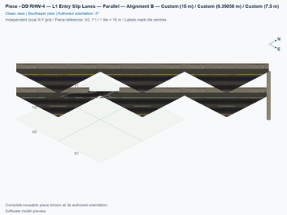](../../00_pieces/ddrhw-parallel-b-lower-entry-slip/previews/preview.png) [Top view](../../00_pieces/ddrhw-parallel-b-lower-entry-slip/previews/preview-top.png) | **[DD RHW-4 — L1 Entry Slip Lanes — Parallel — Alignment B](../../00_pieces/ddrhw-parallel-b-lower-entry-slip/README.md)** `ddrhw-parallel-b-lower-entry-slip` | P05 | 1 | 2 |
| [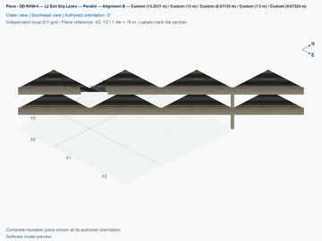](../../00_pieces/ddrhw-parallel-b-upper-exit-slip/previews/preview.png) [Top view](../../00_pieces/ddrhw-parallel-b-upper-exit-slip/previews/preview-top.png) | **[DD RHW-4 — L2 Exit Slip Lanes — Parallel — Alignment B](../../00_pieces/ddrhw-parallel-b-upper-exit-slip/README.md)** `ddrhw-parallel-b-upper-exit-slip` | P06 | 1 | 3 |
| [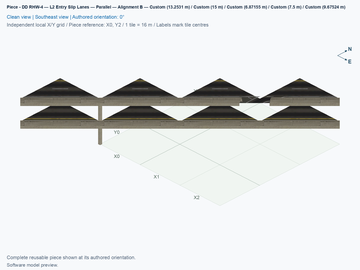](../../00_pieces/ddrhw-parallel-b-upper-entry-slip/previews/preview.png) [Top view](../../00_pieces/ddrhw-parallel-b-upper-entry-slip/previews/preview-top.png) | **[DD RHW-4 — L2 Entry Slip Lanes — Parallel — Alignment B](../../00_pieces/ddrhw-parallel-b-upper-entry-slip/README.md)** `ddrhw-parallel-b-upper-entry-slip` | P07 | 1 | 3 |
| [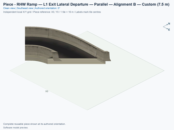](../../00_pieces/ddrhw-parallel-b-lower-exit-departure/previews/preview.png) [Top view](../../00_pieces/ddrhw-parallel-b-lower-exit-departure/previews/preview-top.png) | **[RHW Ramp — L1 Exit Lateral Departure — Parallel — Alignment B](../../00_pieces/ddrhw-parallel-b-lower-exit-departure/README.md)** `ddrhw-parallel-b-lower-exit-departure` | P08 | 1 | 1 |
| [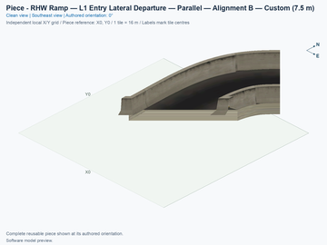](../../00_pieces/ddrhw-parallel-b-lower-entry-departure/previews/preview.png) [Top view](../../00_pieces/ddrhw-parallel-b-lower-entry-departure/previews/preview-top.png) | **[RHW Ramp — L1 Entry Lateral Departure — Parallel — Alignment B](../../00_pieces/ddrhw-parallel-b-lower-entry-departure/README.md)** `ddrhw-parallel-b-lower-entry-departure` | P09 | 1 | 1 |
| [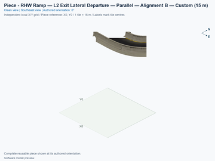](../../00_pieces/ddrhw-parallel-b-upper-exit-departure/previews/preview.png) [Top view](../../00_pieces/ddrhw-parallel-b-upper-exit-departure/previews/preview-top.png) | **[RHW Ramp — L2 Exit Lateral Departure — Parallel — Alignment B](../../00_pieces/ddrhw-parallel-b-upper-exit-departure/README.md)** `ddrhw-parallel-b-upper-exit-departure` | P10 | 1 | 1 |
| [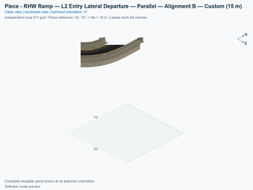](../../00_pieces/ddrhw-parallel-b-upper-entry-departure/previews/preview.png) [Top view](../../00_pieces/ddrhw-parallel-b-upper-entry-departure/previews/preview-top.png) | **[RHW Ramp — L2 Entry Lateral Departure — Parallel — Alignment B](../../00_pieces/ddrhw-parallel-b-upper-entry-departure/README.md)** `ddrhw-parallel-b-upper-entry-departure` | P11 | 1 | 1 |
| [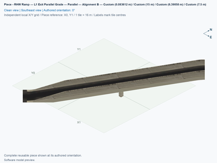](../../00_pieces/ddrhw-parallel-b-lower-exit-grade/previews/preview.png) [Top view](../../00_pieces/ddrhw-parallel-b-lower-exit-grade/previews/preview-top.png) | **[RHW Ramp — L1 Exit Parallel Grade — Parallel — Alignment B](../../00_pieces/ddrhw-parallel-b-lower-exit-grade/README.md)** `ddrhw-parallel-b-lower-exit-grade` | P12 | 1 | 3 |
| [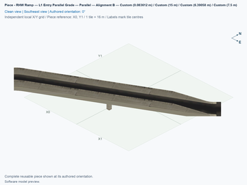](../../00_pieces/ddrhw-parallel-b-lower-entry-grade/previews/preview.png) [Top view](../../00_pieces/ddrhw-parallel-b-lower-entry-grade/previews/preview-top.png) | **[RHW Ramp — L1 Entry Parallel Grade — Parallel — Alignment B](../../00_pieces/ddrhw-parallel-b-lower-entry-grade/README.md)** `ddrhw-parallel-b-lower-entry-grade` | P13 | 1 | 3 |
| [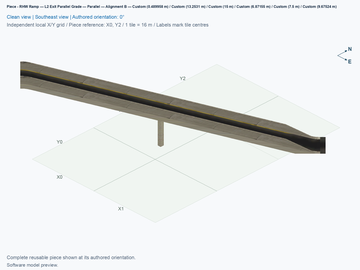](../../00_pieces/ddrhw-parallel-b-upper-exit-grade/previews/preview.png) [Top view](../../00_pieces/ddrhw-parallel-b-upper-exit-grade/previews/preview-top.png) | **[RHW Ramp — L2 Exit Parallel Grade — Parallel — Alignment B](../../00_pieces/ddrhw-parallel-b-upper-exit-grade/README.md)** `ddrhw-parallel-b-upper-exit-grade` | P14 | 1 | 3 |
| [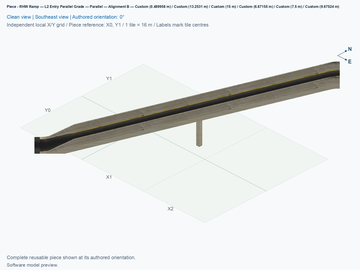](../../00_pieces/ddrhw-parallel-b-upper-entry-grade/previews/preview.png) [Top view](../../00_pieces/ddrhw-parallel-b-upper-entry-grade/previews/preview-top.png) | **[RHW Ramp — L2 Entry Parallel Grade — Parallel — Alignment B](../../00_pieces/ddrhw-parallel-b-upper-entry-grade/README.md)** `ddrhw-parallel-b-upper-entry-grade` | P15 | 1 | 3 |

A **slip lane** is the auxiliary lane between a through lane and a ramp. A **lateral departure** is the flat curve moving that ramp beside the highway. A **grade** is a height change over horizontal distance. These modules retain fixed heights and the close parallel physical profiles; repeating a grade does not create an arbitrary-height system. Match the complete connection card, including direction, height, angle, and slope, before reusing a module in another layout. The fixed native highway phase, whole-cell traffic ownership, and retained physical cuts prevent substitution of whole A types for B types.

## 3. Placements

Use a flat disposable test area. The drawing uses **X0–X10** eastward and **Y0–Y10** northward; the occupied core lies at **X1–X9/Y1–Y9**. Choose one empty square southwest of the layout as X0, Y0, then count whole city-tile steps right for X and up for Y. A construction reference is the source's reference corner, which can itself be empty; match the actual occupied preview squares before clicking. All table placements use the authored **0°** orientation. The aggregate placement confirmation does not provide a separately described mouse-click anchor.

1. Open **Transportation → Highways → SCP → Assemblies**, and select the **Alignment B** button. It starts with **P01**, the crossing. Place P01 at **X4, Y6**. Press **Tab** once, and place **P02**, the northwest terminal, at **X3, Y7**. Press **Tab** once more, and place **P03**, the southeast terminal, at **X5, Y5**. Use this **crossing → northwest terminal → southeast terminal** order for the first test.
2. Place P04–P07, the four straight slip sections, at their table references. P06 and P07 have 3 × 3 bounding footprints with three occupied diagonal cells each. A rectangular preview extent is not a count of replaced plots.
3. Place P08–P11, the four separately owned lateral departures. Some share a reference coordinate with a slip section while occupying another square.
4. Place P12–P15, the four grade components. Their physical surfaces can overhang neighbouring plots, while their owned cells remain distinct. Keep all native through-traffic fragments associated with their B owners.
5. Select **Transportation → Roads → Avenue**, and extend ordinary diagonal Avenue from the northwest and southeast ends. Complete the native southeast centre at **X6, Y4**, which is excluded from the 34 custom cells. Keep that square empty until P03 has been placed. Start with outward connections; dragging Avenue through the complete fixed core or placing it over a prebuilt Avenue are separate game tests.
6. Extend an already working NAM DDRHW-4 highway toward each provided native highway approach. Both decks, their directions, and their boundary positions must match. Reserve the ordinary outside approach tiles at **X0, Y1** beyond P06 and **X9, Y10** beyond P07 in this orientation; the fixed custom components are not direct draggable targets. Test all four proper orientations in separate fresh copies before using a saved city.

| Placement | Exact component name | Construction reference | Rotation | Actual occupied cells | Physical levels |
| --- | --- | --- | --- | --- | --- |
| P01 | DD RHW-4 — L1/L2 over Avenue L0 — Diagonal 90° — Parallel — Alignment B | X4, Y6 | 0° | (X5, Y6), (X4, Y5), (X5, Y5) | Ground Avenue at 0 m; lower deck at 7.5 m; upper deck at 15 m. |
| P02 | Avenue — Northwest Avenue Right-Turn Terminal — Parallel DD RHW — Alignment B | X3, Y7 | 0° | (X4, Y7), (X3, Y6), (X4, Y6) | Ground Avenue and right-turn pavement at 0 m. |
| P03 | Avenue — Southeast Avenue Right-Turn Terminal — Parallel DD RHW — Alignment B | X5, Y5 | 0° | (X6, Y5), (X5, Y4) | Ground Avenue and right-turn pavement at 0 m. |
| P04 | DD RHW-4 — L1 Exit Slip Lanes — Parallel — Alignment B | X7, Y9 | 0° | (X8, Y9), (X7, Y8) | Both native decks at 7.5 m and 15 m; the named access is at 7.5 m. |
| P05 | DD RHW-4 — L1 Entry Slip Lanes — Parallel — Alignment B | X1, Y3 | 0° | (X2, Y3), (X1, Y2) | Both native decks at 7.5 m and 15 m; the named access is at 7.5 m. |
| P06 | DD RHW-4 — L2 Exit Slip Lanes — Parallel — Alignment B | X1, Y3 | 0° | (X3, Y3), (X2, Y2), (X1, Y1) | Both native decks at 7.5 m and 15 m; the named access is at 15 m. |
| P07 | DD RHW-4 — L2 Entry Slip Lanes — Parallel — Alignment B | X7, Y9 | 0° | (X9, Y9), (X8, Y8), (X7, Y7) | Both native decks at 7.5 m and 15 m; the named access is at 15 m. |
| P08 | RHW Ramp — L1 Exit Lateral Departure — Parallel — Alignment B | X7, Y9 | 0° | (X7, Y9) | Flat lateral departure at 7.5 m. |
| P09 | RHW Ramp — L1 Entry Lateral Departure — Parallel — Alignment B | X1, Y3 | 0° | (X1, Y3) | Flat lateral departure at 7.5 m. |
| P10 | RHW Ramp — L2 Exit Lateral Departure — Parallel — Alignment B | X2, Y1 | 0° | (X2, Y1) | Flat lateral departure at 15 m. |
| P11 | RHW Ramp — L2 Entry Lateral Departure — Parallel — Alignment B | X9, Y8 | 0° | (X9, Y8) | Flat lateral departure at 15 m. |
| P12 | RHW Ramp — L1 Exit Parallel Grade — Parallel — Alignment B | X5, Y8 | 0° | (X6, Y8), (X5, Y7), (X6, Y7) | Physical grade between 7.5 m and 0 m; actual cell-edge ports have their own measured intermediate heights. |
| P13 | RHW Ramp — L1 Entry Parallel Grade — Parallel — Alignment B | X2, Y5 | 0° | (X3, Y5), (X2, Y4), (X3, Y4) | Physical grade between 7.5 m and 0 m; actual cell-edge ports have their own measured intermediate heights. |
| P14 | RHW Ramp — L2 Exit Parallel Grade — Parallel — Alignment B | X3, Y4 | 0° | (X4, Y4), (X4, Y3), (X3, Y2) | Physical grade between 15 m and 0 m; actual cell-edge ports have their own measured intermediate heights. |
| P15 | RHW Ramp — L2 Entry Parallel Grade — Parallel — Alignment B | X6, Y7 | 0° | (X8, Y7), (X6, Y6), (X7, Y6) | Physical grade between 15 m and 0 m; actual cell-edge ports have their own measured intermediate heights. |

The crossing and northwest terminal use their empty local **[0,0]** corner as a temporary Road construction helper. The southeast terminal uses local **[1,1]**, the later native centre at X6, Y4. A helper assists the initial placement and is removed by the supported NAM DLL; it adds no permanent custom cell. In this first-placement order, P01's helper is clear before P02 occupies that square. Native Avenue appearance, full model rotation, PATH height retention, traffic movement, and save/reload remain separate acceptance checks.

<!-- BEGIN ASSEMBLY CONNECTION MATRIX -->

## 4. Connection matrix

Read **from an entrance row to an exit column**. **Saved PATH** checks the saved traffic route; **Route Query** checks the route shown by the game; **Visible travel** checks a vehicle completing that journey. For HSR, visible travel means a moving train.

**Game appearance:** [✅](TESTING.md#case-in_game_render-5ff8c8499c1d17798d46) — the complete assembly’s appearance in the game, checked separately from its journeys.

**Legend:** ✅ confirmed; ❌ failed; ? not established. **Forbidden** means the movement is unavailable; its in-game check confirms that it stays unavailable. Click a result for its exact test case. Scope, evidence, and limitations remain in [TESTING](TESTING.md#test-checklist).

| Entrance ↓ / Exit → | **Road · external-1** `external-1` Variant: dd-rhw-l1 | **Road · external-3** `external-3` Variant: dd-rhw-l1 | **Road · external-7** `external-7` Variant: avenue-ground | **Road · external-8** `external-8` Variant: avenue-ground | **Road · external-9** `external-9` Variant: avenue-ground | **Road · external-10** `external-10` Variant: avenue-ground | **Road · external-14** `external-14` Variant: dd-rhw-l2 | **Road · external-16** `external-16` Variant: dd-rhw-l2 | **pedestrian · external-18** `external-18` Variant: avenue-sidewalk | **pedestrian · external-19** `external-19` Variant: avenue-sidewalk |
| --- | --- | --- | --- | --- | --- | --- | --- | --- | --- | --- |
| **Road · external-2** `external-2` Variant: dd-rhw-l2 | **Forbidden** **Saved PATH:** [?](TESTING.md#case-software_connectivity-b985615e2714486d4959) In-game check: [✅](TESTING.md#case-in_game_forbidden_transfer-45ad715584c7027f6711) | **Forbidden** **Saved PATH:** [?](TESTING.md#case-software_connectivity-b985615e2714486d4959) In-game check: [✅](TESTING.md#case-in_game_forbidden_transfer-a77cacd316fb734e83b8) | **Forbidden** **Saved PATH:** [?](TESTING.md#case-software_connectivity-b985615e2714486d4959) In-game check: [✅](TESTING.md#case-in_game_forbidden_transfer-997f06fae33cebaa1bba) | **Forbidden** **Saved PATH:** [?](TESTING.md#case-software_connectivity-b985615e2714486d4959) In-game check: [✅](TESTING.md#case-in_game_forbidden_transfer-3b4d31a4e149e5ee2d08) | **Saved PATH:** [?](TESTING.md#case-software_connectivity-b985615e2714486d4959) **Route Query:** [✅](TESTING.md#case-in_game_route_query-020c39ec9b0178edbe88) **Visible travel:** [✅](TESTING.md#case-in_game_visible_travel-020c39ec9b0178edbe88) | **Forbidden** **Saved PATH:** [?](TESTING.md#case-software_connectivity-b985615e2714486d4959) In-game check: [✅](TESTING.md#case-in_game_forbidden_transfer-aed85a94d17132a210a8) | **Forbidden** **Saved PATH:** [?](TESTING.md#case-software_connectivity-b985615e2714486d4959) In-game check: [✅](TESTING.md#case-in_game_forbidden_transfer-2583769cd77483c2883a) | **Saved PATH:** [?](TESTING.md#case-software_connectivity-b985615e2714486d4959) **Route Query:** [✅](TESTING.md#case-in_game_route_query-edb7331e14f74b0ef127) **Visible travel:** [✅](TESTING.md#case-in_game_visible_travel-edb7331e14f74b0ef127) | **Forbidden** **Saved PATH:** [?](TESTING.md#case-software_connectivity-b985615e2714486d4959) In-game check: [✅](TESTING.md#case-in_game_forbidden_transfer-1d47fcdee69ba5689f8d) | **Forbidden** **Saved PATH:** [?](TESTING.md#case-software_connectivity-b985615e2714486d4959) In-game check: [✅](TESTING.md#case-in_game_forbidden_transfer-8b5cb47978474841bd54) |
| **Road · external-4** `external-4` Variant: dd-rhw-l2 | **Forbidden** **Saved PATH:** [?](TESTING.md#case-software_connectivity-b985615e2714486d4959) In-game check: [✅](TESTING.md#case-in_game_forbidden_transfer-acfbb83678dd3407f723) | **Forbidden** **Saved PATH:** [?](TESTING.md#case-software_connectivity-b985615e2714486d4959) In-game check: [✅](TESTING.md#case-in_game_forbidden_transfer-473d2a4f893950ff86b9) | **Forbidden** **Saved PATH:** [?](TESTING.md#case-software_connectivity-b985615e2714486d4959) In-game check: [✅](TESTING.md#case-in_game_forbidden_transfer-b60af015437751194651) | **Forbidden** **Saved PATH:** [?](TESTING.md#case-software_connectivity-b985615e2714486d4959) In-game check: [✅](TESTING.md#case-in_game_forbidden_transfer-0a97efebee45123a1e62) | **Forbidden** **Saved PATH:** [?](TESTING.md#case-software_connectivity-b985615e2714486d4959) In-game check: [✅](TESTING.md#case-in_game_forbidden_transfer-5b7cbc42d54b1e0ba11b) | **Forbidden** **Saved PATH:** [?](TESTING.md#case-software_connectivity-b985615e2714486d4959) In-game check: [✅](TESTING.md#case-in_game_forbidden_transfer-d3045568f7b1495db89e) | **Saved PATH:** [?](TESTING.md#case-software_connectivity-b985615e2714486d4959) **Route Query:** [✅](TESTING.md#case-in_game_route_query-0613136e337e8c8b42df) **Visible travel:** [✅](TESTING.md#case-in_game_visible_travel-0613136e337e8c8b42df) | **Forbidden** **Saved PATH:** [?](TESTING.md#case-software_connectivity-b985615e2714486d4959) In-game check: [✅](TESTING.md#case-in_game_forbidden_transfer-f3675c4192f7350911b4) | **Forbidden** **Saved PATH:** [?](TESTING.md#case-software_connectivity-b985615e2714486d4959) In-game check: [✅](TESTING.md#case-in_game_forbidden_transfer-8dd1e4db54569bb1adfc) | **Forbidden** **Saved PATH:** [?](TESTING.md#case-software_connectivity-b985615e2714486d4959) In-game check: [✅](TESTING.md#case-in_game_forbidden_transfer-9315643818b6f354d335) |
| **Road · external-5** `external-5` Variant: avenue-ground | **Forbidden** **Saved PATH:** [?](TESTING.md#case-software_connectivity-b985615e2714486d4959) In-game check: [✅](TESTING.md#case-in_game_forbidden_transfer-351113ba5e8f8ded70ae) | **Saved PATH:** [?](TESTING.md#case-software_connectivity-b985615e2714486d4959) **Route Query:** [✅](TESTING.md#case-in_game_route_query-5c83bbe0fc8e886fb0e8) **Visible travel:** [✅](TESTING.md#case-in_game_visible_travel-5c83bbe0fc8e886fb0e8) | **Forbidden** **Saved PATH:** [?](TESTING.md#case-software_connectivity-b985615e2714486d4959) In-game check: [✅](TESTING.md#case-in_game_forbidden_transfer-7858c881e83ff20f1c40) | **Forbidden** **Saved PATH:** [?](TESTING.md#case-software_connectivity-b985615e2714486d4959) In-game check: [✅](TESTING.md#case-in_game_forbidden_transfer-645728b68fb83f114753) | **Saved PATH:** [?](TESTING.md#case-software_connectivity-b985615e2714486d4959) **Route Query:** [✅](TESTING.md#case-in_game_route_query-76146d065cc9bb77cf16) **Visible travel:** [✅](TESTING.md#case-in_game_visible_travel-76146d065cc9bb77cf16) | **Forbidden** **Saved PATH:** [?](TESTING.md#case-software_connectivity-b985615e2714486d4959) In-game check: [✅](TESTING.md#case-in_game_forbidden_transfer-4ae1d027219d754f9fcb) | **Forbidden** **Saved PATH:** [?](TESTING.md#case-software_connectivity-b985615e2714486d4959) In-game check: [✅](TESTING.md#case-in_game_forbidden_transfer-b0fac8f5179eecb61cb5) | **Forbidden** **Saved PATH:** [?](TESTING.md#case-software_connectivity-b985615e2714486d4959) In-game check: [✅](TESTING.md#case-in_game_forbidden_transfer-b4315caca5ac1e8cbd1b) | **Forbidden** **Saved PATH:** [?](TESTING.md#case-software_connectivity-b985615e2714486d4959) In-game check: [✅](TESTING.md#case-in_game_forbidden_transfer-c0b230d65678bdae0b6d) | **Forbidden** **Saved PATH:** [?](TESTING.md#case-software_connectivity-b985615e2714486d4959) In-game check: [✅](TESTING.md#case-in_game_forbidden_transfer-6af10681b1a5f67b542c) |
| **Road · external-6** `external-6` Variant: avenue-ground | **Forbidden** **Saved PATH:** [?](TESTING.md#case-software_connectivity-b985615e2714486d4959) In-game check: [✅](TESTING.md#case-in_game_forbidden_transfer-7eea6cc413d2f1f613af) | **Forbidden** **Saved PATH:** [?](TESTING.md#case-software_connectivity-b985615e2714486d4959) In-game check: [✅](TESTING.md#case-in_game_forbidden_transfer-8692d74b9eecf7961fc6) | **Forbidden** **Saved PATH:** [?](TESTING.md#case-software_connectivity-b985615e2714486d4959) In-game check: [✅](TESTING.md#case-in_game_forbidden_transfer-53c43e75429f0d04ff63) | **Forbidden** **Saved PATH:** [?](TESTING.md#case-software_connectivity-b985615e2714486d4959) In-game check: [✅](TESTING.md#case-in_game_forbidden_transfer-9eb2e941f2ef98bc9fb8) | **Forbidden** **Saved PATH:** [?](TESTING.md#case-software_connectivity-b985615e2714486d4959) In-game check: [✅](TESTING.md#case-in_game_forbidden_transfer-abb98f6c56cfe60bb726) | **Saved PATH:** [?](TESTING.md#case-software_connectivity-b985615e2714486d4959) **Route Query:** [✅](TESTING.md#case-in_game_route_query-3e5a6e0114213701f9d3) **Visible travel:** [✅](TESTING.md#case-in_game_visible_travel-3e5a6e0114213701f9d3) | **Forbidden** **Saved PATH:** [?](TESTING.md#case-software_connectivity-b985615e2714486d4959) In-game check: [✅](TESTING.md#case-in_game_forbidden_transfer-83526822b692eedd2ac2) | **Forbidden** **Saved PATH:** [?](TESTING.md#case-software_connectivity-b985615e2714486d4959) In-game check: [✅](TESTING.md#case-in_game_forbidden_transfer-61fa54d4178c1f80bb2b) | **Forbidden** **Saved PATH:** [?](TESTING.md#case-software_connectivity-b985615e2714486d4959) In-game check: [✅](TESTING.md#case-in_game_forbidden_transfer-c2b79c99ec7d99386b84) | **Forbidden** **Saved PATH:** [?](TESTING.md#case-software_connectivity-b985615e2714486d4959) In-game check: [✅](TESTING.md#case-in_game_forbidden_transfer-472fff7d2758203da1d4) |
| **Road · external-11** `external-11` Variant: avenue-ground | **Forbidden** **Saved PATH:** [?](TESTING.md#case-software_connectivity-b985615e2714486d4959) In-game check: [✅](TESTING.md#case-in_game_forbidden_transfer-ff686f11ceb1c7cd6f8c) | **Forbidden** **Saved PATH:** [?](TESTING.md#case-software_connectivity-b985615e2714486d4959) In-game check: [✅](TESTING.md#case-in_game_forbidden_transfer-e712e38d3365547f5654) | **Saved PATH:** [?](TESTING.md#case-software_connectivity-b985615e2714486d4959) **Route Query:** [✅](TESTING.md#case-in_game_route_query-b72cc2026a9586c58955) **Visible travel:** [✅](TESTING.md#case-in_game_visible_travel-b72cc2026a9586c58955) | **Forbidden** **Saved PATH:** [?](TESTING.md#case-software_connectivity-b985615e2714486d4959) In-game check: [✅](TESTING.md#case-in_game_forbidden_transfer-2ff2463ff14c23ec7ac0) | **Forbidden** **Saved PATH:** [?](TESTING.md#case-software_connectivity-b985615e2714486d4959) In-game check: [✅](TESTING.md#case-in_game_forbidden_transfer-b2838c72770f04ca46ec) | **Forbidden** **Saved PATH:** [?](TESTING.md#case-software_connectivity-b985615e2714486d4959) In-game check: [✅](TESTING.md#case-in_game_forbidden_transfer-0dc43774a73db706779e) | **Forbidden** **Saved PATH:** [?](TESTING.md#case-software_connectivity-b985615e2714486d4959) In-game check: [✅](TESTING.md#case-in_game_forbidden_transfer-6e47c8640b0d0a1c0fb5) | **Forbidden** **Saved PATH:** [?](TESTING.md#case-software_connectivity-b985615e2714486d4959) In-game check: [✅](TESTING.md#case-in_game_forbidden_transfer-843f5a320697189f1af5) | **Forbidden** **Saved PATH:** [?](TESTING.md#case-software_connectivity-b985615e2714486d4959) In-game check: [✅](TESTING.md#case-in_game_forbidden_transfer-ec498c73e7e194e344b5) | **Forbidden** **Saved PATH:** [?](TESTING.md#case-software_connectivity-b985615e2714486d4959) In-game check: [✅](TESTING.md#case-in_game_forbidden_transfer-d1720e6d7c4b8f94ef75) |
| **Road · external-12** `external-12` Variant: avenue-ground | **Forbidden** **Saved PATH:** [?](TESTING.md#case-software_connectivity-b985615e2714486d4959) In-game check: [✅](TESTING.md#case-in_game_forbidden_transfer-658c873316076cfbe823) | **Forbidden** **Saved PATH:** [?](TESTING.md#case-software_connectivity-b985615e2714486d4959) In-game check: [✅](TESTING.md#case-in_game_forbidden_transfer-1d174ffc59b710083491) | **Forbidden** **Saved PATH:** [?](TESTING.md#case-software_connectivity-b985615e2714486d4959) In-game check: [✅](TESTING.md#case-in_game_forbidden_transfer-3cbcb436084b4ccb4a86) | **Saved PATH:** [?](TESTING.md#case-software_connectivity-b985615e2714486d4959) **Route Query:** [✅](TESTING.md#case-in_game_route_query-02c79016dc094030b00a) **Visible travel:** [✅](TESTING.md#case-in_game_visible_travel-02c79016dc094030b00a) | **Forbidden** **Saved PATH:** [?](TESTING.md#case-software_connectivity-b985615e2714486d4959) In-game check: [✅](TESTING.md#case-in_game_forbidden_transfer-ed7af852362f7907deb9) | **Forbidden** **Saved PATH:** [?](TESTING.md#case-software_connectivity-b985615e2714486d4959) In-game check: [✅](TESTING.md#case-in_game_forbidden_transfer-4a98898a848bd58e5e9c) | **Forbidden** **Saved PATH:** [?](TESTING.md#case-software_connectivity-b985615e2714486d4959) In-game check: [✅](TESTING.md#case-in_game_forbidden_transfer-27f36f8cf7193ce8f9c3) | **Saved PATH:** [?](TESTING.md#case-software_connectivity-b985615e2714486d4959) **Route Query:** [✅](TESTING.md#case-in_game_route_query-acb55d5615cc0e49fc6a) **Visible travel:** [✅](TESTING.md#case-in_game_visible_travel-acb55d5615cc0e49fc6a) | **Forbidden** **Saved PATH:** [?](TESTING.md#case-software_connectivity-b985615e2714486d4959) In-game check: [✅](TESTING.md#case-in_game_forbidden_transfer-c7a60dfc29b37c910df2) | **Forbidden** **Saved PATH:** [?](TESTING.md#case-software_connectivity-b985615e2714486d4959) In-game check: [✅](TESTING.md#case-in_game_forbidden_transfer-ff082942fa88dc2ea488) |
| **Road · external-13** `external-13` Variant: dd-rhw-l1 | **Forbidden** **Saved PATH:** [?](TESTING.md#case-software_connectivity-b985615e2714486d4959) In-game check: [✅](TESTING.md#case-in_game_forbidden_transfer-9d3a7a47058ee56867d4) | **Saved PATH:** [?](TESTING.md#case-software_connectivity-b985615e2714486d4959) **Route Query:** [✅](TESTING.md#case-in_game_route_query-c1c3b1d6cc9de4863dc6) **Visible travel:** [✅](TESTING.md#case-in_game_visible_travel-c1c3b1d6cc9de4863dc6) | **Forbidden** **Saved PATH:** [?](TESTING.md#case-software_connectivity-b985615e2714486d4959) In-game check: [✅](TESTING.md#case-in_game_forbidden_transfer-aea9e1fa9d6be23c86a9) | **Saved PATH:** [?](TESTING.md#case-software_connectivity-b985615e2714486d4959) **Route Query:** [✅](TESTING.md#case-in_game_route_query-2deeb28ff4012c1f7c60) **Visible travel:** [✅](TESTING.md#case-in_game_visible_travel-2deeb28ff4012c1f7c60) | **Forbidden** **Saved PATH:** [?](TESTING.md#case-software_connectivity-b985615e2714486d4959) In-game check: [✅](TESTING.md#case-in_game_forbidden_transfer-e41f2edf6ec73c225404) | **Forbidden** **Saved PATH:** [?](TESTING.md#case-software_connectivity-b985615e2714486d4959) In-game check: [✅](TESTING.md#case-in_game_forbidden_transfer-65330cd9e33b4d3c23cf) | **Forbidden** **Saved PATH:** [?](TESTING.md#case-software_connectivity-b985615e2714486d4959) In-game check: [✅](TESTING.md#case-in_game_forbidden_transfer-93182a30f1f0db101ca9) | **Forbidden** **Saved PATH:** [?](TESTING.md#case-software_connectivity-b985615e2714486d4959) In-game check: [✅](TESTING.md#case-in_game_forbidden_transfer-e3f268d2e1901de73aaf) | **Forbidden** **Saved PATH:** [?](TESTING.md#case-software_connectivity-b985615e2714486d4959) In-game check: [✅](TESTING.md#case-in_game_forbidden_transfer-a3b74e7f3ffbbb613acb) | **Forbidden** **Saved PATH:** [?](TESTING.md#case-software_connectivity-b985615e2714486d4959) In-game check: [✅](TESTING.md#case-in_game_forbidden_transfer-5206bd309c49938fae13) |
| **Road · external-15** `external-15` Variant: dd-rhw-l1 | **Saved PATH:** [?](TESTING.md#case-software_connectivity-b985615e2714486d4959) **Route Query:** [✅](TESTING.md#case-in_game_route_query-ac401416d74d1eb1e22a) **Visible travel:** [✅](TESTING.md#case-in_game_visible_travel-ac401416d74d1eb1e22a) | **Forbidden** **Saved PATH:** [?](TESTING.md#case-software_connectivity-b985615e2714486d4959) In-game check: [✅](TESTING.md#case-in_game_forbidden_transfer-a4e788e1b020258465c3) | **Forbidden** **Saved PATH:** [?](TESTING.md#case-software_connectivity-b985615e2714486d4959) In-game check: [✅](TESTING.md#case-in_game_forbidden_transfer-eb279ae09c5a74f5eca2) | **Forbidden** **Saved PATH:** [?](TESTING.md#case-software_connectivity-b985615e2714486d4959) In-game check: [✅](TESTING.md#case-in_game_forbidden_transfer-8af843873794784c501f) | **Forbidden** **Saved PATH:** [?](TESTING.md#case-software_connectivity-b985615e2714486d4959) In-game check: [✅](TESTING.md#case-in_game_forbidden_transfer-caedf1401db3c83aa758) | **Forbidden** **Saved PATH:** [?](TESTING.md#case-software_connectivity-b985615e2714486d4959) In-game check: [✅](TESTING.md#case-in_game_forbidden_transfer-f878eb592942017fc963) | **Forbidden** **Saved PATH:** [?](TESTING.md#case-software_connectivity-b985615e2714486d4959) In-game check: [✅](TESTING.md#case-in_game_forbidden_transfer-09f07564353ba7d7b07b) | **Forbidden** **Saved PATH:** [?](TESTING.md#case-software_connectivity-b985615e2714486d4959) In-game check: [✅](TESTING.md#case-in_game_forbidden_transfer-cfd02f2b0457e0f59485) | **Forbidden** **Saved PATH:** [?](TESTING.md#case-software_connectivity-b985615e2714486d4959) In-game check: [✅](TESTING.md#case-in_game_forbidden_transfer-925eedf3c49ebaa7b19c) | **Forbidden** **Saved PATH:** [?](TESTING.md#case-software_connectivity-b985615e2714486d4959) In-game check: [✅](TESTING.md#case-in_game_forbidden_transfer-71e8eb7c594d8f0c7c8a) |
| **pedestrian · external-17** `external-17` Variant: avenue-sidewalk | **Forbidden** **Saved PATH:** [?](TESTING.md#case-software_connectivity-b985615e2714486d4959) In-game check: [✅](TESTING.md#case-in_game_forbidden_transfer-5f0ecaf6019a10588a09) | **Forbidden** **Saved PATH:** [?](TESTING.md#case-software_connectivity-b985615e2714486d4959) In-game check: [✅](TESTING.md#case-in_game_forbidden_transfer-31ca69ef25c5e9d69014) | **Forbidden** **Saved PATH:** [?](TESTING.md#case-software_connectivity-b985615e2714486d4959) In-game check: [✅](TESTING.md#case-in_game_forbidden_transfer-bd9465e22624ad682f7d) | **Forbidden** **Saved PATH:** [?](TESTING.md#case-software_connectivity-b985615e2714486d4959) In-game check: [✅](TESTING.md#case-in_game_forbidden_transfer-5498c3f09d9b26d7f361) | **Forbidden** **Saved PATH:** [?](TESTING.md#case-software_connectivity-b985615e2714486d4959) In-game check: [✅](TESTING.md#case-in_game_forbidden_transfer-8425d37ead1a47178473) | **Forbidden** **Saved PATH:** [?](TESTING.md#case-software_connectivity-b985615e2714486d4959) In-game check: [✅](TESTING.md#case-in_game_forbidden_transfer-e32c40d6f8592a10431f) | **Forbidden** **Saved PATH:** [?](TESTING.md#case-software_connectivity-b985615e2714486d4959) In-game check: [✅](TESTING.md#case-in_game_forbidden_transfer-11d634fa7068f33bd4a1) | **Forbidden** **Saved PATH:** [?](TESTING.md#case-software_connectivity-b985615e2714486d4959) In-game check: [✅](TESTING.md#case-in_game_forbidden_transfer-e244bf9d35f91c27a676) | **Forbidden** **Saved PATH:** [?](TESTING.md#case-software_connectivity-b985615e2714486d4959) In-game check: [✅](TESTING.md#case-in_game_forbidden_transfer-5e765a60841caa762486) | **Saved PATH:** [?](TESTING.md#case-software_connectivity-b985615e2714486d4959) **Route Query:** [✅](TESTING.md#case-in_game_route_query-82170d5876aed4b95935) **Visible travel:** [✅](TESTING.md#case-in_game_visible_travel-82170d5876aed4b95935) |
| **pedestrian · external-20** `external-20` Variant: avenue-sidewalk | **Forbidden** **Saved PATH:** [?](TESTING.md#case-software_connectivity-b985615e2714486d4959) In-game check: [✅](TESTING.md#case-in_game_forbidden_transfer-33743e69248a46885340) | **Forbidden** **Saved PATH:** [?](TESTING.md#case-software_connectivity-b985615e2714486d4959) In-game check: [✅](TESTING.md#case-in_game_forbidden_transfer-189a807ee875a5bea24c) | **Forbidden** **Saved PATH:** [?](TESTING.md#case-software_connectivity-b985615e2714486d4959) In-game check: [✅](TESTING.md#case-in_game_forbidden_transfer-93f6a5089580c15b28e5) | **Forbidden** **Saved PATH:** [?](TESTING.md#case-software_connectivity-b985615e2714486d4959) In-game check: [✅](TESTING.md#case-in_game_forbidden_transfer-5749326780672e90e156) | **Forbidden** **Saved PATH:** [?](TESTING.md#case-software_connectivity-b985615e2714486d4959) In-game check: [✅](TESTING.md#case-in_game_forbidden_transfer-397f463190f368206765) | **Forbidden** **Saved PATH:** [?](TESTING.md#case-software_connectivity-b985615e2714486d4959) In-game check: [✅](TESTING.md#case-in_game_forbidden_transfer-68ea96a6295cac406818) | **Forbidden** **Saved PATH:** [?](TESTING.md#case-software_connectivity-b985615e2714486d4959) In-game check: [✅](TESTING.md#case-in_game_forbidden_transfer-356df5b50ffa28ba4748) | **Forbidden** **Saved PATH:** [?](TESTING.md#case-software_connectivity-b985615e2714486d4959) In-game check: [✅](TESTING.md#case-in_game_forbidden_transfer-ba53d4350b178517e2a6) | **Saved PATH:** [?](TESTING.md#case-software_connectivity-b985615e2714486d4959) **Route Query:** [✅](TESTING.md#case-in_game_route_query-850a9cc79024893244f1) **Visible travel:** [✅](TESTING.md#case-in_game_visible_travel-850a9cc79024893244f1) | **Forbidden** **Saved PATH:** [?](TESTING.md#case-software_connectivity-b985615e2714486d4959) In-game check: [✅](TESTING.md#case-in_game_forbidden_transfer-d9fd58ae0cc5058f4026) |

Source: [connections.json](connections.json).

<!-- END ASSEMBLY CONNECTION MATRIX -->
