# DD RHW-4 — Parallel Diagonal Avenue Diamond

[1. Views](#1-views) · [2. Pieces](#2-pieces) · [3. Placements](#3-placements) · [4. Connection matrix](#4-connection-matrix) · [Testing ↗ (separate document)](TESTING.md)

This modular blueprint crosses a diagonal ground Avenue with a completely straight NAM double-decker RHW-4 highway. The lower deck is 7.5 m above ground and carries traffic southwest; the upper deck is 15 m high and carries traffic northeast. Each deck retains its two through lanes. Four 6 m-wide elevated ramps move sideways at deck height, run close and parallel to the highway, descend or climb, and meet the Avenue through separate 90° right-turn terminals. Each ground terminal keeps the 6 m join to its grade, narrows smoothly to **3.5 m over 3 m**, and remains narrow through the turn into its Avenue carriageway.

The kit uses **15 reusable types, 15 placements, and 31 occupied tiles inside an 8 × 8-tile rectangle**, or **128 × 128 m**. Each parallel ramp centre is 12 m from the highway axis, leaving a **1 m road-edge gap** between its 3 m half-width and the native highway's 8 m half-width. The drawing retains X0–X9 and Y0–Y9 from the earlier blueprint; this smaller layout occupies X1–X8 and Y1–Y8, without resetting the reference grid. Outside approach roads are additional to the 31 core tiles.

The highway shoulders now provide longer traffic slip lanes and matching white markings within that same footprint. Read from a highway through lane toward its ramp: the **lower deck uses an 8 m smooth sideways taper plus 4 m straight shoulder**, or **12 m**; the **upper deck uses a 5 m taper plus 1 m straight shoulder**, or **6 m**. An on-ramp traverses that profile in reverse. The lower access routes start 6.788225 m farther upstream in already owned highway cells. The upper access routes retain their previous outer ports because their existing owned cells provide less shoulder distance; making them equally long would need a larger traffic footprint. These lengths are measured along the straight highway axis and describe only the shoulder treatment, before the separately owned curved departure.

This accepted layout is **Alignment A**. The [complementary Alignment B](../ddrhw-l1-and-l2-diagonal-avenue-parallel-diamond-alignment-b/README.md) fits the adjacent diagonal Avenue grid position with its own pieces and placement table. Open **Transportation → Highways → SCP | DD RHW-4 — Parallel Diagonal Avenue Diamond**, then choose **SCP | ASSEMBLY | DD RHW-4 — Parallel Diagonal Avenue Diamond — Alignment A**. **Tab** moves forward through A’s fifteen components, **Shift+Tab** moves backward, and **each click places one component**. B has a separate cycle. The submenu requires the Submenus DLL, SC4ResourceLoadingHooks DLL version 2.0.1 or later, and `submenu-essentials.dat`; follow the [shared menu procedure](../../../../docs/BUILD_AND_INSTALL.md#8-prepare-the-assembly-menu). This presentation label preserves A’s accepted source title and pictures. Compilation, installation, and observed game behaviour remain separate stages recorded in [TESTING.md](TESTING.md).

**Adaptive sidewalks are implemented on all nine Avenue tiles**, owned by P01, P02, and P03. The game can select its native pavement appearance in response to nearby development, while attached rotating models retain the highway and ramps above it. Connecting an Avenue alone does not force the developed sidewalk appearance. Its [resource mechanism and exact limits](TESTING.md#3-software-checks) are documented separately from the older successful adaptive probe.

**Current shadow policy:** all fifteen components intentionally supply no cast shadows. The user requested this appearance after reporting that the adjoining draggable DD highway has no visible shadow; this is the stated consistency preference, not an independent measurement of every native DD resource. The previous shadow-carrier repair is historical. After installing the checked revision and restarting, test a **fresh copy on empty, flat land**, including newly placed **P01 and P04–P15**, so older saved attachments do not confuse the result. Check for unwanted remaining shadows at **Medium** and **High**, all camera views, and every zoom. Existing-city cleanup, appearance, save/reload, and demolition remain unverified; follow the [focused no-shadow test](TESTING.md#44-independent-module-shadow-test).

**No-ramp control reported on 2026-11-01:** the user confirms that the through-highway path across the bridge works when the on- and off-ramps are not placed. This is a limited control result, not confirmation of the complete diamond with ramps. The reported scope and remaining unknowns are retained in [Results and known issues](TESTING.md#5-results-and-known-issues).

| Ramp | Traffic arrives from | Traffic leaves towards |
| --- | --- | --- |
| Lower off-ramp | Northeast highway approach, lower deck | Northwest Avenue arm |
| Lower on-ramp | Northwest Avenue arm | Southwest highway arm, lower deck |
| Upper off-ramp | Southwest highway approach, upper deck | Southeast Avenue arm |
| Upper on-ramp | Southeast Avenue arm | Northeast highway arm, upper deck |

Ramp traffic uses only the adjacent Avenue carriageway, meaning the lanes carrying traffic in one direction. There is no turn across the opposing carriageway. The Avenue remains two-way, with its native pedestrian routes retained. Each ramp driveway still crosses the pedestrian route beside its own carriageway; the narrower mouth exposes more native ground artwork beside that crossing, rather than drawing a fixed sidewalk over the ramp asphalt.

The [native highway approach experiment](../../NETWORK_SPEC.md#12-native-highway-approach-experiment) requests one ordinary NAM DD tile immediately outside each highway end when the L2 exit slip and L2 entry slip are freshly placed. Reserve one extra 16 × 16 m approach plot at each end beyond the fixed construction plan. In the pictured 0° layout, these plots are (X0, Y1) beyond P06 and (X8, Y9) beyond P07. Existing placed components do not gain those tiles automatically. Follow the [connection test](TESTING.md#41-native-highway-connection-test) before replacing a saved-city assembly; joining behavior remains unverified in the game.

## 1. Views

These six canonical pictures follow the HSR trumpet's exact order: clean top, clean southeast, named top, named southeast, named northwest, and construction overview. P01–P15 identify the same placements in every named picture; full menu names, colours, badges, and leaders retain that mapping. X increases east/right, Y increases north/up, and one tile is 16 × 16 m.

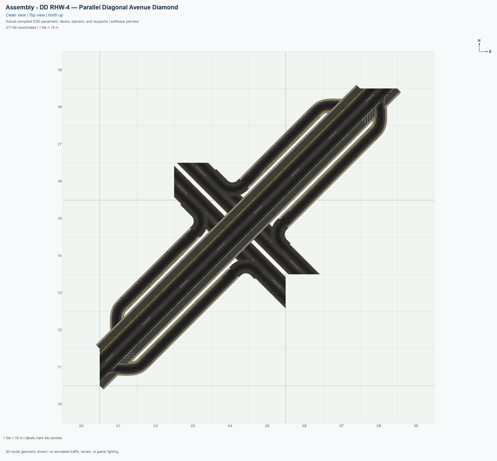

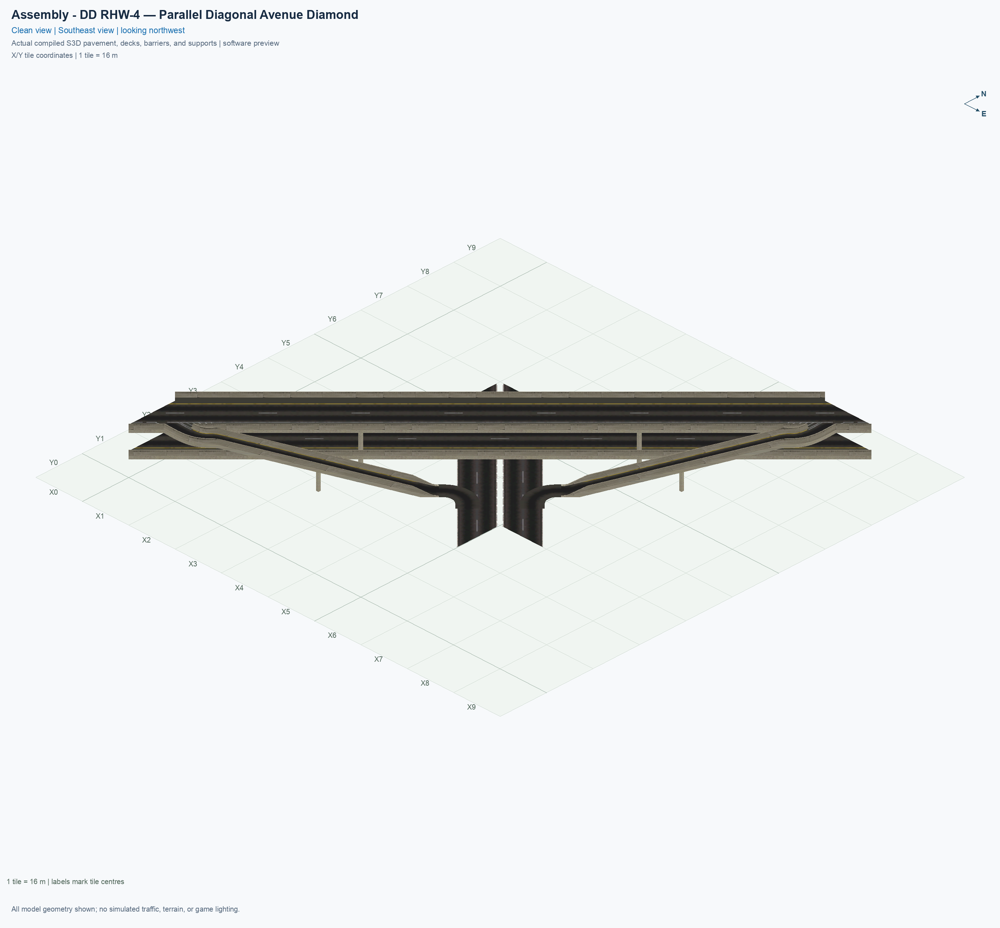

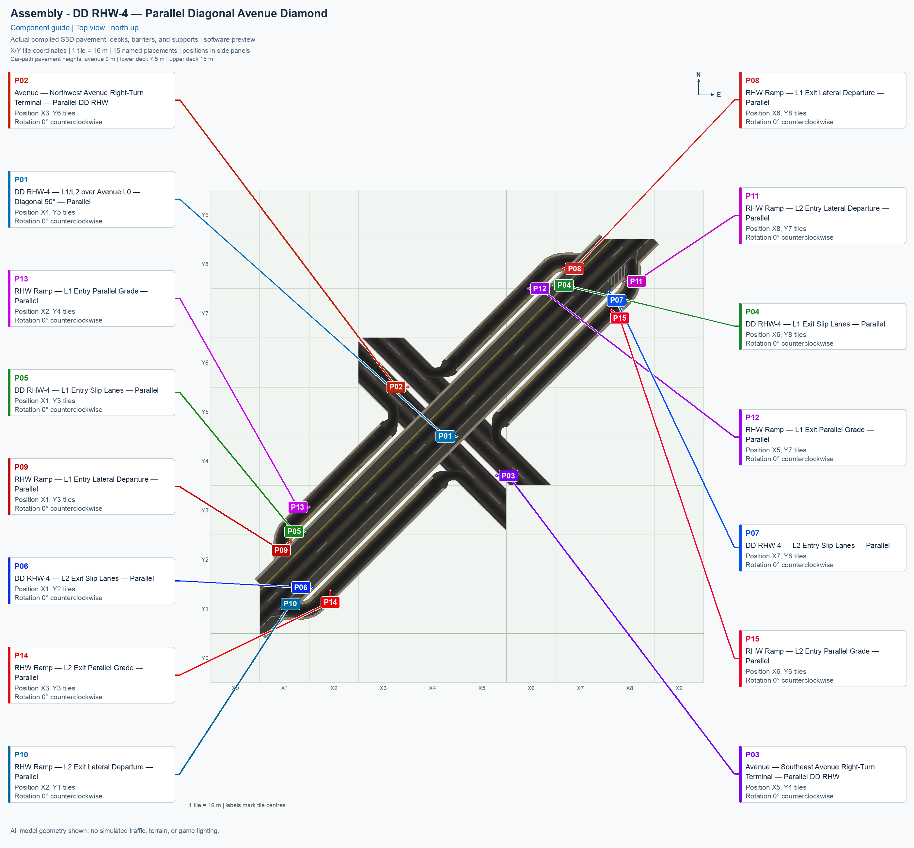

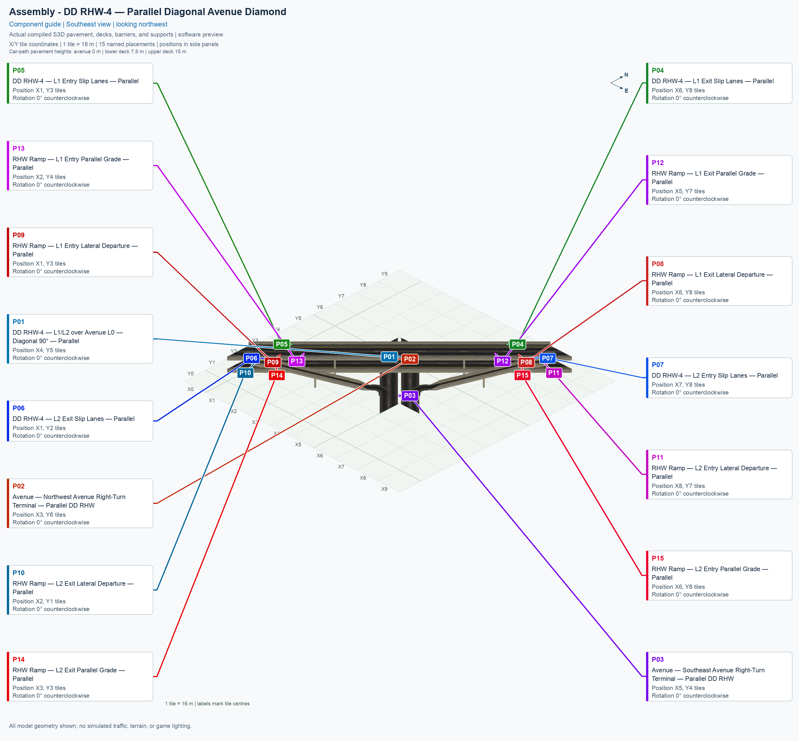

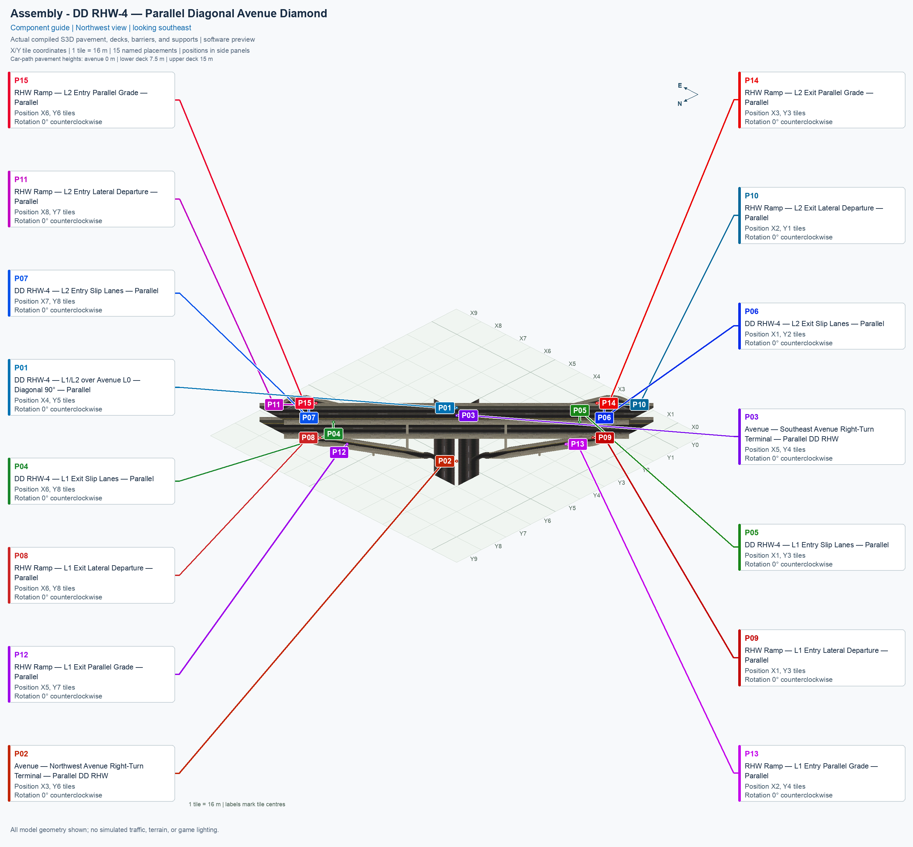

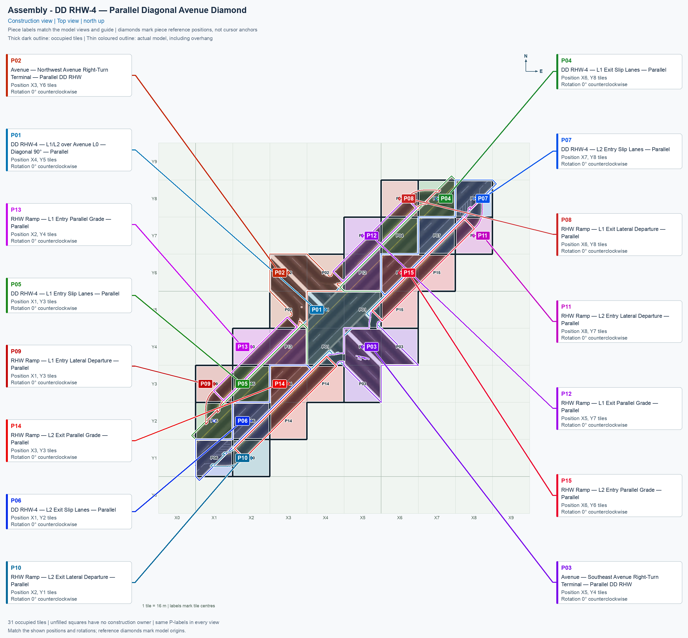

The construction view places translucent ownership colours over the actual compiled top view. Thick boundaries show the city squares occupied by each component. Separate coloured outlines follow its real model projection, including parts drawn over another component's tile. This **model overhang** does not create a second owner or a second traffic resource in that square. It also does not establish vertical clearance by itself.

The [implemented atomization drawing](previews/parallel-atomization.png) shows the saved traffic lines, structural obstacles, ownership borders, and selected functional cuts separately. The curved high departures belong to P08–P11, the straight graded ramp models to P12–P15, and the ground right turns to P02/P03. The native highway remains straight. Whole-tile traffic ownership requires native highway PATH fragments inside the grade components and small outside-deck upper-turn fragments inside P01; those necessary services cannot be replaced by an unchanged generic highway tile.

## 2. Pieces

Each visible thumbnail opens that type's full angled picture; **Top view** opens its north-up view. Standalone pictures show the authored 0° orientation. Every row is used once in this layout, and the table order is the assembly button's forward cycle.

| Standalone angled picture | Exact menu name and permanent piece ID | Placement | Quantity | Occupied tiles |
| --- | --- | --- | ---: | ---: |
| [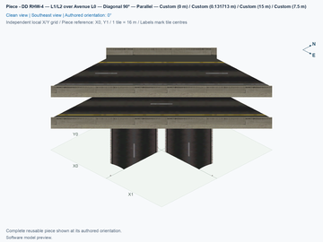](../../00_pieces/ddrhw-parallel-crossing/previews/preview.png) [Top view](../../00_pieces/ddrhw-parallel-crossing/previews/preview-top.png) | **[DD RHW-4 — L1/L2 over Avenue L0 — Diagonal 90° — Parallel](../../00_pieces/ddrhw-parallel-crossing/README.md)** `ddrhw-parallel-crossing` | P01 | 1 | 3 |
| [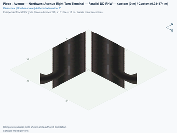](../../00_pieces/ddrhw-parallel-northwest-terminal/previews/preview.png) [Top view](../../00_pieces/ddrhw-parallel-northwest-terminal/previews/preview-top.png) | **[Avenue — Northwest Avenue Right-Turn Terminal — Parallel DD RHW](../../00_pieces/ddrhw-parallel-northwest-terminal/README.md)** `ddrhw-parallel-northwest-terminal` | P02 | 1 | 3 |
| [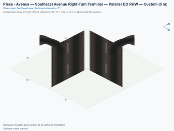](../../00_pieces/ddrhw-parallel-southeast-terminal/previews/preview.png) [Top view](../../00_pieces/ddrhw-parallel-southeast-terminal/previews/preview-top.png) | **[Avenue — Southeast Avenue Right-Turn Terminal — Parallel DD RHW](../../00_pieces/ddrhw-parallel-southeast-terminal/README.md)** `ddrhw-parallel-southeast-terminal` | P03 | 1 | 3 |
| [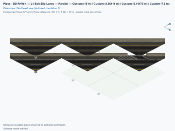](../../00_pieces/ddrhw-parallel-lower-exit-slip/previews/preview.png) [Top view](../../00_pieces/ddrhw-parallel-lower-exit-slip/previews/preview-top.png) | **[DD RHW-4 — L1 Exit Slip Lanes — Parallel](../../00_pieces/ddrhw-parallel-lower-exit-slip/README.md)** `ddrhw-parallel-lower-exit-slip` | P04 | 1 | 2 |
| [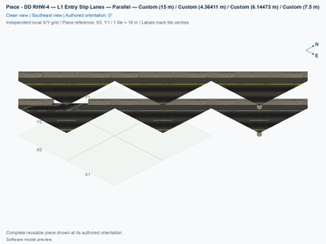](../../00_pieces/ddrhw-parallel-lower-entry-slip/previews/preview.png) [Top view](../../00_pieces/ddrhw-parallel-lower-entry-slip/previews/preview-top.png) | **[DD RHW-4 — L1 Entry Slip Lanes — Parallel](../../00_pieces/ddrhw-parallel-lower-entry-slip/README.md)** `ddrhw-parallel-lower-entry-slip` | P05 | 1 | 2 |
| [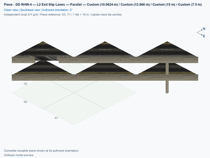](../../00_pieces/ddrhw-parallel-upper-exit-slip/previews/preview.png) [Top view](../../00_pieces/ddrhw-parallel-upper-exit-slip/previews/preview-top.png) | **[DD RHW-4 — L2 Exit Slip Lanes — Parallel](../../00_pieces/ddrhw-parallel-upper-exit-slip/README.md)** `ddrhw-parallel-upper-exit-slip` | P06 | 1 | 2 |
| [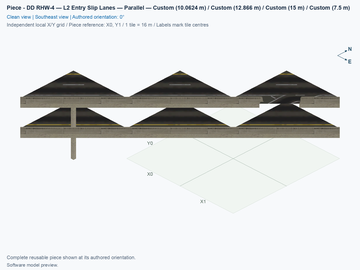](../../00_pieces/ddrhw-parallel-upper-entry-slip/previews/preview.png) [Top view](../../00_pieces/ddrhw-parallel-upper-entry-slip/previews/preview-top.png) | **[DD RHW-4 — L2 Entry Slip Lanes — Parallel](../../00_pieces/ddrhw-parallel-upper-entry-slip/README.md)** `ddrhw-parallel-upper-entry-slip` | P07 | 1 | 2 |
| [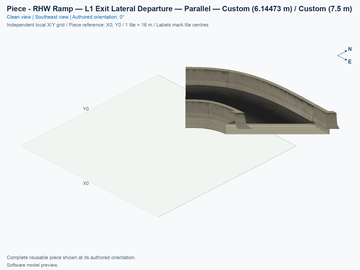](../../00_pieces/ddrhw-parallel-lower-exit-departure/previews/preview.png) [Top view](../../00_pieces/ddrhw-parallel-lower-exit-departure/previews/preview-top.png) | **[RHW Ramp — L1 Exit Lateral Departure — Parallel](../../00_pieces/ddrhw-parallel-lower-exit-departure/README.md)** `ddrhw-parallel-lower-exit-departure` | P08 | 1 | 1 |
| [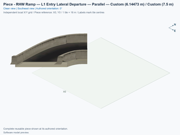](../../00_pieces/ddrhw-parallel-lower-entry-departure/previews/preview.png) [Top view](../../00_pieces/ddrhw-parallel-lower-entry-departure/previews/preview-top.png) | **[RHW Ramp — L1 Entry Lateral Departure — Parallel](../../00_pieces/ddrhw-parallel-lower-entry-departure/README.md)** `ddrhw-parallel-lower-entry-departure` | P09 | 1 | 1 |
| [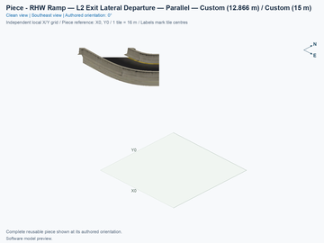](../../00_pieces/ddrhw-parallel-upper-exit-departure/previews/preview.png) [Top view](../../00_pieces/ddrhw-parallel-upper-exit-departure/previews/preview-top.png) | **[RHW Ramp — L2 Exit Lateral Departure — Parallel](../../00_pieces/ddrhw-parallel-upper-exit-departure/README.md)** `ddrhw-parallel-upper-exit-departure` | P10 | 1 | 1 |
| [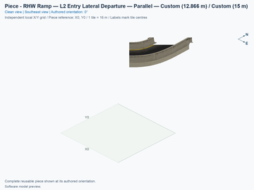](../../00_pieces/ddrhw-parallel-upper-entry-departure/previews/preview.png) [Top view](../../00_pieces/ddrhw-parallel-upper-entry-departure/previews/preview-top.png) | **[RHW Ramp — L2 Entry Lateral Departure — Parallel](../../00_pieces/ddrhw-parallel-upper-entry-departure/README.md)** `ddrhw-parallel-upper-entry-departure` | P11 | 1 | 1 |
| [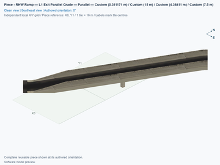](../../00_pieces/ddrhw-parallel-lower-exit-grade/previews/preview.png) [Top view](../../00_pieces/ddrhw-parallel-lower-exit-grade/previews/preview-top.png) | **[RHW Ramp — L1 Exit Parallel Grade — Parallel](../../00_pieces/ddrhw-parallel-lower-exit-grade/README.md)** `ddrhw-parallel-lower-exit-grade` | P12 | 1 | 2 |
| [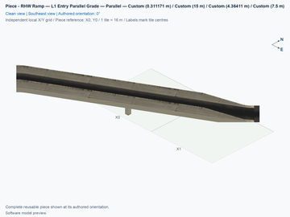](../../00_pieces/ddrhw-parallel-lower-entry-grade/previews/preview.png) [Top view](../../00_pieces/ddrhw-parallel-lower-entry-grade/previews/preview-top.png) | **[RHW Ramp — L1 Entry Parallel Grade — Parallel](../../00_pieces/ddrhw-parallel-lower-entry-grade/README.md)** `ddrhw-parallel-lower-entry-grade` | P13 | 1 | 2 |
| [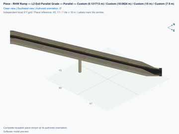](../../00_pieces/ddrhw-parallel-upper-exit-grade/previews/preview.png) [Top view](../../00_pieces/ddrhw-parallel-upper-exit-grade/previews/preview-top.png) | **[RHW Ramp — L2 Exit Parallel Grade — Parallel](../../00_pieces/ddrhw-parallel-upper-exit-grade/README.md)** `ddrhw-parallel-upper-exit-grade` | P14 | 1 | 3 |
| [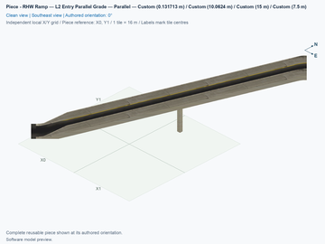](../../00_pieces/ddrhw-parallel-upper-entry-grade/previews/preview.png) [Top view](../../00_pieces/ddrhw-parallel-upper-entry-grade/previews/preview-top.png) | **[RHW Ramp — L2 Entry Parallel Grade — Parallel](../../00_pieces/ddrhw-parallel-upper-entry-grade/README.md)** `ddrhw-parallel-upper-entry-grade` | P15 | 1 | 3 |

A **slip lane** is the auxiliary lane between a highway through lane and a ramp. A **lateral departure** is the flat curved section moving that ramp sideways. A **grade** is height change divided by horizontal distance: 20% means a 2 m change over 10 m horizontally. The grade modules are fixed transitions from 7.5 m or 15 m to ground, with approximately 17.91% lower and 28.20% upper peak slopes; they cannot be repeated indefinitely to choose arbitrary heights. Each R6 terminal turn has a 6 m horizontal centreline radius. These compressed experimental dimensions are not real-road design standards.

Each new straight auxiliary-lane centre sits 5.5 m from the highway axis, within the native deck. Its checked car corridor is 2.5 m wide. The outer edge of that corridor lies 6.75 m from the axis, leaving **0.421875 m** to the native barrier foot at 7.171875 m. This is a corridor-to-barrier measurement on the straight shoulder section, rather than an added pavement width or a claim about real expressway standards. The existing physical barrier openings and separately placed ramp models stay in place.

Only P02 and P03 have the revised narrow ground mouths. Their asphalt changes from 6 m at the grade join to 3.5 m after 3 m, then remains 3.5 m through the turn and its Avenue joining collar. The checked car corridor is 2.5 m wide, leaving 0.5 m of asphalt on each side at the narrowest section. Where a ramp runs beside the Avenue pedestrian centreline, the asphalt edge remains approximately 1.149 m away. That is a route-centreline clearance, not a measured sidewalk width; the actual driveway crossings are separate.

## 3. Placements

Prepare a flat disposable test area before following this reference plan. Choose an empty city square southwest of the junction as the picture’s **X0, Y0** square. Count city-tile steps right for X and up for Y; for example, P01’s X4, Y5 reference is four steps right and five steps up from that chosen square. These are blueprint coordinates, not coordinates displayed by the game. The 8 × 8 core uses the positions below; leave additional room outside its Avenue and highway ends for approach tests. All placements use the authored **0°** orientation. **Home** and **End** rotate the selected component, while **Tab** and **Shift+Tab** choose a different component. Match the actual occupied preview squares, especially where the construction reference lies in an empty corner. The software reference does not establish an observed mouse-click anchor for the new pieces.

1. Open **Transportation → Highways → SCP | DD RHW-4 — Parallel Diagonal Avenue Diamond**, and select **SCP | ASSEMBLY | DD RHW-4 — Parallel Diagonal Avenue Diamond — Alignment A**. Press **Tab** once from P01 to P02, and place **P02** at **X3, Y6**. Press **Shift+Tab** to return to P01, and place **P01** at **X4, Y5**. Press **Tab** twice to select P03, and place **P03** at **X5, Y4**. This sequence leaves each adaptive component's unused helper corner clear during its first placement; occupied-neighbour handling is a separate game test.
2. Cycle forward to P04–P07, and place the four straight slip-lane sections at their table positions. Their 2 × 2 bounding squares contain only two diagonal occupied cells; the reference corner itself is empty.
3. Place P08–P11, the four separate curved high departures. A departure can share a reference coordinate with a slip section while owning a different square. The preview's actual occupied cells decide ownership.
4. Place P12–P15, the four parallel grade sections. Their physical models extend into adjoining components' tiles, but their occupied cells do not overlap. Inspect the layered construction picture before placing any replacement.
5. Select **Transportation → Roads → Avenue**, and extend the exposed northwest and southeast Avenue ends outward. Start at an outside end, and drag away from the core. For the first test, leave the centre as placed; drawing a new Avenue through the whole core and placement over a prebuilt Avenue are separate tests. Check native DD RHW-4 approaches against every required deck boundary before adding the highway ends; matching only one level is insufficient.

| Placement | Exact component name | Construction reference | Rotation | Actual occupied cells | Physical levels |
| --- | --- | --- | --- | --- | --- |
| P01 | DD RHW-4 — L1/L2 over Avenue L0 — Diagonal 90° — Parallel | X4, Y5 | 0° | (X4, Y5), (X5, Y5), (X4, Y4) | 0 m Avenue; 7.5 m L1; 15 m L2 |
| P02 | Avenue — Northwest Avenue Right-Turn Terminal — Parallel DD RHW | X3, Y6 | 0° | (X3, Y6), (X4, Y6), (X3, Y5) | 0 m ground Avenue and right-turn pavement |
| P03 | Avenue — Southeast Avenue Right-Turn Terminal — Parallel DD RHW | X5, Y4 | 0° | (X5, Y4), (X6, Y4), (X5, Y3) | 0 m ground Avenue and right-turn pavement |
| P04 | DD RHW-4 — L1 Exit Slip Lanes — Parallel | X6, Y8 | 0° | (X7, Y8), (X6, Y7) | Both highway levels: 7.5/15 m; named access at 7.5 m |
| P05 | DD RHW-4 — L1 Entry Slip Lanes — Parallel | X1, Y3 | 0° | (X2, Y3), (X1, Y2) | Both highway levels: 7.5/15 m; named access at 7.5 m |
| P06 | DD RHW-4 — L2 Exit Slip Lanes — Parallel | X1, Y2 | 0° | (X2, Y2), (X1, Y1) | Both highway levels: 7.5/15 m; named access at 15 m |
| P07 | DD RHW-4 — L2 Entry Slip Lanes — Parallel | X7, Y8 | 0° | (X8, Y8), (X7, Y7) | Both highway levels: 7.5/15 m; named access at 15 m |
| P08 | RHW Ramp — L1 Exit Lateral Departure — Parallel | X6, Y8 | 0° | (X6, Y8) | Physical departure at 7.5 m and 0% grade |
| P09 | RHW Ramp — L1 Entry Lateral Departure — Parallel | X1, Y3 | 0° | (X1, Y3) | Physical departure at 7.5 m and 0% grade |
| P10 | RHW Ramp — L2 Exit Lateral Departure — Parallel | X2, Y1 | 0° | (X2, Y1) | Physical departure at 15 m and 0% grade |
| P11 | RHW Ramp — L2 Entry Lateral Departure — Parallel | X8, Y7 | 0° | (X8, Y7) | Physical departure at 15 m and 0% grade |
| P12 | RHW Ramp — L1 Exit Parallel Grade — Parallel | X5, Y7 | 0° | (X5, Y7), (X5, Y6) | Physical grade: 7.5 ↔ 0 m; saved tile-edge cuts have their measured intermediate heights |
| P13 | RHW Ramp — L1 Entry Parallel Grade — Parallel | X2, Y4 | 0° | (X2, Y4), (X3, Y4) | Physical grade: 7.5 ↔ 0 m; saved tile-edge cuts have their measured intermediate heights |
| P14 | RHW Ramp — L2 Exit Parallel Grade — Parallel | X3, Y3 | 0° | (X3, Y3), (X4, Y3), (X3, Y2) | Physical grade: 15 ↔ 0 m; saved tile-edge cuts have their measured intermediate heights |
| P15 | RHW Ramp — L2 Entry Parallel Grade — Parallel | X6, Y6 | 0° | (X6, Y6), (X7, Y6), (X6, Y5) | Physical grade: 15 ↔ 0 m; saved tile-edge cuts have their measured intermediate heights |

The three adaptive 2 × 2 components use their unused local **[1,1]** corner as a temporary Road placement handle. NAM's supported DLL removes that helper; it is not permanent construction ownership. All nine Avenue cells already contain the native texture variants, rules, pedestrian routes, and rotating model attachments needed for adaptive ground artwork. The native Avenue texture can respond to surrounding development, while the retained models supply the highway and ramp geometry. Visible sidewalks, pedestrian routes, Avenue redraw, and moving cars are distinct checks; none is approved merely because another one works. See [the exact game test sequence](TESTING.md#4-game-checks).

<!-- BEGIN ASSEMBLY CONNECTION MATRIX -->

## 4. Connection matrix

Read **from an entrance row to an exit column**. **Saved PATH** checks the saved traffic route; **Route Query** checks the route shown by the game; **Visible travel** checks a vehicle completing that journey. For HSR, visible travel means a moving train.

**Game appearance:** [?](TESTING.md#case-in_game_render-df9ef4e05aeff6621a5b) — the complete assembly’s appearance in the game, checked separately from its journeys.

**Legend:** ✅ confirmed; ❌ failed; ? not established. **Forbidden** means the movement is unavailable; its in-game check confirms that it stays unavailable. Click a result for its exact test case. Scope, evidence, and limitations remain in [TESTING](TESTING.md#test-checklist).

| Entrance ↓ / Exit → | **Road · external-1** `external-1` Variant: dd-rhw-l1 | **Road · external-3** `external-3` Variant: dd-rhw-l1 | **Road · external-7** `external-7` Variant: avenue-ground | **Road · external-8** `external-8` Variant: avenue-ground | **Road · external-9** `external-9` Variant: avenue-ground | **Road · external-10** `external-10` Variant: avenue-ground | **Road · external-14** `external-14` Variant: dd-rhw-l2 | **Road · external-16** `external-16` Variant: dd-rhw-l2 | **pedestrian · external-18** `external-18` Variant: avenue-sidewalk | **pedestrian · external-19** `external-19` Variant: avenue-sidewalk |
| --- | --- | --- | --- | --- | --- | --- | --- | --- | --- | --- |
| **Road · external-2** `external-2` Variant: dd-rhw-l2 | **Forbidden** **Saved PATH:** [?](TESTING.md#case-software_connectivity-3fc282b2535ab544443e) In-game check: [?](TESTING.md#case-in_game_forbidden_transfer-7f9e8270fd8608916edd) | **Forbidden** **Saved PATH:** [?](TESTING.md#case-software_connectivity-3fc282b2535ab544443e) In-game check: [?](TESTING.md#case-in_game_forbidden_transfer-910caed083a20d7e7a84) | **Forbidden** **Saved PATH:** [?](TESTING.md#case-software_connectivity-3fc282b2535ab544443e) In-game check: [?](TESTING.md#case-in_game_forbidden_transfer-2f1a48847e162e808115) | **Forbidden** **Saved PATH:** [?](TESTING.md#case-software_connectivity-3fc282b2535ab544443e) In-game check: [?](TESTING.md#case-in_game_forbidden_transfer-05d825d26f483a28ec48) | **Saved PATH:** [?](TESTING.md#case-software_connectivity-3fc282b2535ab544443e) **Route Query:** [?](TESTING.md#case-in_game_route_query-88ff90dc63dafe7621dd) **Visible travel:** [?](TESTING.md#case-in_game_visible_travel-88ff90dc63dafe7621dd) | **Forbidden** **Saved PATH:** [?](TESTING.md#case-software_connectivity-3fc282b2535ab544443e) In-game check: [?](TESTING.md#case-in_game_forbidden_transfer-8ef7ff39f5b07466a89e) | **Forbidden** **Saved PATH:** [?](TESTING.md#case-software_connectivity-3fc282b2535ab544443e) In-game check: [?](TESTING.md#case-in_game_forbidden_transfer-d35d728eaee9116ea7e6) | **Saved PATH:** [?](TESTING.md#case-software_connectivity-3fc282b2535ab544443e) **Route Query:** [?](TESTING.md#case-in_game_route_query-0416e38938bce251b0fd) **Visible travel:** [?](TESTING.md#case-in_game_visible_travel-0416e38938bce251b0fd) | **Forbidden** **Saved PATH:** [?](TESTING.md#case-software_connectivity-3fc282b2535ab544443e) In-game check: [?](TESTING.md#case-in_game_forbidden_transfer-6e1efa5b4b947b5b6dc0) | **Forbidden** **Saved PATH:** [?](TESTING.md#case-software_connectivity-3fc282b2535ab544443e) In-game check: [?](TESTING.md#case-in_game_forbidden_transfer-83c76f96b8119c034736) |
| **Road · external-4** `external-4` Variant: dd-rhw-l2 | **Forbidden** **Saved PATH:** [?](TESTING.md#case-software_connectivity-3fc282b2535ab544443e) In-game check: [?](TESTING.md#case-in_game_forbidden_transfer-f861eab51510e615fbc1) | **Forbidden** **Saved PATH:** [?](TESTING.md#case-software_connectivity-3fc282b2535ab544443e) In-game check: [?](TESTING.md#case-in_game_forbidden_transfer-c5f8357eed78bb1c9018) | **Forbidden** **Saved PATH:** [?](TESTING.md#case-software_connectivity-3fc282b2535ab544443e) In-game check: [?](TESTING.md#case-in_game_forbidden_transfer-84b251491b8c8723652e) | **Forbidden** **Saved PATH:** [?](TESTING.md#case-software_connectivity-3fc282b2535ab544443e) In-game check: [?](TESTING.md#case-in_game_forbidden_transfer-c5d655d3ab1d53609d5a) | **Forbidden** **Saved PATH:** [?](TESTING.md#case-software_connectivity-3fc282b2535ab544443e) In-game check: [?](TESTING.md#case-in_game_forbidden_transfer-494de8c83840c260f40a) | **Forbidden** **Saved PATH:** [?](TESTING.md#case-software_connectivity-3fc282b2535ab544443e) In-game check: [?](TESTING.md#case-in_game_forbidden_transfer-b65dc552d3e459b7572d) | **Saved PATH:** [?](TESTING.md#case-software_connectivity-3fc282b2535ab544443e) **Route Query:** [?](TESTING.md#case-in_game_route_query-534cfa7b2ac7ff969472) **Visible travel:** [?](TESTING.md#case-in_game_visible_travel-534cfa7b2ac7ff969472) | **Forbidden** **Saved PATH:** [?](TESTING.md#case-software_connectivity-3fc282b2535ab544443e) In-game check: [?](TESTING.md#case-in_game_forbidden_transfer-3e32693ab51750277bd4) | **Forbidden** **Saved PATH:** [?](TESTING.md#case-software_connectivity-3fc282b2535ab544443e) In-game check: [?](TESTING.md#case-in_game_forbidden_transfer-f252402a2244d6131807) | **Forbidden** **Saved PATH:** [?](TESTING.md#case-software_connectivity-3fc282b2535ab544443e) In-game check: [?](TESTING.md#case-in_game_forbidden_transfer-7a21f18ccce8e9de534c) |
| **Road · external-5** `external-5` Variant: avenue-ground | **Forbidden** **Saved PATH:** [?](TESTING.md#case-software_connectivity-3fc282b2535ab544443e) In-game check: [?](TESTING.md#case-in_game_forbidden_transfer-dd677a089c7b76830be0) | **Saved PATH:** [?](TESTING.md#case-software_connectivity-3fc282b2535ab544443e) **Route Query:** [?](TESTING.md#case-in_game_route_query-217f36d98365ba353cd5) **Visible travel:** [?](TESTING.md#case-in_game_visible_travel-217f36d98365ba353cd5) | **Forbidden** **Saved PATH:** [?](TESTING.md#case-software_connectivity-3fc282b2535ab544443e) In-game check: [?](TESTING.md#case-in_game_forbidden_transfer-a52b495f5c7b9680bebc) | **Forbidden** **Saved PATH:** [?](TESTING.md#case-software_connectivity-3fc282b2535ab544443e) In-game check: [?](TESTING.md#case-in_game_forbidden_transfer-8d7b64e3610ef561d8fe) | **Saved PATH:** [?](TESTING.md#case-software_connectivity-3fc282b2535ab544443e) **Route Query:** [?](TESTING.md#case-in_game_route_query-48cae13231dfa2e77099) **Visible travel:** [?](TESTING.md#case-in_game_visible_travel-48cae13231dfa2e77099) | **Forbidden** **Saved PATH:** [?](TESTING.md#case-software_connectivity-3fc282b2535ab544443e) In-game check: [?](TESTING.md#case-in_game_forbidden_transfer-a6ab9b04533e16595eb5) | **Forbidden** **Saved PATH:** [?](TESTING.md#case-software_connectivity-3fc282b2535ab544443e) In-game check: [?](TESTING.md#case-in_game_forbidden_transfer-59dbae0d5c744076c467) | **Forbidden** **Saved PATH:** [?](TESTING.md#case-software_connectivity-3fc282b2535ab544443e) In-game check: [?](TESTING.md#case-in_game_forbidden_transfer-ea53b93312075c8b3e43) | **Forbidden** **Saved PATH:** [?](TESTING.md#case-software_connectivity-3fc282b2535ab544443e) In-game check: [?](TESTING.md#case-in_game_forbidden_transfer-4cf06ae83c629354b94e) | **Forbidden** **Saved PATH:** [?](TESTING.md#case-software_connectivity-3fc282b2535ab544443e) In-game check: [?](TESTING.md#case-in_game_forbidden_transfer-5b866caaa0c61ecdc0d5) |
| **Road · external-6** `external-6` Variant: avenue-ground | **Forbidden** **Saved PATH:** [?](TESTING.md#case-software_connectivity-3fc282b2535ab544443e) In-game check: [?](TESTING.md#case-in_game_forbidden_transfer-500048f800080c70936f) | **Forbidden** **Saved PATH:** [?](TESTING.md#case-software_connectivity-3fc282b2535ab544443e) In-game check: [?](TESTING.md#case-in_game_forbidden_transfer-c7ad449f3590bef45213) | **Forbidden** **Saved PATH:** [?](TESTING.md#case-software_connectivity-3fc282b2535ab544443e) In-game check: [?](TESTING.md#case-in_game_forbidden_transfer-0a0baceeec1e2068912f) | **Forbidden** **Saved PATH:** [?](TESTING.md#case-software_connectivity-3fc282b2535ab544443e) In-game check: [?](TESTING.md#case-in_game_forbidden_transfer-f105ff8e4cc155e5a23e) | **Forbidden** **Saved PATH:** [?](TESTING.md#case-software_connectivity-3fc282b2535ab544443e) In-game check: [?](TESTING.md#case-in_game_forbidden_transfer-4e0108db99a20a28e256) | **Saved PATH:** [?](TESTING.md#case-software_connectivity-3fc282b2535ab544443e) **Route Query:** [?](TESTING.md#case-in_game_route_query-480ef7ca711e6f036c2e) **Visible travel:** [?](TESTING.md#case-in_game_visible_travel-480ef7ca711e6f036c2e) | **Forbidden** **Saved PATH:** [?](TESTING.md#case-software_connectivity-3fc282b2535ab544443e) In-game check: [?](TESTING.md#case-in_game_forbidden_transfer-393ad8265653d5da19bb) | **Forbidden** **Saved PATH:** [?](TESTING.md#case-software_connectivity-3fc282b2535ab544443e) In-game check: [?](TESTING.md#case-in_game_forbidden_transfer-5a5b89414c09a60faea8) | **Forbidden** **Saved PATH:** [?](TESTING.md#case-software_connectivity-3fc282b2535ab544443e) In-game check: [?](TESTING.md#case-in_game_forbidden_transfer-8dd1c84805e5d5c726bc) | **Forbidden** **Saved PATH:** [?](TESTING.md#case-software_connectivity-3fc282b2535ab544443e) In-game check: [?](TESTING.md#case-in_game_forbidden_transfer-5de555cead3127945fff) |
| **Road · external-11** `external-11` Variant: avenue-ground | **Forbidden** **Saved PATH:** [?](TESTING.md#case-software_connectivity-3fc282b2535ab544443e) In-game check: [?](TESTING.md#case-in_game_forbidden_transfer-4b749d5278607f375735) | **Forbidden** **Saved PATH:** [?](TESTING.md#case-software_connectivity-3fc282b2535ab544443e) In-game check: [?](TESTING.md#case-in_game_forbidden_transfer-a2d173d460731f7d2887) | **Saved PATH:** [?](TESTING.md#case-software_connectivity-3fc282b2535ab544443e) **Route Query:** [?](TESTING.md#case-in_game_route_query-594632d4fe383ea9b612) **Visible travel:** [?](TESTING.md#case-in_game_visible_travel-594632d4fe383ea9b612) | **Forbidden** **Saved PATH:** [?](TESTING.md#case-software_connectivity-3fc282b2535ab544443e) In-game check: [?](TESTING.md#case-in_game_forbidden_transfer-ec62f170003cbad03fb7) | **Forbidden** **Saved PATH:** [?](TESTING.md#case-software_connectivity-3fc282b2535ab544443e) In-game check: [?](TESTING.md#case-in_game_forbidden_transfer-d0b94d8a02d0a4a7bb49) | **Forbidden** **Saved PATH:** [?](TESTING.md#case-software_connectivity-3fc282b2535ab544443e) In-game check: [?](TESTING.md#case-in_game_forbidden_transfer-44b01327ac6e3b44510a) | **Forbidden** **Saved PATH:** [?](TESTING.md#case-software_connectivity-3fc282b2535ab544443e) In-game check: [?](TESTING.md#case-in_game_forbidden_transfer-c4a123078a21cc6b5ac8) | **Forbidden** **Saved PATH:** [?](TESTING.md#case-software_connectivity-3fc282b2535ab544443e) In-game check: [?](TESTING.md#case-in_game_forbidden_transfer-01ef4f06792dbd69c981) | **Forbidden** **Saved PATH:** [?](TESTING.md#case-software_connectivity-3fc282b2535ab544443e) In-game check: [?](TESTING.md#case-in_game_forbidden_transfer-1616203b91c2d54b0075) | **Forbidden** **Saved PATH:** [?](TESTING.md#case-software_connectivity-3fc282b2535ab544443e) In-game check: [?](TESTING.md#case-in_game_forbidden_transfer-cd06d722d8ca78a789f9) |
| **Road · external-12** `external-12` Variant: avenue-ground | **Forbidden** **Saved PATH:** [?](TESTING.md#case-software_connectivity-3fc282b2535ab544443e) In-game check: [?](TESTING.md#case-in_game_forbidden_transfer-edb7d19ca3838e25f80a) | **Forbidden** **Saved PATH:** [?](TESTING.md#case-software_connectivity-3fc282b2535ab544443e) In-game check: [?](TESTING.md#case-in_game_forbidden_transfer-c343aaf62757b3db3833) | **Forbidden** **Saved PATH:** [?](TESTING.md#case-software_connectivity-3fc282b2535ab544443e) In-game check: [?](TESTING.md#case-in_game_forbidden_transfer-7691e455744785d013ca) | **Saved PATH:** [?](TESTING.md#case-software_connectivity-3fc282b2535ab544443e) **Route Query:** [?](TESTING.md#case-in_game_route_query-0aa7a738ca4dcce53666) **Visible travel:** [?](TESTING.md#case-in_game_visible_travel-0aa7a738ca4dcce53666) | **Forbidden** **Saved PATH:** [?](TESTING.md#case-software_connectivity-3fc282b2535ab544443e) In-game check: [?](TESTING.md#case-in_game_forbidden_transfer-fc20335b86e977287192) | **Forbidden** **Saved PATH:** [?](TESTING.md#case-software_connectivity-3fc282b2535ab544443e) In-game check: [?](TESTING.md#case-in_game_forbidden_transfer-de5d0669e19d6d68c51f) | **Forbidden** **Saved PATH:** [?](TESTING.md#case-software_connectivity-3fc282b2535ab544443e) In-game check: [?](TESTING.md#case-in_game_forbidden_transfer-48d49f94217543254123) | **Saved PATH:** [?](TESTING.md#case-software_connectivity-3fc282b2535ab544443e) **Route Query:** [?](TESTING.md#case-in_game_route_query-545e048a7dadf0fa6bae) **Visible travel:** [?](TESTING.md#case-in_game_visible_travel-545e048a7dadf0fa6bae) | **Forbidden** **Saved PATH:** [?](TESTING.md#case-software_connectivity-3fc282b2535ab544443e) In-game check: [?](TESTING.md#case-in_game_forbidden_transfer-6370c5cb63101708857a) | **Forbidden** **Saved PATH:** [?](TESTING.md#case-software_connectivity-3fc282b2535ab544443e) In-game check: [?](TESTING.md#case-in_game_forbidden_transfer-25cd376dd31421a6cc21) |
| **Road · external-13** `external-13` Variant: dd-rhw-l1 | **Forbidden** **Saved PATH:** [?](TESTING.md#case-software_connectivity-3fc282b2535ab544443e) In-game check: [?](TESTING.md#case-in_game_forbidden_transfer-d095d1a070f57fdaeb74) | **Saved PATH:** [?](TESTING.md#case-software_connectivity-3fc282b2535ab544443e) **Route Query:** [?](TESTING.md#case-in_game_route_query-13fed700a7fd0118fd92) **Visible travel:** [?](TESTING.md#case-in_game_visible_travel-13fed700a7fd0118fd92) | **Forbidden** **Saved PATH:** [?](TESTING.md#case-software_connectivity-3fc282b2535ab544443e) In-game check: [?](TESTING.md#case-in_game_forbidden_transfer-79ae4fdfc85b7e8377be) | **Saved PATH:** [?](TESTING.md#case-software_connectivity-3fc282b2535ab544443e) **Route Query:** [?](TESTING.md#case-in_game_route_query-6b716472071f40b2272b) **Visible travel:** [?](TESTING.md#case-in_game_visible_travel-6b716472071f40b2272b) | **Forbidden** **Saved PATH:** [?](TESTING.md#case-software_connectivity-3fc282b2535ab544443e) In-game check: [?](TESTING.md#case-in_game_forbidden_transfer-80cce82366ed76335490) | **Forbidden** **Saved PATH:** [?](TESTING.md#case-software_connectivity-3fc282b2535ab544443e) In-game check: [?](TESTING.md#case-in_game_forbidden_transfer-567a807e5990af8dd441) | **Forbidden** **Saved PATH:** [?](TESTING.md#case-software_connectivity-3fc282b2535ab544443e) In-game check: [?](TESTING.md#case-in_game_forbidden_transfer-1d14f02ac0e4a99f749c) | **Forbidden** **Saved PATH:** [?](TESTING.md#case-software_connectivity-3fc282b2535ab544443e) In-game check: [?](TESTING.md#case-in_game_forbidden_transfer-493f7ab41ee394612115) | **Forbidden** **Saved PATH:** [?](TESTING.md#case-software_connectivity-3fc282b2535ab544443e) In-game check: [?](TESTING.md#case-in_game_forbidden_transfer-b632a7b7546989fcf45a) | **Forbidden** **Saved PATH:** [?](TESTING.md#case-software_connectivity-3fc282b2535ab544443e) In-game check: [?](TESTING.md#case-in_game_forbidden_transfer-679a5a3b778272f8ef59) |
| **Road · external-15** `external-15` Variant: dd-rhw-l1 | **Saved PATH:** [?](TESTING.md#case-software_connectivity-3fc282b2535ab544443e) **Route Query:** [?](TESTING.md#case-in_game_route_query-02d98a532d3f3a6e919c) **Visible travel:** [?](TESTING.md#case-in_game_visible_travel-02d98a532d3f3a6e919c) | **Forbidden** **Saved PATH:** [?](TESTING.md#case-software_connectivity-3fc282b2535ab544443e) In-game check: [?](TESTING.md#case-in_game_forbidden_transfer-7cae2bb5ef4d85c8a0ea) | **Forbidden** **Saved PATH:** [?](TESTING.md#case-software_connectivity-3fc282b2535ab544443e) In-game check: [?](TESTING.md#case-in_game_forbidden_transfer-0355f07d646b92191ff7) | **Forbidden** **Saved PATH:** [?](TESTING.md#case-software_connectivity-3fc282b2535ab544443e) In-game check: [?](TESTING.md#case-in_game_forbidden_transfer-a1dfe98f161f16e086fe) | **Forbidden** **Saved PATH:** [?](TESTING.md#case-software_connectivity-3fc282b2535ab544443e) In-game check: [?](TESTING.md#case-in_game_forbidden_transfer-ca71dba7164134ec8224) | **Forbidden** **Saved PATH:** [?](TESTING.md#case-software_connectivity-3fc282b2535ab544443e) In-game check: [?](TESTING.md#case-in_game_forbidden_transfer-9315f4bfd55474f2545b) | **Forbidden** **Saved PATH:** [?](TESTING.md#case-software_connectivity-3fc282b2535ab544443e) In-game check: [?](TESTING.md#case-in_game_forbidden_transfer-d06969267f03389dd704) | **Forbidden** **Saved PATH:** [?](TESTING.md#case-software_connectivity-3fc282b2535ab544443e) In-game check: [?](TESTING.md#case-in_game_forbidden_transfer-b68ca5ef7b59736ee401) | **Forbidden** **Saved PATH:** [?](TESTING.md#case-software_connectivity-3fc282b2535ab544443e) In-game check: [?](TESTING.md#case-in_game_forbidden_transfer-8dbb3121520d0a8d3e2c) | **Forbidden** **Saved PATH:** [?](TESTING.md#case-software_connectivity-3fc282b2535ab544443e) In-game check: [?](TESTING.md#case-in_game_forbidden_transfer-c5447ce11e3e0325993d) |
| **pedestrian · external-17** `external-17` Variant: avenue-sidewalk | **Forbidden** **Saved PATH:** [?](TESTING.md#case-software_connectivity-3fc282b2535ab544443e) In-game check: [?](TESTING.md#case-in_game_forbidden_transfer-5702418065504b6eb596) | **Forbidden** **Saved PATH:** [?](TESTING.md#case-software_connectivity-3fc282b2535ab544443e) In-game check: [?](TESTING.md#case-in_game_forbidden_transfer-c4c4c0785240cde9a4fc) | **Forbidden** **Saved PATH:** [?](TESTING.md#case-software_connectivity-3fc282b2535ab544443e) In-game check: [?](TESTING.md#case-in_game_forbidden_transfer-8fdead2eb6e2c62d63cc) | **Forbidden** **Saved PATH:** [?](TESTING.md#case-software_connectivity-3fc282b2535ab544443e) In-game check: [?](TESTING.md#case-in_game_forbidden_transfer-f612ca9d35694d63bbeb) | **Forbidden** **Saved PATH:** [?](TESTING.md#case-software_connectivity-3fc282b2535ab544443e) In-game check: [?](TESTING.md#case-in_game_forbidden_transfer-4f4dbc86163b7b9ad7f6) | **Forbidden** **Saved PATH:** [?](TESTING.md#case-software_connectivity-3fc282b2535ab544443e) In-game check: [?](TESTING.md#case-in_game_forbidden_transfer-f22fc4afcc75fd2177b0) | **Forbidden** **Saved PATH:** [?](TESTING.md#case-software_connectivity-3fc282b2535ab544443e) In-game check: [?](TESTING.md#case-in_game_forbidden_transfer-d687f106963d0d31dc69) | **Forbidden** **Saved PATH:** [?](TESTING.md#case-software_connectivity-3fc282b2535ab544443e) In-game check: [?](TESTING.md#case-in_game_forbidden_transfer-1d0388f9771e4ccdbb29) | **Forbidden** **Saved PATH:** [?](TESTING.md#case-software_connectivity-3fc282b2535ab544443e) In-game check: [?](TESTING.md#case-in_game_forbidden_transfer-01b6d8f4ed53c9d67704) | **Saved PATH:** [?](TESTING.md#case-software_connectivity-3fc282b2535ab544443e) **Route Query:** [?](TESTING.md#case-in_game_route_query-5d6ba3ff2feb9ca427f3) **Visible travel:** [?](TESTING.md#case-in_game_visible_travel-5d6ba3ff2feb9ca427f3) |
| **pedestrian · external-20** `external-20` Variant: avenue-sidewalk | **Forbidden** **Saved PATH:** [?](TESTING.md#case-software_connectivity-3fc282b2535ab544443e) In-game check: [?](TESTING.md#case-in_game_forbidden_transfer-954053c7b47ae2346922) | **Forbidden** **Saved PATH:** [?](TESTING.md#case-software_connectivity-3fc282b2535ab544443e) In-game check: [?](TESTING.md#case-in_game_forbidden_transfer-ca655d0204a0ff63812f) | **Forbidden** **Saved PATH:** [?](TESTING.md#case-software_connectivity-3fc282b2535ab544443e) In-game check: [?](TESTING.md#case-in_game_forbidden_transfer-6ecb5f36752967e79171) | **Forbidden** **Saved PATH:** [?](TESTING.md#case-software_connectivity-3fc282b2535ab544443e) In-game check: [?](TESTING.md#case-in_game_forbidden_transfer-47852064fac6c2cc841e) | **Forbidden** **Saved PATH:** [?](TESTING.md#case-software_connectivity-3fc282b2535ab544443e) In-game check: [?](TESTING.md#case-in_game_forbidden_transfer-5088a39bae5dae73d8af) | **Forbidden** **Saved PATH:** [?](TESTING.md#case-software_connectivity-3fc282b2535ab544443e) In-game check: [?](TESTING.md#case-in_game_forbidden_transfer-9f817da07504ea143e86) | **Forbidden** **Saved PATH:** [?](TESTING.md#case-software_connectivity-3fc282b2535ab544443e) In-game check: [?](TESTING.md#case-in_game_forbidden_transfer-1ff4227b2e5b65ab4738) | **Forbidden** **Saved PATH:** [?](TESTING.md#case-software_connectivity-3fc282b2535ab544443e) In-game check: [?](TESTING.md#case-in_game_forbidden_transfer-26c1b51262e5bbb666f5) | **Saved PATH:** [?](TESTING.md#case-software_connectivity-3fc282b2535ab544443e) **Route Query:** [?](TESTING.md#case-in_game_route_query-7df6e910902e03b4a1bb) **Visible travel:** [?](TESTING.md#case-in_game_visible_travel-7df6e910902e03b4a1bb) | **Forbidden** **Saved PATH:** [?](TESTING.md#case-software_connectivity-3fc282b2535ab544443e) In-game check: [?](TESTING.md#case-in_game_forbidden_transfer-dd290fc0f38d14f3cd5d) |

Source: [connections.json](connections.json).

<!-- END ASSEMBLY CONNECTION MATRIX -->
