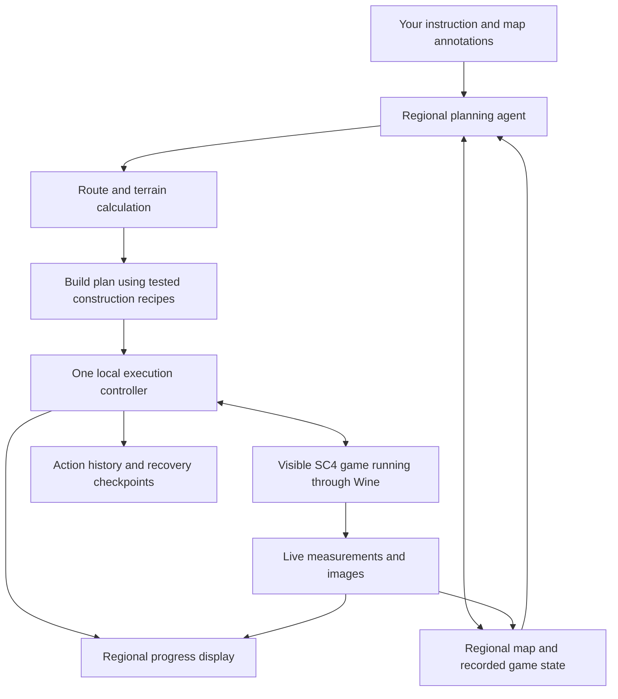

# SimCity 4 regional agent: research and development plan

Research date: **7 September 2026**. Prepared for Simon's Windows GOG edition running through Wine and Porting Kit on macOS.

**Status:** Research and a proposed design. No controller was installed, no command listener was enabled, and no terrain or city was changed during this research. “Documented” means supported by a project's documentation or source; it does not mean tested in this Wine installation. Proposed tool names and interface controls below do not exist yet.

Detailed interaction examples are in [Sample Agent Workflows](SimCity%204%20-%20Sample%20Agent%20Workflows.md): nine sequence diagrams covering regional development, HSR construction, terrain, services, transit improvements, revisions, manual control, recovery and bounded operation.

## 1. Recommendation

Build a **regional planning and control system around the running Windows game**. The agent would interpret your intentions, plan across the entire map, and delegate precise construction to a local controller. You would watch the real game as it loads cities, moves its camera, changes terrain and builds infrastructure. A separate regional map would show where it is working and how each change fits the masterplan.

I did not find a verified, ready-to-install package that already does all of this for SimCity 4. I did find substantial working parts: a game-command client, an automatic regional simulator, a live-statistics browser interface, terrain generators, save parsers, and an actual AI tool server for SC4 assets. Combining and extending these is a credible development project. Reliable NAM construction and Wine compatibility are the main technical gates.

The initial target should use a copy of **CAM - Fresh Start**, the four-large-tile region prepared during setup. Your recorded baseline is GOG **1.1.641.0**, 32-bit Windows, NAM **50**, NAM DLL **1.3.1**, CAM **3.1.1**, SIM **4.0.1**, and Plop and Paint/Render Services. Keep a record of these versions because they affect construction and simulation. See the [local setup summary](../SimCity%204%20-%20Setup%20Summary.md).

The eventual controller should support larger layouts and mixed city-tile sizes. Keep a coarse overview of the whole region and load detailed data for the current corridor or district as needed. Measure loading, simulation and save times before choosing a large demonstration region: increasing tile count also increases the time required to revisit the region.

A terminology distinction matters: an SC4 **city tile** is the separately loaded square saved by the game. A **metropolitan area** in our plan could spread across several such squares. Your instruction “put a major city here” should describe the metropolitan area, without forcing it to stop at a save-file boundary.

## 2. Existing solutions and attempts

| Project | What already exists | How it helps; remaining gap |
|---|---|---|
| [SC4 Network Game Command](https://github.com/0xC0000054/sc4-network-game-command) | An August 2026 C# client for the Windows game's internal command connection. | A promising route to live control. Author-tested on a Windows digital release; Wine remains untested. Commands can hang or crash the game; only one connection is supported. |
| [SC4 game command documentation](https://github.com/0xC0000054/sc4-game-command-documentation) | Documentation of the base game's command interface and Lua test-script entry points. | Much of the required control has names and documented parameters. Coverage is incomplete and some commands are unimplemented. |
| [Region Sync](https://community.simtropolis.com/files/file/37590-region-sync/) | Released 31 August 2026: automatically visits established cities, advances simulation, saves and continues. | Strong evidence that regional operation is practical. It does not plan or construct a region. |
| [SC4 Web Interface](https://github.com/dsalzner/simcity4-webinterface-plugin) | A released DLL sends live statistics as JSON and displays browser charts; it can pause at month boundaries or on a deficit. | Existing precedent for live data and a second screen. It needs auditing and much richer spatial information. |
| [dbpf-mcp](https://github.com/caspervg/dbpf-mcp) | An implemented AI tool server for indexing, reading and writing SC4 asset packages. | Could help identify installed stations, lots, properties and network paths. It edits/explores assets; it is not a gameplay controller. |
| [SimCity Atlas](https://github.com/nishantmodak/simcity-atlas/blob/main/README.md) | Published on the research date: an agent skill and tools for making regional terrain from geographic data. | A close precedent for asking an agent to make a region. The author explicitly excludes playing the simulation and developing cities; some visual and save/reopen checks are still unverified. |
| [SC4Mapper-2026](https://github.com/caspervg/SC4Mapper-2026) | A modernized regional terrain editor/generator. | Useful for initial terrain preparation. Its platform support and generated output would require local testing. |
| [SC4Parser](https://github.com/Killeroo/SC4Parser) and [SC4Cartographer](https://github.com/Killeroo/SC4Cartographer) | Save-file reading and map-image generation. | Foundations for surveying existing terrain, buildings and networks. Several save structures have partial support; saved data is a snapshot. |
| [Region Census](https://github.com/0xC0000054/sc4-region-census) | Regional statistics and per-city CSV export. | Useful for an initial survey and as a reference for enumerating cities. It does not export every spatial layer we need. |
| [Hallucinating Splines](https://github.com/andrewedunn/hallucinating-splines) | An AI mayor project with tools, simulation actions, maps and action logs. | A useful example of the intended agent experience. It uses **Micropolis**, the classic SimCity-derived engine; its game controller cannot operate SC4 or NAM. |

There is also an academic project titled [SimCity: Multi-Agent Urban Development Simulation with Rich Interactions](https://arxiv.org/abs/2510.01297). It models an economy with households, firms, government and a central bank. It is a separate research simulator, so it should not be mistaken for an existing controller of Maxis SimCity 4.

The search covered SC4/SimCity 4 combined with AI, agent, bot, automation, region and MCP, then inspected relevant project documentation and source. The finding is **“no complete implementation verified in this search”**, rather than proof that no private or obscure attempt exists. More source detail is in [existing-work research notes](regional-agent-existing-work.md).

## 3. The experience to build

Example instruction:

> Develop this region around public transport. Put a large metropolitan centre at A, a second city at B, and smaller towns along the eastern valley. Connect A and B with high-speed rail. Keep the northern hills forested. Reshape terrain where needed for rail, but preserve the coastline. Show me construction as it happens.

The proposed workflow:

1. **Choose a region.** The controller reads its layout and creates a working copy. This gives the project a known starting point and a recoverable original.
2. **Mark locations.** On the regional map, click **Add city centre**, click A, and enter a name and size priority. Repeat for B. Draw protected land with **Protect area**, and optional rail waypoints with **Add corridor**. Typed descriptions remain available, but explicit map marks make “here” unambiguous.
3. **Read the interpreted brief.** The system states its assumptions: what “major city” means, which land may change, the funding mode, and whether HSR is a required network type or a broader fast-rail objective. It stores these rules so later agents do not forget them.
4. **Inspect the masterplan.** The map shows future centres, employment districts, rail stations, local transit, reserved expansion land, utilities and proposed terrain changes. Selecting a route shows why it was chosen and any unsupported crossing.
5. **Start the build.** The real game stays visible. The controller loads the required city and moves the camera to the next construction area. The map highlights that city and the current operation.
6. **Steer while it works.** Controls include **Pause work**, **Follow construction**, **Show plan**, **Take over**, and **Stop after this step**. A new instruction such as “move the station south” creates a revised plan for work that has not yet happened; changing completed work gets an explicit demolition/rebuild estimate.
7. **Inspect results.** Completed sections show both construction evidence and simulation results. The agent reports whether transport is being used, whether services are overloaded, and what still prevents the next development stage.

Illustrative status display; the figures below are invented examples:

```text
REGION: Demonstration region          PLAN: revision 4
ACTIVE CITY: Eastbank                 GAME: paused for construction
WORK: Preparing the approach to Central Station
LOCATION: corridor H1, section 12
WHY: This approach avoids the protected hillside.
STATE: 11 sections verified; 1 building; 6 still planned
NEXT: Place track, inspect connections, test station access
[Pause work] [Follow construction] [Take over]
```

The activity display should show short decision explanations and actual tool results. It should never present proposed work as already built.

## 4. How the parts connect

An **agent** is the AI plus the tools it can call. A **controller** is the local program that checks those requests and carries them out. **Telemetry** means measurements exported from the running game. **MCP**, the Model Context Protocol, is a standard way to offer those tools to an agent.



Specialist agents could review transport, terrain, economics and urban design in parallel. **Exactly one controller issues game-changing commands.** It also owns city switching and simulation time. This prevents one agent from changing terrain while another is laying track on an old map.

For the first version, expose the controller to the local agent environment we are using through MCP. Official documentation supports local process-based MCP servers in the desktop/Codex environment; a local controller can therefore sit beside Wine. A later dedicated application could call an OpenAI model through function calling, where our application executes the requested operations and returns results. Both are supported integration patterns; neither supplies SC4 tools automatically. An ordinary web conversation would need its own supported connection to the controller. [Local MCP documentation](https://learn.chatgpt.com/docs/extend/mcp?surface=cli), [function calling](https://developers.openai.com/api/docs/guides/function-calling).

## 5. A persistent map of the whole region

The agent needs a durable record that survives chat interruptions and game restarts. Keep the following layers, each with its source, measurement time and game date:

| Layer | What it contains | Why it matters |
|---|---|---|
| City layout | Stable city identifiers, names, boundaries and save paths | Load the correct tile and translate regional positions into local positions. |
| Terrain | Elevation, slope, water, protected land and planned earthworks | Route around obstacles and keep borders continuous. |
| Transport | Track/road segments, stations, crossings, connections and observed usage | Distinguish an attractive line from a usable transport route. |
| Development | Zones, occupied buildings, jobs, population and reserved sites | Expand centres deliberately and protect existing development. |
| Services | Power, water, waste, education, health and emergency provision | Check whether new districts can operate. |
| Economy | Funds, recurring income/expense, demand and neighbor deals | Decide when the next stage is affordable and useful. |
| Project state | Plan revisions, completed actions, failures, screenshots and checkpoints | Resume accurately and explain progress. |

Proposed coordinate convention: put the regional origin at the northwest corner; increase X eastward and Z southward. Store units explicitly. This is our convention, to be calibrated against SC4's command coordinates and camera rotation.

SC4Mapper's implementation converts region-layout units into 64-cell offsets and assembles shared terrain edges. Large cities have 257 terrain vertices across a 256-cell side. A four-large-tile square therefore has a 512 × 512-cell planning grid and a 513 × 513 shared height grid. Read these arrays in batches rather than asking the model to reason about every cell or sending hundreds of thousands of individual game requests. [Mapper implementation](https://github.com/caspervg/SC4Mapper-2026/blob/master/src/sc4mapper/region.py).

The installed Plop and Paint catalogue helps answer **“which assets are available?”** It does not answer **“what exists in this city right now?”** The latter needs saved-city parsing or live telemetry. Missing information must remain “unknown”, rather than becoming a zero population, zero congestion or empty plot.

## 6. Planning cities and infrastructure

The language model should choose goals and explain tradeoffs. A numerical solver should calculate routes. A **solver** is ordinary software that searches possible layouts and scores them against explicit rules.

The proposed planning sequence is:

1. Identify buildable areas, protected land, water crossings and likely station sites around the marked centres.
2. Allocate metropolitan centres, secondary towns, employment, industry, green space and expansion reserves. Balance jobs and housing locally as well as regionally.
3. Design an HSR backbone between major centres. Add commuter rail for intermediate settlements and local subway, tram or bus access around stations.
4. Reserve station footprints and approaches before placing dense development. Include walking access and interchange paths; drawing intersecting lines does not establish a transfer.
5. Calculate several candidate alignments. Score travel impedance, track length, gradient, curve geometry, earthworks, crossings, demolition, construction cost and maintenance. Treat protected areas and unsupported pieces as forbidden.
6. Test each alignment against actual construction recipes for the installed NAM version. Recalculate routes that require an unavailable tunnel, curve or junction.
7. Add streets, freight access and utilities to serve the resulting districts. Public transport priority should coexist with the access needed by buildings and services.
8. Divide development into useful stages: a functioning initial district, its transport link, the next centre, then density and service upgrades.

A reasonable routing implementation would first search a coarse map, then refine promising corridors with **A\***, a pathfinding algorithm that evaluates candidate steps toward a destination. Each step must include direction and, where relevant, height and construction-piece type. A simple shortest line across the ground is insufficient for rail.

The solver should estimate access using the transport network, rather than drawing a circle around every station. Its estimate remains a planning approximation until checked against SC4's own simulation. A public-transport usage target needs a clearly defined measurement and baseline before claiming success.

## 7. High-speed rail and NAM: the construction problem

**HSR** means high-speed rail. NAM's legacy HSR/GHSR are monorail-based overrides: a starter piece changes the appearance and rules of track dragged through it. They use monorail transport behavior and have documented crossing limitations. Functioning monorail tunnels are unavailable. The official documentation labels this component legacy and describes a future successor; a planned successor should not enter our list of currently usable pieces. [NAM HSR guide](https://www.sc4nam.com/docs/feature-guides/high-speed-rail/).

**HRW**, Hybrid Railway, combines Rail and Monorail paths and uses FLEX pieces—predefined pieces that adapt to supported adjoining networks. Its construction differs from ordinary draggable track. [NAM HRW guide](https://www.sc4nam.com/docs/feature-guides/hybrid-railway/).

The official technical table lists **no HRW bridges or tunnels**. Any river or mountain passage therefore needs an independently verified alternative and compatible transitions. A subway conversion changes the simulated transport mode; it should be labelled accordingly. See the [HRW specifications](https://www.sc4nam.com/docs/tech-specs/hybrid-railway/) and the more detailed [transport research notes](regional-agent-transport.md).

Recommendation: test legacy HSR as the initial dedicated express backbone, with conventional rail and local transit around it. Add HRW only through verified recipes where its mixed operation is useful. This is an implementation priority, not a conclusion that the other system is inferior.

A **construction recipe** must specify:

- Required mod versions and the exact starter, station or network identifiers.
- Footprint, permitted slopes, clearances, orientations and necessary approaches.
- Ordered placement operations and the expected result after each one.
- How to prove the track/station can carry the required traffic.
- How to stop or recover if a placement fails.

For example, “HSR station with tram interchange” expands into terrain preparation, station lot placement, correct express approaches, local tram connections, pedestrian access, and route verification. It is not one invented `build_hsr` command.

Your NAM startup log confirms the Eternal Commute Loop patch is active. NAM's documentation and version 1.3.1 source show that it blocks **neighbor-to-neighbor through trips between the north and west borders of a city**, in either direction. This does not prohibit those physical connections or trips to local destinations. Our route model must include this behavior; a physically continuous line may still fail the intended through journey. [NAM DLL guide](https://www.sc4nam.com/docs/feature-guides/nam-dll/), [versioned implementation](https://github.com/NAMTeam/nam-dll/blob/1.3.1/src/CommuteLoop.cpp).

Concrete planning example: in a two-by-two tile layout, a journey from the northeast tile to the southwest tile could pass through the northwest tile using its east and south edges. The geometrically similar route through the southeast tile would need a north-to-west through trip there, which this patch blocks. This is an inference from the documented rule; actual passenger routing still needs a controlled test.

## 8. Terrain control

Use two paths, depending on whether development exists:

**Initial landscape preparation.** A coherent regional height map can be generated before developing the region. Mapper uses blank city templates when writing terrain; this makes it a promising starting point for new landscapes, without establishing that it safely rewrites developed cities. SimCity Atlas is another reference for the geographic-data workflow. The proposed live build would load and inspect this prepared landscape before construction begins.

**Live earthworks.** For visible terrain changes during construction, calculate a small patch of target heights, show its extent, then apply it through verified game operations. These patches would create station platforms, gradual approaches, cuttings, embankments and local smoothing. The base game has documented elevation reading/writing commands; the generic terrain-brush command lacks a documented usable signature. [City commands](https://github.com/0xC0000054/sc4-game-command-documentation/blob/main/commands/Maxis/CityCommands.md).

Every patch should check existing buildings and networks, protected land, water level, maximum permitted change and affected city edges. Shared boundary heights need one agreed target applied consistently to both cities. Large operations should be divided into visible batches, with rendering allowed between batches.

Do not treat changing sea level as a harmless shortcut for shaping a shoreline. For developed areas, terrain operations must first be tested for effects on lots, networks, water appearance, saves and adjacent cities. The plan should show affected area and estimated cut/fill volume before execution. These estimates are our calculations, distinct from any in-game charge.

## 9. Building cities that function

The regional controller should establish utility supply, usable access and an initial jobs/housing balance, then build density gradually. Schools, hospitals, fire cover and waste management must expand with the population. The installed larger hospitals become catalogue choices with measurable capacity and cost.

**Zoning** designates land for development by the simulation. **Plopping** directly places a selected lot. Use zoning and suitable growth conditions for the ordinary city economy, and direct placement for infrastructure and verified special lots. A requested skyline or CAM growth stage cannot be guaranteed merely by drawing high-density zoning. The agent should monitor actual growth and explain unmet prerequisites.

Support two explicit funding policies:

| Policy | Intended behavior |
|---|---|
| Normal economic play | The controller respects observed city funds and running costs, develops in affordable stages and uses only verified operations with understood charges. |
| Funded regional design | An explicitly selected construction allowance permits the planned backbone earlier; ongoing service and transport performance are still measured. Any funding intervention is recorded. |

For technical development, a separate funded test region makes infrastructure experiments easier. The eventual user chooses the actual region's policy. Undocumented developer commands may charge differently or bypass normal restrictions; compare them with ordinary placement before calling either policy implemented.

SC4's regional operation is sequential: the loaded city advances while others contribute saved information. Region Sync demonstrates loading cities, waiting for readiness, running simulation, saving and continuing. Its report describes successful seven-city tests, but no universal signal proving that regional effects have finished settling. [Region Sync implementation report](https://github.com/RacoonsInATrenchcoat/SC4-Region-Update/blob/main/docs/project-summary.md).

Our scheduler should therefore revisit affected neighbors after construction, record each city's game date, and measure changes over bounded passes. Its order should reflect dependencies such as power exporters and consumers. Stop when chosen indicators stabilize within declared tolerances or the pass/time budget is exhausted; report which happened. Do not claim simultaneous region-wide simulation or guaranteed equilibrium.

## 10. Watching the real work

There should be two coordinated views:

- **The actual game:** visible city, moving camera, terrain changes, construction and simulation. Pause the simulation clock during precise construction while allowing the screen to render. Offer a watchable pace and an optional faster batch mode.
- **The regional display:** active city, current operation, plan revision, protected land, future corridors, completed work and measurement age. Use distinct states: planned, executing, physically verified, simulation verified, failed and blocked.

The game command documentation includes camera positioning and screenshot output. These are promising ways to follow work and obtain game images without relying on the desktop accessibility tool, which has not been able to inspect this Wine window. Exact behavior under Wine still needs testing. The documented placement operations also need calibration; the existence of a command name is not proof of safe arbitrary NAM construction. [App commands](https://github.com/0xC0000054/sc4-game-command-documentation/blob/main/commands/Maxis/AppCommands.md).

Start with the game window plus a separate display. Add an in-game status panel and temporary corridor outlines later. **Render Services**, already in this installation, supplies panel registration, drawing and world-to-screen helpers that could support such a custom overlay. Its installed version's interface must be checked before using features from newer source. This overlay would require new code; Plop and Paint does not already provide an agent dashboard. [Render Services](https://github.com/caspervg/sc4-render-services).

Log events after the game confirms each step. The dashboard must survive the agent conversation ending. If updates stop, show the last received time and “connection lost” instead of continuing a progress animation. Screenshots are discrete images, not automatically a smooth video feed; measure capture performance before choosing an update rate. Keep the game's existing 1920 × 1200 setting during initial tests, and measure whether a separate monitor or compact overlay is needed for comfortable viewing.

## 11. The game bridge to develop

A **DLL** is Windows code loaded inside the game. A small custom bridge DLL can inspect internal SC4 interfaces and expose carefully bounded operations. Keep planning and data storage outside the 32-bit game process.

Use the existing network-command interface for early capability tests. It requires the launch argument `-NetCommandGenerator:enabled` and listens on port 50020. It can accept connections from other computers, so testing must include local-only isolation; merely pointing the client at `127.0.0.1` does not restrict the listener. If that cannot be isolated cleanly in this Wine setup, use a local file queue or a custom loopback-bound bridge. [Command-system documentation](https://github.com/0xC0000054/sc4-game-command-documentation).

The longer-term bridge would supply city identity, bulk terrain/network data, finances, demand, service statistics and completion events. Relevant internal interfaces exist, but require C++ wrappers and validation. Examples include the [regional-city interface](https://github.com/nsgomez/gzcom-dll/blob/master/gzcom-dll/include/cISC4RegionalCity.h), [budget interface](https://github.com/nsgomez/gzcom-dll/blob/master/gzcom-dll/include/cISC4BudgetSimulator.h) and [traffic interface](https://github.com/nsgomez/gzcom-dll/blob/master/gzcom-dll/include/cISC4TrafficSimulator.h). Unknown signatures and partially understood grids remain research tasks.

The existing web-statistics plug-in is a reference, rather than a module to trust without inspection: its source appears to swap estimated income and year-to-date expenses, and narrows some financial values to smaller integers. Verify exported figures against the game and preserve their proper numeric widths. [Source inspected](https://github.com/dsalzner/simcity4-webinterface-plugin/blob/main/src/cMessageLoggerCOMDirector.cpp).

Game operations must execute at safe points on the game's own execution thread. A network/file reader may enqueue work, but should not call engine methods concurrently. Region Sync demonstrates why lifecycle events matter, including waiting for city readiness and postponing city exit until a simulation callback has finished. Incorporate that approach into the one controller; do not run two independent city-switching systems at once.

Recommended implementation choices: C++ for the Win32 DLL; Python for regional data and numerical planning; a local SQLite database for durable records; a small browser interface for maps/progress; and an MCP adapter for the agent. These are proposed roles, not additional software installations performed today.

## 12. Proposed tools exposed to the agent

These names describe functions we would implement. They are not current SC4 commands.

| Tool | Meaning |
|---|---|
| `region.inspect` | Read region layout, city identities, available observations and their ages. |
| `assets.search` | Find installed, compatible infrastructure and buildings by purpose and footprint. |
| `plan.create` / `plan.revise` | Convert the brief and map marks into a versioned masterplan. |
| `corridor.solve` | Calculate alternatives using terrain, transport rules and tested pieces. |
| `terrain.preview` | Return the area, heights and consequences of a proposed terrain patch. |
| `work.enqueue` | Submit a bounded operation tied to the current plan and expected game state. |
| `work.status` | Read progress, evidence and reasons for any stoppage. |
| `region.advance` | Visit selected cities and simulate to a defined date or stopping condition. |
| `region.evaluate` | Compare the observed region with development and transport targets. |
| `work.pause` / `work.resume` | Control construction without abandoning its recorded state. |
| `checkpoint.create` / `checkpoint.restore` | Save or recover a consistent project state under the controller's ownership. |

Each action needs an identifier, target city, affected area, plan revision, expected preconditions, allowed cost/terrain limits and a verification rule. If a request times out, check whether it happened before retrying. Otherwise, a delayed reply could cause the same station to be placed twice or the same area to be demolished twice.

The agent receives concise summaries and selected maps. Large terrain arrays and detailed network records stay local, where software can query them precisely. Only verified capabilities should appear in the agent's available tools.

## 13. Recovery and human control

Before changing a cross-city corridor, create a **checkpoint**: a consistent saved copy of all affected cities, the plan, and its action history. Coordinate saves with Auto Save and wait for each file write to finish. Copying a save while it is being written is not a valid checkpoint.

During a stage, record completed operations. On a crash or lost connection, reload the journal, inspect the real game and reconcile any uncertain action before resuming. Restoring a cross-city stage may require restoring all affected cities together so their borders and neighbor information match. Never replace the save of a currently loaded city behind the game's back.

An unexpected dialog, wrong city, missing asset, invalid route or contradictory readback should stop new construction and identify the reason. **Pause work** should stop the queue promptly; it cannot guarantee interruption in the middle of a hung engine call. **Take over** hands control to the user, and resuming requires a fresh survey of the affected area.

Use live placement for developed cities. An author-maintained SC4 CLI testing workflow warns that some lots placed directly into save files can crash when queried or bulldozed. That technique is useful for asset experiments, but needs stronger validation before becoming a playable-city construction method. [SC4 CLI testing notes](https://github.com/sebamarynissen/simtropolis-channel/blob/main/docs/adding-via-scripts.md).

## 14. Development stages and tests

The rows below are proposed acceptance gates. A stage is complete when its result is demonstrated in the actual installation, rather than when code has merely been written.

| Stage | What to implement | Evidence required before progressing |
|---|---|---|
| **0 — Prove the connection** | A copied test region, controlled command connection, city identification, simulation pause, camera movement, screenshot, one placement and save/reopen. | Correct city and coordinates; visible rendering; charges/side effects recorded; successful persistence; listener isolation; timeout behavior known. Measure loading and command latency on this Wine engine. |
| **1 — Survey and masterplan** | Whole-region catalogue, terrain grid, asset selection, annotated map and route candidates. | All four starting tiles represented once; shared edges align; every fact has provenance and age; candidate rail corridors use supported geometry or explicitly mark a gap. User can place centres on the map. |
| **2 — Construction recipes** | Road, rail, HSR starter, station, local transit, terrain patch and border-connection procedures. | Each recipe works in required orientations and survives save/reopen. Checks include slopes, insufficient funds, blocked land, station access and interrupted replies. Unsupported bridges/junctions remain unavailable. |
| **3 — Visible regional construction** | One corridor across multiple cities, terrain approaches, stations, local feeder transport, activity map and camera following. | The real game shows each stage; both sides of every border agree; a diagnostic population/jobs setup produces supported trips; failures pause cleanly. This is the first substantial end-to-end demonstration. |
| **4 — Metropolitan development** | Zoning, utilities, civic services, phased growth, budget rules and regional simulation passes. | Several planned centres develop; actual demand and service bottlenecks guide changes; all tiles can save/reload; development decisions remain within the chosen policy. |
| **5 — Sustained regional management** | Multiple corridors, congestion response, redevelopment, revisions, restart/resume and optional in-game overlay. | A substantial run survives city changes and an intentional controller interruption, avoids duplicate actions, displays stale data correctly and produces a readable regional results report. |

The practical dependency order is connection → observation → validated construction → regional execution → economic management. Route planning and the progress interface can be developed alongside bridge work using clearly labelled test data. Do not present those test displays as live game integration.

If ordinary commands cannot place a needed NAM piece, the next step is a verified DLL wrapper around the relevant placement operation. If that is unavailable, a calibrated GUI procedure is a possible fallback only after observation and input access work in Wine. A recipe still lacking a reliable execution path must block that route or select a supported alternative.

## 15. The final demonstration to aim for

Use a copied region with at least four city tiles and explicit marks for two major centres and smaller settlements. The acceptance brief should require:

1. A saved regional masterplan connecting the intended centres with an HSR backbone and local public transport.
2. Terrain changes with matching city edges and protected areas respected.
3. A physically continuous, usable cross-city railway with functioning stations and transfers.
4. Developed districts supported by utilities, jobs and civic services, with honest reporting of growth that has not yet occurred.
5. The real game visibly performing construction, with accurate current-city/current-action tracking.
6. Simulation evidence of route usage and service performance; any travel or public-transport-share metric must state its definition and coverage.
7. Successful save/reopen of every affected city and consistent resumption after an interruption.
8. A final comparison of the brief, the built result, unresolved constraints and the next useful development stage.

Do not claim an arbitrary regional population target, end-to-end passenger itinerary or transit percentage has been achieved if telemetry cannot measure it. Use structural tests, supported traffic observations and clearly labelled estimates until richer measurements are available.

## 16. Main uncertainties and decisions

| Question | What we know | Required next evidence |
|---|---|---|
| Can the command interface work through this Wine engine? | Windows digital support is documented; this setup is not tested. | Stage 0 connection and rendering checks. |
| Can the agent see the game reliably? | Desktop inspection failed previously; game-side screenshot output is documented. | Valid current images under the actual renderer, measured capture cost and staleness detection. |
| Can it construct every requested NAM feature? | Feature documentation exists; generic network placement is incomplete. | Recipe-by-recipe validation. No promise of universal mod support. |
| Can it reshape developed terrain safely? | Elevation setters and internal terrain interfaces exist. | Tests near lots, networks, water and city edges, followed by save/reopen. |
| Can it measure regional journey quality? | Traffic interfaces and saved records expose some data. | Validate units, coverage and per-city versus cross-city meaning. |
| Can it behave as a normal economic player? | Financial interfaces exist, but command charges/constraints need checking. | Compare native placement and automated operations; verify every budget field. |
| Can it run unattended for hours? | Regional cycling is demonstrated elsewhere; dialogs, crashes and focus issues remain possible. | A bounded endurance test with fault injection and recovery. |
| Can it be packaged for other players? | Many components are open source and the game/mods are version-sensitive. | Pin dependencies, review reuse licenses, provide reproducible builds and compatibility tests before distribution. |

My assessment: the requested experience is plausible enough to justify prototyping, and the evidence is much stronger than a screenshot-clicking concept alone. The work still includes substantial controller engineering and SC4-specific testing. A credible delivery estimate should follow Stage 0 and the first HSR recipe, because those determine whether we can reuse existing commands or must extend the internal game interfaces.

The recommended first deliverable is therefore **a whole-region survey and map connected to the visible game, followed by a verified multi-city rail corridor**. That directly tests the architecture needed for your eventual “build out this region” instruction.
