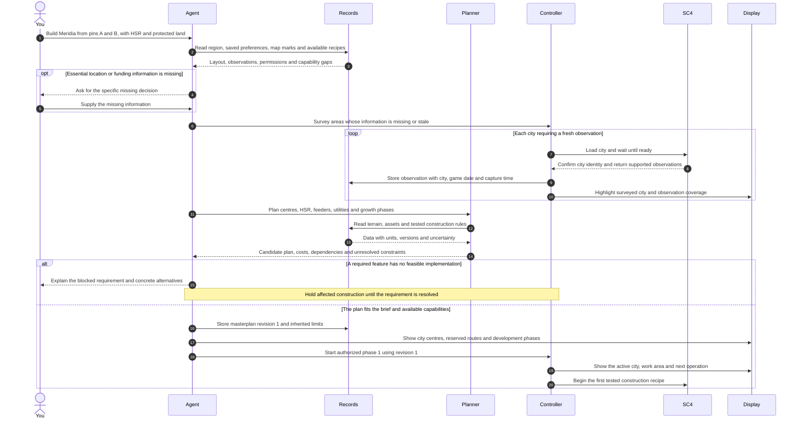
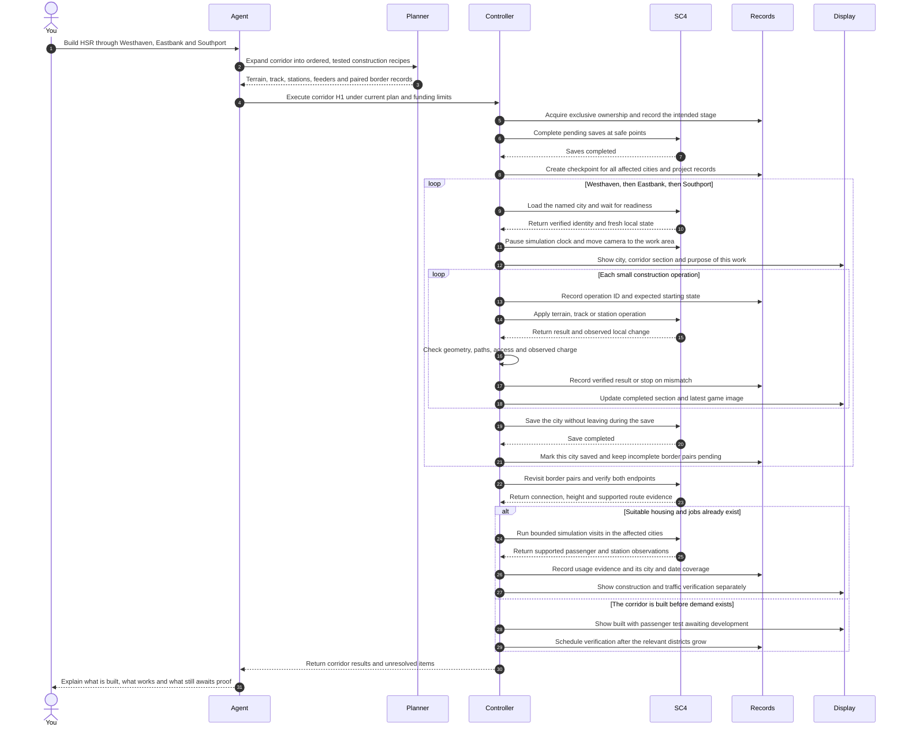
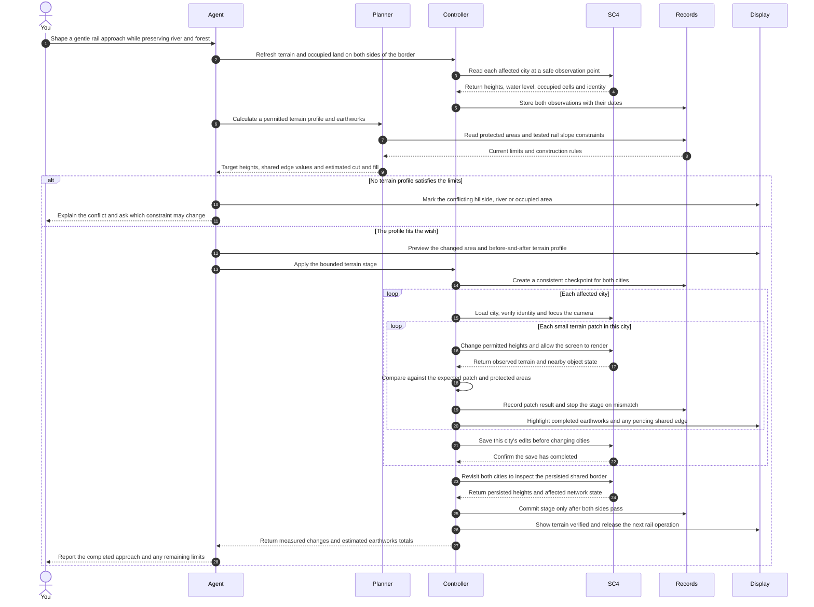
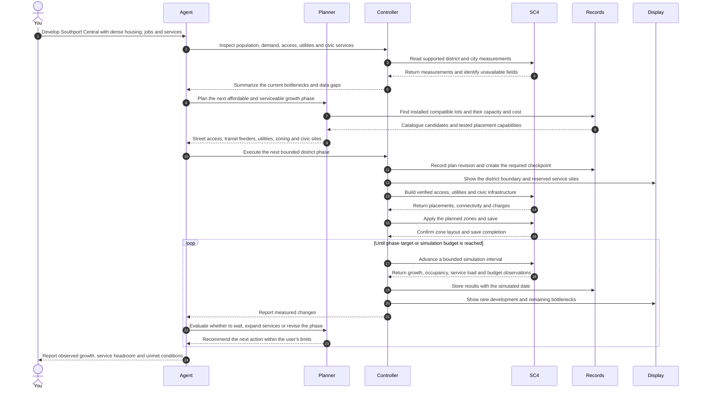
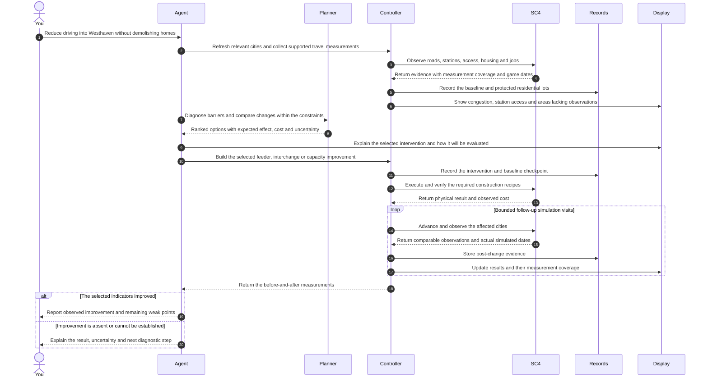
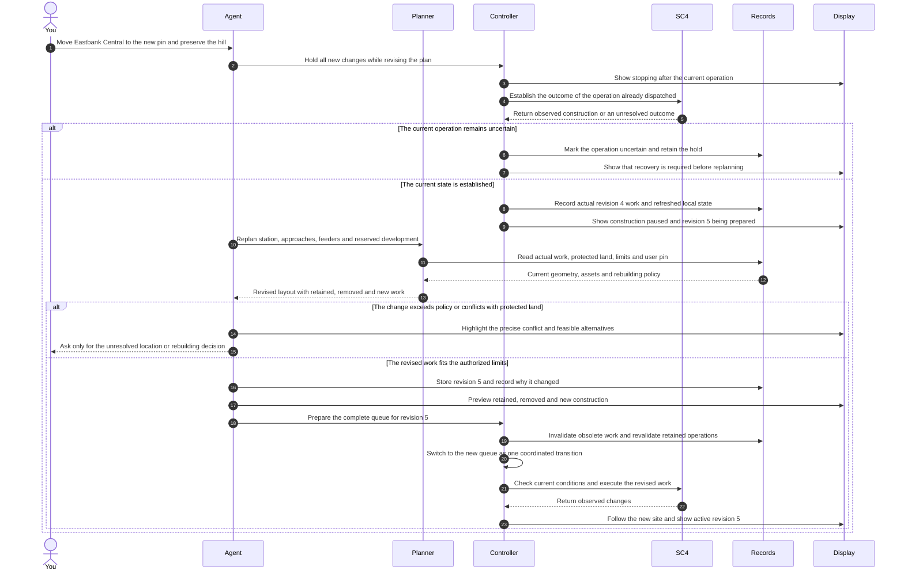
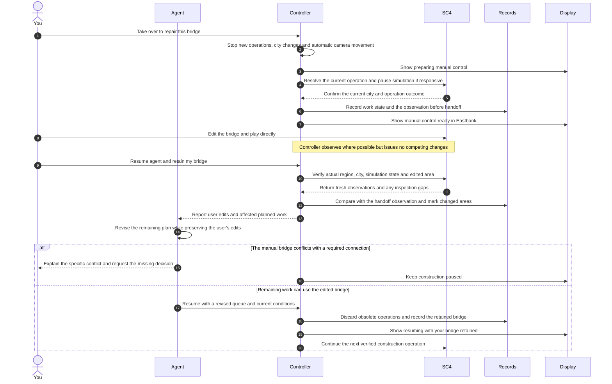
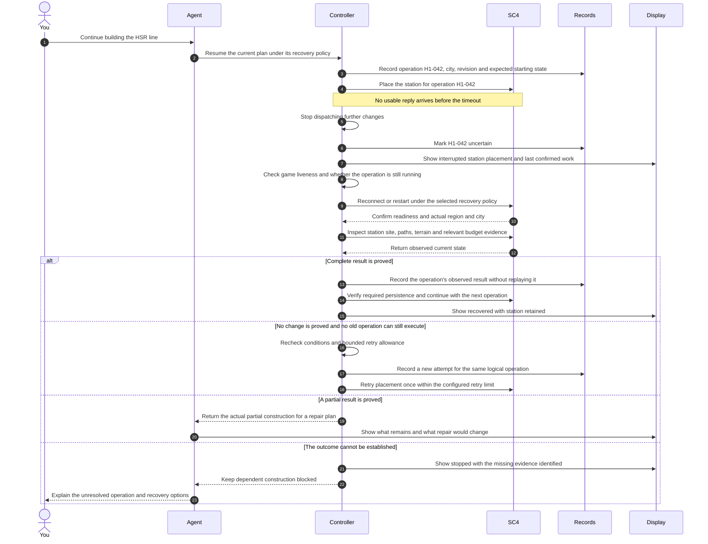
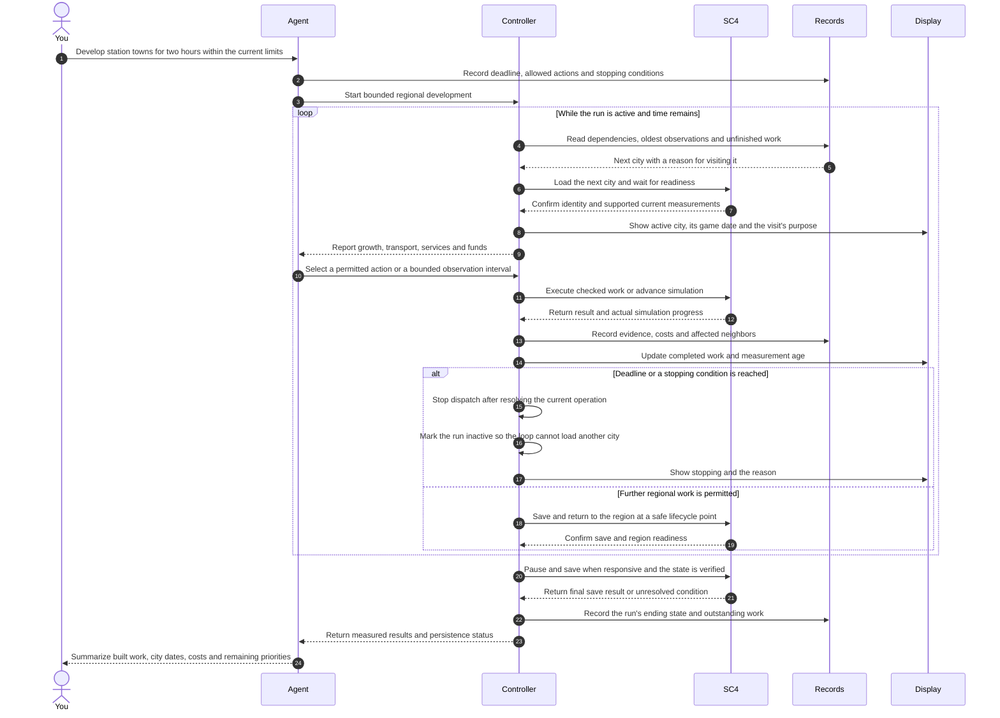

# SimCity 4 regional agent: sample workflows

Draft specification · 7 September 2026

These are proposed interactions for the system described in the [regional agent plan](SimCity%204%20-%20Regional%20Agent%20Research%20and%20Plan.md). They are not demonstrations of a controller that has already been built. Every game-changing operation below depends on a tested implementation for the Windows game under Wine.

Each workflow starts with a user wish, follows the messages between the components, and states the visible result and completion conditions. Numbers, place names, route identifiers and dialogue are illustrative. They do not describe the current contents of your game.

## How to read the diagrams

Read from top to bottom: time progresses downward. Each vertical column belongs to a person or component. A solid arrow sends a request or event; a dashed arrow returns information. A **loop** repeats its enclosed steps. An **alt** box shows alternative outcomes. An **opt** box contains an optional step.

| Participant | Meaning |
|---|---|
| **You** | The person giving instructions or taking control. |
| **Agent** | The AI that interprets the wish, chooses priorities and explains decisions. |
| **Planner** | Software that calculates terrain, routes, construction order and resource requirements. |
| **Records** | The persistent map, asset catalogue, plans, action history and references to backups. |
| **Controller** | The single local program allowed to issue game-changing commands and switch cities. |
| **SC4** | The actual running game; replies are collected through a tested game bridge. |
| **Display** | The regional map and progress panel, shown alongside the real game. |

A **city tile** is one separately loaded city square. A **recipe** is a tested sequence for constructing something, including its required space and validation. A **checkpoint** is a consistent saved copy from which work can be recovered. A **revision** is a numbered version of the plan. An **operation ID** is a unique label that helps distinguish a new instruction from a repeated request.

The display receives factual progress from the controller. The agent adds short explanations. Game screenshots and observations carry capture times and city identities, so an old view is not mistaken for the current city.

## Shared example region

The examples use a fictional region called **Meridia**, with four city tiles:

| Northwest | Northeast |
|---|---|
| Westhaven: planned major centre | Eastbank: planned intermediate centre |
| **Southwest** | **Southeast** |
| Greenfields: farming and protected land | Southport: planned second major centre |

The example express corridor runs **Westhaven → Eastbank → Southport**, crossing two city borders. These names denote city tiles; urban development can extend across their boundaries. The protected hillside, coast and valley are example inputs to planning.

Unless a wish says otherwise, the examples assume the user has already selected a funding policy and defined protected land. Instructions that authorize building can proceed within those limits. A plan preview is informational unless the user asks to review it before construction. Missing essential information or an impossible constraint requires a focused question, rather than an invented answer.

## 1. A regional wish becomes a masterplan and build programme

**User wish:** “Build Meridia around public transport. Put the largest centre at A in Westhaven and another at B in Southport. Connect them by HSR through Eastbank. Preserve the marked hills and coastline. Use my funded-design settings and show me the work.”

**Inputs:** Map pins A and B; protected-area outlines; the chosen funding policy; the region and installed mod catalogue. **HSR** means high-speed rail.

**What you see:** Survey coverage fills in on the region map. Planned centres and corridors appear before physical construction. The game then loads the first work site and follows the initial operation.

**Result:** A recorded masterplan and a dependency-ordered work queue. For example, power and access precede occupied districts; station land is reserved before adjacent dense development. The region is not labelled “finished” when the planning step ends.

**When the wish is “make a plan first”:** End this sequence after showing the masterplan. Execution begins only after a later building instruction.

## 2. Build a high-speed railway across three city tiles

**User wish:** “Build the Westhaven–Eastbank–Southport HSR corridor now, including stations and local public-transport access.”

**Starting conditions:** The corridor has a feasible alignment and verified recipes for its starters, curves, crossings, stations and border connections. If a required recipe is unverified, this workflow first returns a capability gap; it cannot manufacture a supported game command.

**What you see:** The camera follows terrain preparation, track and station work. When the controller leaves Westhaven for Eastbank, the regional map moves its active-city highlight. A border crossing stays “pending other side” until both ends have been checked.

**Completion conditions:** Correct network types and paths, activated stations, usable access, matching border endpoints and successful save/reopen checks. Passenger operation is a separate result. No claims about individual passengers completing an entire regional journey are made unless the measurements actually support that conclusion.

**Failure example:** A crossing reverts to ordinary monorail or cannot be placed. The controller stops that recipe, marks the section failed and returns the actual state for replanning. Dependent track construction does not continue across the gap.

## 3. Reshape a valley and keep terrain continuous across a border

**User wish:** “Make a gentle rail approach along this valley between Eastbank and Southport. Keep the river and protected forest. Show me the earthworks.”

**Inputs:** A marked corridor; a user-selected limit on terrain changes; protected areas; current terrain and buildings. The example assumes a permitted live-terrain method has passed the tests in the main plan.

**What you see:** A map preview of the affected area, followed by actual terrain changes in the game. The terrain profile is a side-on chart of height along the route; it makes a steep approach visible before track placement.

**Completion conditions:** Heights match the target within the declared tolerance, the shared edge agrees after reload, protected areas are unchanged, and affected objects remain valid. Cut/fill estimates and in-game expenditure are reported as different measurements.

**Failure example:** The game stops after changing Eastbank but before changing Southport. The stage remains incomplete. Resume only after inspecting both sides; otherwise restore the coordinated checkpoint while the affected cities are unloaded. Do not mark a half-completed border as safe for railway construction.

## 4. Grow a station district and provide adequate services

**User wish:** “Build a dense, walkable district around Southport Central. Give it jobs, schools and a hospital that will not immediately overflow. Use the CAM buildings I installed.”

**Inputs:** Station location, allowed development area, desired density, funding policy and installed assets. **CAM** is the installed Colossus Addon Mod, which expands the development system. **Zoning** designates land where the simulation may grow buildings; it does not guarantee a particular building immediately.

**What you see:** Access and infrastructure appear first. Buildings grow as the game simulates. The district display reports actual occupancy and services, rather than treating zoned land as already populated.

**Hospital example:** The planner selects from the actual installed lots, checks placement and recurring costs, and measures effective capacity and patient demand after placement. If funding changes effective capacity, it uses the measured result. A large nominal capacity is not assumed to guarantee coverage of the entire district.

**Completion conditions:** The phase is built and persisted, observed development is reported accurately, and service demands are within the selected limits. If growth stalls, the result names the observed bottleneck or states that its cause is still uncertain. The controller never reports a requested CAM skyline as achieved simply because it placed high-density zoning.

**Loop detail:** A service expansion recommended inside the loop is a new recorded construction operation, checked and executed through the same controller. The agent does not bypass the construction rules by calling it a repair.

## 5. Improve public transport based on observed problems

**User wish:** “Too many people drive into Westhaven. Improve public transport, but preserve the existing homes.”

**Inputs:** The protected housing boundary; current station access and traffic observations; the user's spending limits. The first task is diagnosis: more track is only one possible remedy.

**Specific diagnostic examples:** A station may lack walking access; a feeder may end too far away; a useful line may be overloaded; or the supposed regional through-route may be restricted. Each explanation needs evidence before construction is chosen.

**Completion conditions:** The intervention respects protected homes, and the final report shows comparable measurements. If a region-wide public-transport share is unavailable, report the supported city/route indicators instead. Before-and-after changes are observations; continuing population growth can also influence them, so they are not automatically proof of causation.

## 6. Change the station location while construction is running

**User wish:** “Move Eastbank Central to this new pin farther south. Keep the hill untouched and adjust the approaches and feeder routes.”

**Starting conditions:** Revision 4 is running. Some approach track may already exist. The controller must first establish what has happened before calculating revision 5.

**What you see:** “Stopping” changes to “Paused” only after the current operation's outcome is known. The map then shows which existing track stays, which would be removed, and where new work will occur.

**Two important cases:** If the station is unbuilt, only the plan and dependent queued work move. If it is already built, moving it is a demolition-and-rebuild operation with explicit disruption and costs. The established rebuilding policy decides whether that needs a further user decision.

**Completion conditions:** All subsequent operations use the validated revision 5 queue, including unchanged work carried forward. A late reply from revision 4 remains evidence about the old operation; it never restarts obsolete queued construction. The revision covers the station's related paths and utilities, rather than moving only its map marker. The initial design holds all new game changes during this queue transition.

## 7. Let the user take over and then preserve their edits

**User wish:** “Pause. I want to fix this bridge myself. Continue when I tell you.”

**Starting conditions:** The agent is operating the game. Manual control must be a clear handoff: construction, city changes, camera following and automated simulation advances stop before the user is told the handoff is ready.

**What you see:** Three distinct states: “Preparing manual control”, “Manual control ready”, and “Resuming”. The camera stays under your control during the handoff.

**Completion conditions:** The controller identifies any city you loaded, resurveys areas it could not observe, and preserves manual work in the revised plan. It does not silently overwrite your bridge using an older instruction.

**Failure example:** If a game command is hung, the controller cannot claim that manual control is ready. It shows the unresolved operation and enters recovery. Expiration of a timer does not prove that the game has stopped changing.

## 8. Recover when a command times out or the game crashes

**User wish:** “Continue building the regional HSR line.”

**Fault in this example:** The controller sends a station-placement operation but receives no reply. A missing reply does not establish whether the station was placed.

**What you see:** The display states the last confirmed action and marks the interrupted operation “Uncertain”. It does not keep advancing its completion bar while the connection is lost.

**Checkpoint restoration, when necessary:** First show which cities and later progress would be restored. Follow the selected recovery policy; ask if losing that progress is an unresolved decision. Ensure affected cities are unloaded and file writes have ended. Restore the entire affected-city set and matching project state, retain the audit history, then load and verify the restored state before rebuilding the queue.

**Completion conditions:** The controller proves whether the operation happened, avoids duplicates, and resumes from the state that actually exists. Previously observed work may disappear after a crash if it was never saved; the history alone is not proof of persistence. If the last branch applies, the correct outcome is a clear stop, not a claim of recovery.

## 9. Develop and maintain the region for a bounded run

**User wish:** “Keep developing the station towns for the next two hours. Prioritize public transport, keep the existing spending limits, and stop if you lose track of the game.”

**Inputs:** A two-hour real-world limit, per-city simulation limits, development priorities, budget rules and the watchable-build policy. A game month and a real-world minute are different units.

**What you see:** The active-city highlight moves with the game. Each city has its own last observed game date; an overview of old data is visibly different from a fresh city observation. Loading, building, simulating, saving and stopping are distinct activities.

**Stopping conditions:** The deadline, a user stop request, a breached financial/service limit, wrong city identity, uncertain command outcome, or observations becoming too old under the chosen policy. Thresholds are selected and recorded before the run; they are not silently invented during execution.

**Completion conditions:** The report distinguishes construction, observed growth, verified transport use and unfinished work. It states which cities were saved successfully. A two-hour limit stops new dispatch; a current game call or final safe save may finish later. A frozen game may prevent a final save and must be reported as such.

## Common execution rules behind every diagram

The diagrams omit some repeated plumbing to keep their main sequence readable. Every construction workflow still follows these rules:

1. **Validate before dispatch.** Check the region, city, plan revision, relevant area, installed capabilities and operation limits. Recheck immediately before the actual game change if other work has occurred since planning.
2. **Keep one writer.** The controller serializes construction, automatic simulation advances, saves and city switching. Before loading another city, establish the outgoing city's save state and finish any required save. This also applies to surveys and resumption after manual play. A manual handoff suspends automatic camera control. Reading the game must occur through safe observation points.
3. **Record before and after.** Persist an operation ID and expected starting conditions before sending a change. Record the actual result and evidence afterward. The same operation may have multiple attempts; those attempts never imply multiple intended stations.
4. **Verify at three levels.** Check physical placement, save/reopen persistence, and simulation behavior where measurable. These can finish at different times and must have separate statuses.
5. **Stop a failed dependency.** A failed terrain patch or connection blocks work that depends on it. A loop in a diagram never authorizes continuing through a failed verification.
6. **Coordinate checkpoints.** Save at safe points, wait for writes and relevant Auto Save activity to finish, and copy a coherent affected-city set. Cross-city stages retain the checkpoint until both sides are verified.
7. **Keep the picture honest.** The display shows the last observed city, operation and capture time. Under the example watchable-build policy, loss of required tracking stops new changes after the current operation is resolved. A stalled image never becomes fabricated live progress.
8. **Ask only for a needed decision.** A valid building wish already authorizes work within its limits. Ask when essential input is missing, a protected constraint must change, or a proposed recovery/rebuild exceeds the recorded policy.

| Status | Exact meaning |
|---|---|
| Planned | Exists in the design; no game change is implied. |
| Queued | Eligible to run after its dependencies pass. |
| Executing | Sent to the game; the outcome is not yet verified. |
| Physically verified | The requested objects or terrain have been observed. |
| Persisted | The required save/reopen verification passed. |
| Simulation verified | Defined behavior was observed with its measurement scope recorded. |
| Awaiting demand | Infrastructure exists, but an operational usage test needs development first. |
| Stopping | New dispatch is halted; the current operation still needs resolution. |
| Paused | New changes are suspended and no previously dispatched command can still execute. |
| Uncertain | A sent operation may have completed or partially completed; inspect before retrying. |
| Blocked | A named dependency, capability or user decision prevents further work. |

Operation status and controller status are separate. A controller can be paused with an uncertain historical result only after proving that the old command can no longer execute. If the command might still change the game, the controller remains stopping or in recovery and cannot release manual control. Even after execution has stopped, uncertain results need inspection before dependent work resumes.

## Suggested implementation order

Start by implementing **workflow 1's survey and recorded plan**, then a small supported portion of **workflow 2** with real observations and camera following. Add **workflow 8's interruption handling** before allowing a long queue. Expand to the full cross-city corridor, terrain work and user handoff. District growth, diagnosis and the two-hour regional run follow once the basic operations and recovery are dependable.

The resulting demonstration should let a user give one regional wish, see a persistent masterplan, watch the game act on it, change their mind, take control, and resume without losing the relationship between the plan and the real region.

The nine diagrams are also provided as individual Mermaid `.mmd` files in [workflow-diagrams](workflow-diagrams). Their syntax was checked with Mermaid 11.17.2; this verifies the diagram notation, not the proposed game integration. The main regional plan contains the research sources and implementation uncertainties behind these workflows.
