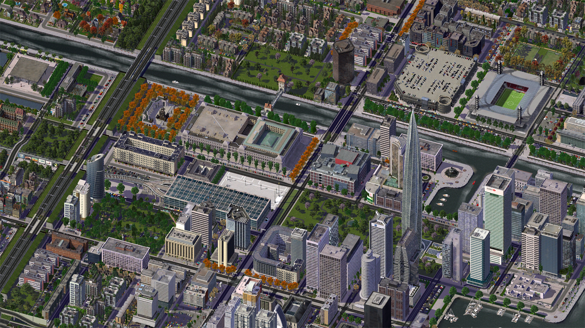
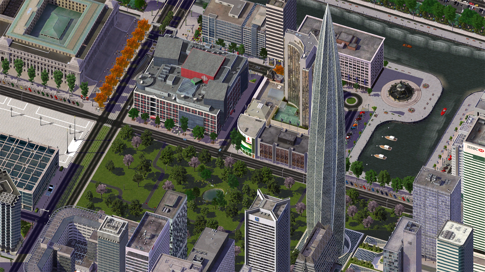
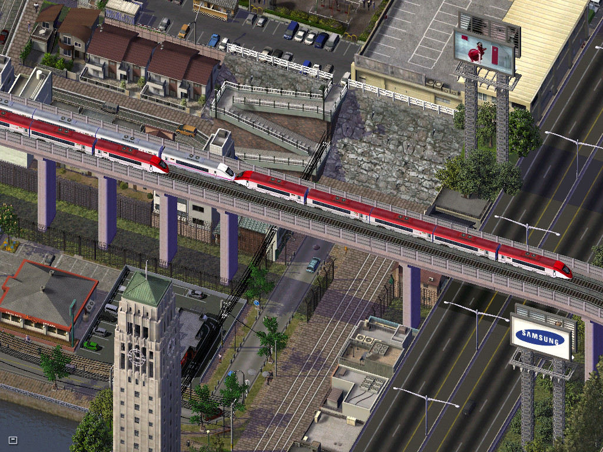
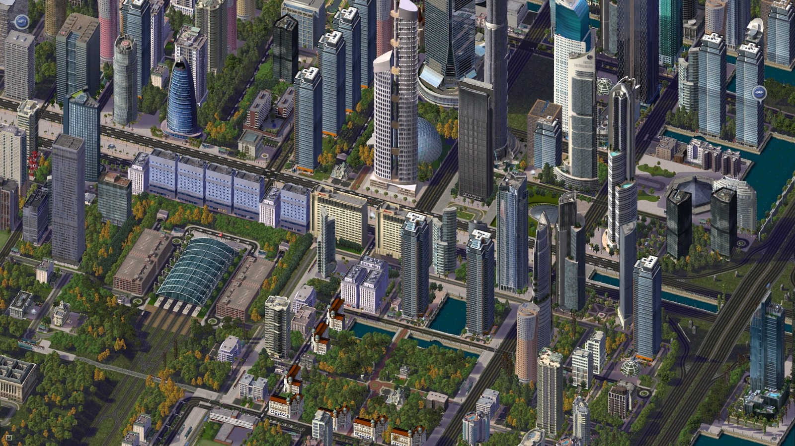
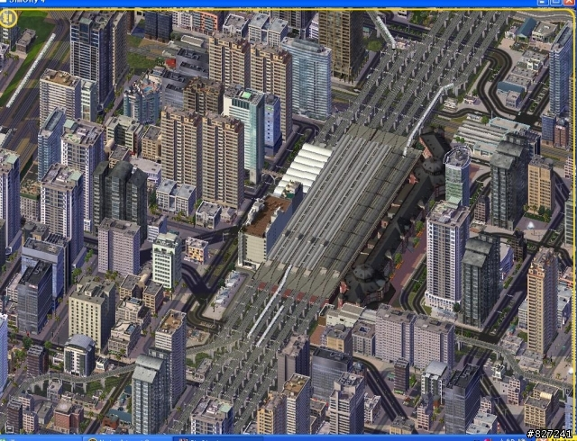

# SimCity 4 — modern city centers with high-speed rail

Picture references gathered on 14 September 2026. **HSR** means **high-speed rail**. These are existing SimCity 4 screenshots published online by players. Source links appear beside each picture.

The first examples have explicit HSR identification in their source. The additional references are included for their city layout; their HSR status is not confirmed. Descriptions of what to copy are my visual design suggestions, not claims made by the creators.

## 1. Zenebach — a glass HSR terminal beside a modern city center

**Creator:** InvaderNat. **HSR confirmed:** the creator identifies the large blue-glass building below the state parliament as the HSR terminus. A **terminus** is a station where the line ends.

**Look for:** the wide glass station roof in the left-center of the picture, the tracks entering from the left, the park directly below the station, and the towers toward the waterfront.

**Idea to copy:** give the station a visible forecourt and park, then place the tallest buildings one or two street blocks away. That keeps the station recognizable in the skyline.

[Original city journal — Zenebach](https://community.simtropolis.com/journals/entry/25417-zenebach/) · [Original image](https://i.imgur.com/B1OyXuC.png)

## 2. Zenebach — a closer look at the station neighborhood

**Creator:** InvaderNat. **Same city as picture 1.** The HSR terminal is partly visible at the left edge; this picture is most useful for planning the surrounding blocks.

**Look for:** the rectangular park between the station and the prominent pointed tower, with a waterfront promenade behind it.

**Idea to copy:** place an open green space between your HSR hub and your landmark skyscraper. Use shorter buildings around the park so that the tallest tower stands out.

[Original city journal — Zenebach](https://community.simtropolis.com/journals/entry/25417-zenebach/) · [Original image](https://i.imgur.com/Z9hW8M0.png)

## 3. The Pink Republic — Shinkansen passing through midtown

**Creator:** pinkindustry. **HSR confirmed:** the original picture is titled “shinkansen passing through midtown” and tagged “high speed railways.” **Shinkansen** is the name of Japan's high-speed railway system.

**Look for:** the red-and-white trains crossing the picture on a concrete elevated structure, above streets and other transport lines.

**Idea to copy:** use a straight elevated HSR approach through the built-up district, with street-level greenery and shops around its supports. This is a track-integration reference rather than a wide skyline view.

[Original gallery entry](https://community.simtropolis.com/gallery/image/45-shinkansen-passing-through-midtown/) · [Original image](https://www.simtropolis.com/objects/storage/monthly_2018_08/large.7.jpg.40f711a6f85673b60e8c593f4d8f3da3.jpg)

## 4. Korona City 2 — a large station surrounded by glass towers

**Additional layout reference; HSR not confirmed.** This screenshot shows a large rail station, but the source available during this search did not establish that it serves HSR.

**Look for:** the arched glass station roof at lower left, the green strips alongside its approach tracks, and the varied towers and canals around it.

**Idea to copy:** combine a broad glass-roofed station with a dense cluster of modern towers, while keeping trees beside the railway and open space near the entrance.

[Original gallery entry — Korona City 2](https://community.simtropolis.com/gallery/image/2730-korona-city-2/) · [Original image](https://www.simtropolis.com/objects/storage/monthly_2018_08/large.2.jpg.45f6ff4357c099f2cc3d371e0d95a108.jpg)

## 5. Japanese-style station district — dense development on both sides

**Additional layout reference; HSR not confirmed.** This is a reposted screenshot on Mobile01. The original city name and creator could not be verified. “Japanese-style” describes its appearance; it is not a verified identification of the station model.

**Look for:** the long station running diagonally through the middle, with closely spaced buildings and streets on both sides.

**Idea to copy:** make your central station the organizing feature of the district. Run streets alongside it and cluster offices near its entrances, leaving room at both ends for the approach tracks.

[Source discussion on Mobile01](https://www.mobile01.com/topicdetail.php?f=179&t=590713) · [Image as reposted](https://attach.mobile01.com/attach/200804/mobile01-09cda0360dd830e736a53db40a4eed3e.jpg)

## Starting point for your installed buildings

Your project record, [Tokyo Hub — Installed Buildings](../../Tokyo%20Hub%20-%20Installed%20Buildings.md), lists Tokyo Central Station and the Xyloxadoria Modern Arched and Modern Diagonal elevated HSR stations. The [restored NAM station record](../../SimCity%204%20-%20Restored%20NAM%20Stations.md) also lists the HSRP Transit Hub by 3ddz.

My preferred combination is **picture 1's park-and-tower arrangement** with **picture 3's elevated HSR approach**. Picture 5 is an alternative if you want a much denser station district.

The images remain the work of their respective creators. Local copies are collected here with links to their published sources.
